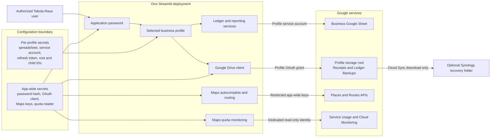
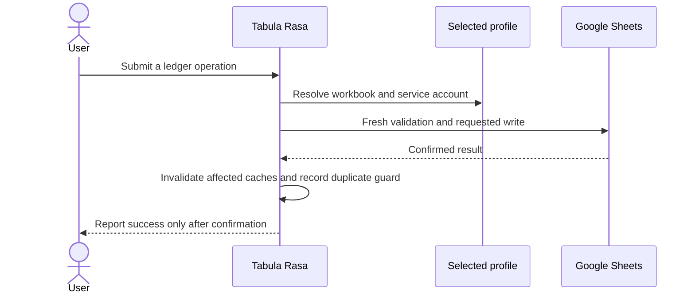
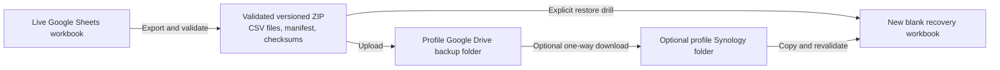

# Architecture

Project Tabula Rasa is one Streamlit application serving one or more isolated
business profiles. A profile selects its own Google Sheets workbook,
service-account credential, optional Google Drive authorization, and recovery
destinations. The application password and OAuth client are intentionally
deployment-wide. The optional Google Maps browser and Routes credentials are
also app-wide; the separate quota-monitoring identity is app-wide as well.
They are never profile identities.

## System context

The selected profile determines which workbook, service account, refresh token,
Drive folders, recovery settings, caches, and duplicate-submission guards are
used for the operation. The application currently grants an authenticated user
access to every configured profile; it does not provide per-profile user
authorization.

## Identity and storage boundaries

| Concern | Credential or identity | Data location | Scope |
| --- | --- | --- | --- |
| Application sign-in | Application password hash | App-wide secrets | Entire deployment |
| Ledger reads and writes | Profile Sheets service account | Profile Google workbook | One profile |
| Receipts and cloud backups | Shared OAuth client plus profile refresh token | Profile Drive root and managed children | One profile |
| Address suggestions and route mileage | Restricted browser and server Maps keys | Google Places and Routes APIs | Entire deployment |
| Maps quota and usage monitoring | Dedicated Maps quota service account with read-only scope | Service Usage and Cloud Monitoring in the explicit Maps project number | Entire deployment |
| Local configuration | Operating-system file permissions | .streamlit/secrets.toml and business_profiles.json | Local deployment |
| Hosted configuration | Streamlit Secrets | Hosted deployment | Hosted projection of each profile |
| NAS recovery copy | DSM account and separate Cloud Sync authorization | Profile-specific NAS root | One profile |

The Sheets service account edits the ledger workbook. A human Google account
authorizes the Drive files used for receipts and cloud backups. Neither
credential automatically grants the permissions of the other. Google Drive
folders do not need to be shared with the Sheets service account.

The browser Maps key is sent only to the autocomplete component and depends on
website plus API restrictions. The Routes key remains server-side and is sent
only to the Routes API. Neither key is sourced from or grants access to a
business profile, workbook, service account, or Drive authorization. Quota
monitoring uses a separate app-wide service-account JSON mapping and the
`cloud-platform.read-only` and `monitoring.read` scopes; it never reuses profile
Sheets credentials or human Drive OAuth. The
ledger persists only the existing visible address and user-confirmed mileage;
it does not retain complete Google responses or polylines.

Local profile configuration is plaintext and must remain on a protected,
non-synchronized filesystem. The hosted representation is an explicit allowlist
containing the profile name, spreadsheet ID, Sheets service-account credential,
and validated Drive authorization plus its storage root and managed children.
Local backup paths and Synology metadata are intentionally excluded.

## Ledger source of truth

Google Sheets remains the active ledger and storage source of truth. Accounts,
categories, Payees, Tags, transactions, mileage, mixed-use source records, and
receipt references remain in the selected profile's workbook; local files and
backup archives are not alternate ledgers. Transaction and mileage rows store
Tag associations as validated lists of stable IDs, while display names resolve
from the same profile's Tags worksheet so a later rename does not rewrite
ledger rows.

Cost-based mixed-use expenses use a dedicated `MixedUseExpenses` worksheet as
the authoritative source collection. Each source contains the normal editable
Expense inputs, the full total, business-use percentage, currency-rounded
allocated amount, allocation rationale, and stable source and projection IDs.
The corresponding Transactions row remains an ordinary Expense projection and
stores generic `source_type` and `source_id` provenance. Source-aware CRUD
updates the existing projection or removes both records, with fresh reads and
postcondition classification for the non-transactional multi-row writes.
This Phase A contract is storage/domain-only; it does not expose a user-facing
mixed-use workflow.

Edits, deletes, uniqueness checks, and reference checks use fresh data before
writing. A write success is shown only after the Google API confirms it.
Affected caches are invalidated only after confirmation. Temporary network and
quota failures use bounded retries, while uncertain mutations are read back or
reconciled before any safe retry.

## Receipt boundary

Receipt bytes live in the selected profile's Google Drive Receipts folder.
Transactions store stable receipt references in the profile's Transactions
worksheet. A reference contains the Drive identity and integrity metadata
needed for display, retry, backup inventory, and recovery.

The transaction-creation workflow validates every selected file, saves the
transaction first, then uploads and links receipts. If receipt work is partial,
the confirmed transaction remains saved and unresolved files have a retry path.
An uploaded-but-unlinked file is recovered by its existing identity rather than
blindly uploaded again.

Removing a receipt from a transaction removes only the ledger reference. It
does not delete the Google Drive file; the file remains available as an
unreferenced receipt for relinking. Multi-file post-creation uploads, safe
filename handling, checksums, and uncertain-response recovery are part of the
receipt contract.

## Backup and recovery boundary

Backups are recovery artifacts, not alternate live ledgers. Current archives
contain the ledger CSVs, a manifest, checksums, and a receipt metadata
inventory; receipt bytes are recovered independently from the protected Drive
or Synology copy. Restoration always targets a new blank workbook and refuses
the configured live workbook. See [Backup and recovery](BACKUP_RECOVERY.md).

Synology is an independent copy path operated by DSM Cloud Sync. The app stores
the expected profile-root destination, schedule, and retention policy but does
not configure DSM, connect to the NAS, or report transfer health. Destination
deletions remain disabled so Drive retention cannot erase the independent copy.

## Accounting and hierarchy invariants

- Transfers change account balances but do not affect income or expenses.
- Mileage is separate from financial transactions.
- Accounts and categories have at most two layers. Parent and child accounts
  share a balance-sheet classification; parent and child categories share an
  Income or Expense kind.
- Stable account and category IDs remain attached to transactions when a
  record is renamed, promoted, or reparented.
- Account family totals combine direct parent activity with direct child
  activity exactly once. Category summaries preserve direct activity and child
  detail without double-counting.
- Account subtype and balance-sheet classification are separate. Bank and Cash
  are assets; Credit card and Short-term debt are liabilities; Equity is equity;
  and Other may use any classification.
- Asset opening balances are normally positive. Liability and equity opening
  ledger balances are normally negative and are presented conventionally in
  reports.
- Current earnings are income minus expenses and are included in total equity.
- Reports flag any difference in Assets = Liabilities + Equity.
- This is a record-keeping tool, not tax or accounting advice.

## Profile isolation invariants

Every workbook read and write, import, export, receipt operation, backup,
recovery action, cache, prepared-export snapshot, and duplicate guard must use
the selected profile key and its configuration revision. A global fallback must
never substitute another profile's workbook, credential, token, folder,
recovery destination, or cached data.

When the profile changes, page-local selections and pending notices are cleared
or rebuilt. The new profile's workbook is initialized and accessed only under
its own key. Hosted projections do not grant local administration or reveal
local-only recovery metadata.

## Implementation map

| Area | Primary implementation |
| --- | --- |
| Streamlit shell and routing | tabula_rasa/app.py |
| Shared presentation tokens and CSS | tabula_rasa/presentation.py |
| Profile selection and readiness | tabula_rasa/business_profiles.py and tabula_rasa/profile_readiness.py |
| Local profile persistence | tabula_rasa/local_profile_store.py |
| Sheets storage, current v10 backup format, and restore validation | tabula_rasa/storage/google_sheets.py |
| Legacy backup conversion (v1–v9 to v10) | scripts/migrate_legacy_backup.py |
| Drive OAuth and file operations | tabula_rasa/google_drive.py |
| Drive administration and Picker | tabula_rasa/google_drive_admin.py and tabula_rasa/google_drive_picker.py |
| Maps autocomplete and route distance | tabula_rasa/address_autocomplete.py and tabula_rasa/maps_routing.py |
| Receipts and recovery metadata | tabula_rasa/receipt_manifest.py and tabula_rasa/receipt_recovery.py |
| Synology settings | tabula_rasa/synology_recovery.py |

Setup, OAuth administration, and recovery procedures belong in the specialized
guides linked from the root [README](../README.md), not in this architecture
overview.
