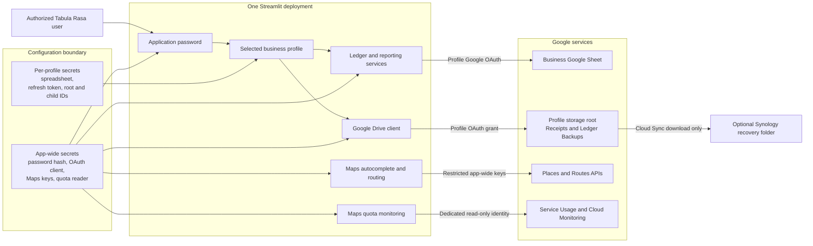
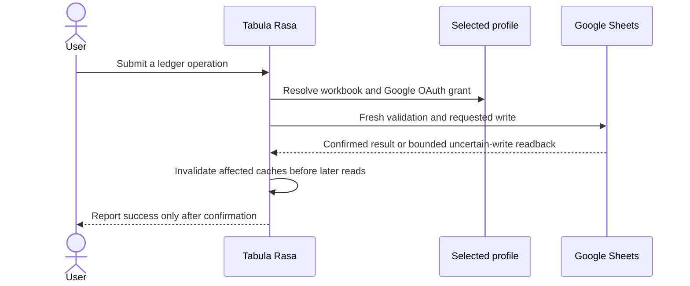
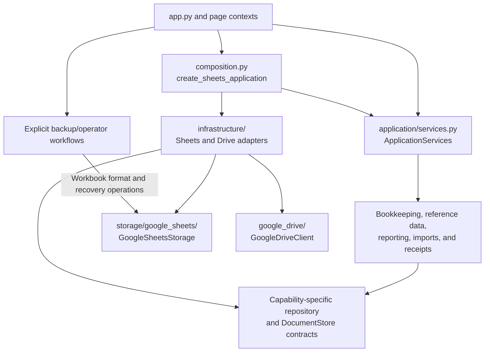
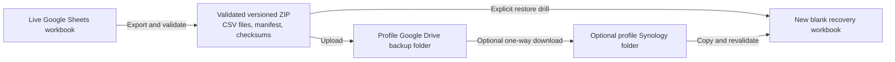

# Architecture

Project Tabula Rasa is one Streamlit application serving one or more isolated
business profiles. A profile selects its own Google Sheets workbook,
Google OAuth grant for Sheets and Drive, and recovery
destinations. The application password and OAuth client are intentionally
deployment-wide. The optional Google Maps browser and Routes credentials are
also app-wide; the separate quota-monitoring identity is app-wide as well.
They are never profile identities.

## System context

The selected profile determines which workbook, Google OAuth grant, refresh token,
Drive folders, recovery settings, caches, and duplicate-submission guards are
used for the operation. The application currently grants an authenticated user
access to every configured profile; it does not provide per-profile user
authorization.

## Identity and storage boundaries

| Concern | Credential or identity | Data location | Scope |
| --- | --- | --- | --- |
| Application sign-in | Application password hash | App-wide secrets | Entire deployment |
| Ledger reads and writes | Profile Google OAuth grant | Profile Google workbook | One profile |
| Receipts and cloud backups | Shared OAuth client plus profile refresh token | Profile Drive root and managed children | One profile |
| Address suggestions and route mileage | Restricted browser and server Maps keys | Google Places and Routes APIs | Entire deployment |
| Maps quota and usage monitoring | Dedicated Maps quota service account with read-only scope | Service Usage and Cloud Monitoring in the explicit Maps project number | Entire deployment |
| Local configuration | Operating-system file permissions | .streamlit/secrets.toml and business_profiles.json | Local deployment |
| Hosted configuration | Streamlit Secrets | Hosted deployment | Hosted projection of each profile |
| NAS recovery copy | DSM account and separate Cloud Sync authorization | Profile-specific NAS root | One profile |

Sheets and Drive authenticate as the same profile-scoped human Google account
through the shared OAuth client and narrow `drive.file` scope. Picker grants
access to the selected workbook; Google account Editor permission is required.
Profiles may use the same account or different accounts, with separate resource
selections, caches, and grants. Read-only utilities use the same grant but perform
only reads. Local profile format version 2 rejects obsolete Sheets keys; the
one-time profile conversion lives in `scripts/migrate_profile_oauth.py`.

The browser Maps key is sent only to the autocomplete component and depends on
website plus API restrictions. The Routes key remains server-side and is sent
only to the Routes API. Neither key is sourced from or grants access to a
business profile, workbook, or Google OAuth authorization. Quota
monitoring uses a separate app-wide service-account JSON mapping and the
`cloud-platform.read-only` and `monitoring.read` scopes; it never reuses profile
Sheets credentials or human Drive OAuth. The
ledger persists only the existing visible address and user-confirmed mileage;
it does not retain complete Google responses or polylines.

Local profile configuration is plaintext and must remain on a protected,
non-synchronized filesystem. The hosted representation is an explicit allowlist
containing the profile name, spreadsheet ID, Google OAuth grant,
and validated Drive authorization plus its storage root and managed children.
Local backup paths and Synology metadata are intentionally excluded.

## Ledger source of truth

Google Sheets remains the active ledger and storage source of truth. Accounts,
categories, Payees, Tags, transactions, mileage, mixed-use source records, and
receipt references remain in the selected profile's workbook; local files and
backup archives are not alternate ledgers. Transaction and mileage rows store
Tag associations as validated lists of stable IDs, while display names resolve
from the same profile's Tags worksheet so a later rename does not rewrite
ledger rows.

Cost-based mixed-use expenses use a dedicated `MixedUseExpenses` worksheet as
the authoritative source collection. Each source contains the normal editable
Expense inputs, the full total, business-use percentage, currency-rounded
allocated amount, allocation rationale, and stable source and projection IDs.
The corresponding Transactions row remains an ordinary Expense projection and
stores generic `source_type` and `source_id` provenance. Source-aware CRUD
updates the existing projection or removes both records while preserving the
source-authoritative and read-only-projection invariants. These are
non-transactional multi-row writes. Pre-write validation, stable identity,
bounded uncertain-write readback, and actionable partial-state guidance are
preferred to an application-level transaction protocol.
This Phase A contract is storage/domain-only; it does not expose a user-facing
mixed-use workflow.

### Bounded remote mutation policy

Google Sheets is the active source of truth, but it is not a transactional or
serializable database. The application therefore does not emulate ACID
semantics with dependency snapshots, transaction managers, repeated
postcondition checks, or automatic repair loops. Native batch requests are
appropriate when they reduce a logically coupled mutation, but a batch is not
treated as a general rollback boundary.

Every mutation still protects correctness at the boundary by reading fresh
records before writes, validating domain and referential constraints, enforcing
selected profile identity, rejecting stale expected-record edits, and
generating stable IDs before creates. The supported network policy is
deliberately small:

1. Attempt the requested write once.
2. If commit status is uncertain, read the affected stable ID or final state
   once. A confirmed requested state is success.
3. Retry once only when the fresh read proves the operation is absent and the
  retry cannot duplicate or corrupt data. Otherwise, invalidate affected
   caches and stop with an actionable inspection/recovery message.

A successful Google response is authoritative; an uncertain response can be
confirmed only by the one bounded readback described above. The application
does not add a second success-path read merely to defend against unsupported
manual row reordering or other arbitrary cross-client interleavings. Affected
caches are invalidated after a confirmed or uncertain write, before later reads
can reuse stale rows. This boundary keeps duplicate prevention and stale-write
protection while avoiding a growing state-machine that pretends Sheets offers
guarantees it does not provide.

### Process-local workbook mutation coordination

The Sheets storage layer keeps a private, process-local lock bundle for each
configured spreadsheet ID. Its ledger lock coordinates mutations whose fresh
checks and row-number writes must not overlap within this process; its Payee
and Tag locks protect their workbook-local duplicate-name and merge/remove
reference checks. When a mutation needs more than one lock, it acquires the
ledger lock before the Payee or Tag lock.

These locks coordinate storage instances in the same Python process that target
the same workbook. They do not serialize another process or replica, manual
Google Sheets edits, or otherwise turn Sheets into a transactional backend.
Mixed-use projection immutability remains an explicit storage API invariant,
independent of this coordination.

### Recoverable cross-service partial failure

Drive and Sheets operations are also not atomic. Receipt workflows prepare a
stable receipt identity and content hash, upload at most once plus one safe
identity-based retry after an uncertain Drive response, then link the known
file in Sheets. If linking is uncertain, one fresh transaction/source read can
confirm success; otherwise the workflow stops and tells the user what to
inspect. A successfully uploaded but unlinked file remains in the profile's
Drive storage and is surfaced as an **Unreferenced Receipt** for explicit
recovery. The app does not delete that file as simulated rollback.

This same rule applies to future multi-service work: make partial state
detectable and recoverable, keep recovery scoped to the selected profile and
configuration revision, and expose a user-facing recovery boundary when
automatic repair would require a distributed transaction simulation.

### Frozen Sheets source boundary

[Final Sheets source contract](SHEETS_SOURCE_CONTRACT.md) owns the frozen
format-13 worksheet/header, archive/manifest, domain-relationship, and retirement
decision under #261, #220, and initiative #124. Runtime, backup validation,
restore, and future #254 extraction consume this same boundary. Only genuinely
blank workbooks or interrupted current-header bootstrap may be initialized.
Populated unsupported workbooks and non-13 archives fail before writes;
historical ledger-format converters and their aliases have been retired.

Retirement preserves existing accounting history, ledgers, receipts, backup
files, and the pre-cutover Sheets source. Backup retention belongs to #223.
Profile/OAuth migration, current-format receipt recovery/association tooling,
and ordinary CSV/QuickBooks imports remain supported. PostgreSQL schema
migrations and managed backup/PITR (#259) remain independent; #260 owns its
separately versioned canonical export. #243's canonical PostgreSQL model maps
this source by domain meaning rather than duplicating worksheet layouts.

### Proportionality and review drift

Defensive complexity is justified by the combination of realistic likelihood,
impact, detectability/recoverability, and implementation/test/maintenance
cost. High-impact data-loss, duplicate, stale-write, security, and
cross-profile risks deserve strong controls. A low-likelihood state with a
clear manual recovery path does not automatically justify hundreds of lines
of production and test machinery.

When a review round successively adds retry callbacks, snapshots, state
branches, or success-path readbacks for narrower variants of the same race,
perform a holistic mission check. Classify a finding on two independent axes:
whether it can technically occur, and whether it is inside the supported
product threat/concurrency model at a proportional cost. The smallest safe
response may be a local stable-ID check, a stop-and-inspect error, or an
evidence-backed dispute. Batch related accepted fixes into one coherent review
head instead of repeatedly expanding the implementation for every theoretical
interleaving.

## Responsibility-based module boundaries

The structural refactor follows ownership and data-flow seams, not a fixed
line-count target. A cohesive moderately large module is preferable to
artificial fragmentation. Stable public facades and package re-exports keep
unrelated callers from changing while the implementation moves behind them.
Lower-level storage, client, and schema helpers must not depend on Streamlit
page renderers, and shared helpers are justified only when they clarify a
real responsibility or remove real duplication.

The current decomposition uses these seams:

| Responsibility | Current boundary |
| --- | --- |
| Application composition | `tabula_rasa/composition.py` resolves trusted per-profile backend configuration. Internal Sheets graphs retain explicit workbook administration; activated PostgreSQL graphs contain services only. `create_application` enforces the recorded cutover/environment binding before composing PostgreSQL. |
| Application services and contracts | `tabula_rasa/application/services.py` assembles `ApplicationServices`; `ledger_setup.py` owns the initial setup service and its result DTO; `contracts.py` declares the repository capabilities that service needs. |
| Infrastructure adapter | `tabula_rasa/infrastructure/google_sheets.py` adapts the existing storage facade to `LedgerSetupRepository` without duplicating storage behavior. |
| Sheets storage facade | `tabula_rasa/storage/google_sheets/__init__.py` keeps `GoogleSheetsStorage` and re-exports intentionally public names. |
| Sheets primitives | `tabula_rasa/storage/google_sheets/errors.py`, `tabula_rasa/storage/google_sheets/schema.py`, `tabula_rasa/storage/google_sheets/validation.py`, `tabula_rasa/storage/google_sheets/client.py`, and a small `tabula_rasa/storage/google_sheets/base.py` own errors, current schema, API access, validation, and shared row/cache/read/write helpers. |
| Sheets domains | `tabula_rasa/storage/google_sheets/accounts.py` owns account and category hierarchies; `tabula_rasa/storage/google_sheets/payees.py`, `tags.py`, `transactions.py`, `recurring.py`, `mileage.py`, `mixed_use.py`, `receipts.py`, and `backup.py` own the other cohesive domain operations. Historical migration code stays in scripts. |
| Receipt page workflow | `tabula_rasa/page_renderers/transactions/receipt_workflows.py` owns reusable upload/recovery state; `tabula_rasa/page_renderers/transactions/receipt_editor.py` owns editor rendering; `tabula_rasa/page_renderers/transactions/receipt_display.py` owns listing/unlink UI. `tabula_rasa/page_renderers/transactions/receipts.py` may remain a thin compatibility facade. |
| Mileage page | `tabula_rasa/page_renderers/mileage_form_shared.py` owns shared Add/Edit address, route, and trip-field rendering, keyed widgets, and common validation; `mileage_form.py` and `mileage_ledger.py` keep create/update/delete controllers separate; `mileage_routing.py` and `mileage_locations.py` own route state and location helpers; `mileage.py` remains orchestration-focused. |
| Transaction ledger page | `tabula_rasa/page_renderers/transactions/transaction_form.py` owns shared Add/Edit/Copy field rendering, keyed widgets, normalized drafts, and common validation; `creation.py` and `ledger_editor.py` keep create/update/delete and receipt controllers separate; `ledger_filters.py`, `ledger_bulk.py`, and `transaction_copy.py` own the remaining ledger seams; `ledger.py` composes them. |
| Drive integration | `tabula_rasa/google_drive/__init__.py` preserves `GoogleDriveClient`; `tabula_rasa/google_drive/oauth.py`, `tabula_rasa/google_drive/client.py`, `tabula_rasa/google_drive/folders.py`, `tabula_rasa/google_drive/ledgers.py`, `tabula_rasa/google_drive/receipts.py`, and `tabula_rasa/google_drive/backups.py` separate identity/auth, generic requests, managed folders, initial ledger provision, receipts, and backups. |
| Local profile administration | `local_profile_admin.py` remains the page entry point and profile-summary composer; `local_profile_admin_forms.py`, `local_profile_admin_readiness.py`, `local_profile_admin_security.py`, `local_profile_admin_support.py`, and `local_profile_admin_synology.py` own the distinct form, readiness, deployment-security, shared setup, and Synology responsibilities. |
| Tests | `tests/storage/google_sheets/`, `tests/google_drive/`, `tests/mixed_use_storage/`, and `tests/receipt_recovery/` follow the production/workflow seams and keep shared fixtures in local support modules rather than duplicating them per domain. |

The current Sheets package implements the first slice with a stable facade,
explicit primitive modules, and a flat set of domain mixins. `base.py` is kept
to genuinely shared row/lock primitives for now; any later split of remaining
shared behavior must have a clear ownership boundary and preserve imports and
behavior. This is composition for compatibility, not a new storage framework.

The local administration review found durable seams between profile forms,
readiness checks, deployment-security guidance, local Synology metadata, and
the page-level profile summary/orchestration. Its entry point stays stable,
while private helpers are imported and tested from their owning modules rather
than re-exported as permanent compatibility aliases. These boundaries are
architectural ownership guidance, not a demand that every row of code become a
separate class or file.

### Application services and persistence contracts

[Issue #225](https://github.com/Roklion/Project_Tabula_Rasa/issues/225) establishes
the composition foundation for the semantic extraction in
[epic #219](https://github.com/Roklion/Project_Tabula_Rasa/issues/219), within
[initiative #124](https://github.com/Roklion/Project_Tabula_Rasa/issues/124).
The existing responsibility-based decomposition remains useful: extraction
proceeds through cohesive workflows, preserving their behavior and public
facades while moving business ownership out of the persistence implementation.

The first service is deliberately narrow. `LedgerSetupRepository` declares a
`ledger_name` property and `ensure_defaults() -> dict[str, int]`.
`LedgerSetupService` consumes that contract, returns a frozen `LedgerInfo(name)`
from `get_info()`, and delegates default initialization. The application shell
uses this service for the workbook caption and its existing once-per-session
default initialization. Default selection, fresh reads, current-format checks,
and remote write behavior remain in the existing Sheets implementation.

Arrows show dependencies. Application services and contracts do not import
Sheets, gspread, Streamlit, or infrastructure. An adapter implements the
contract and depends on the existing backend; the composition root is the
place where those implementations are selected and connected.

`assemble_application_services` builds a frozen `ApplicationServices` from
explicitly supplied repositories and a document store. Its setup repository is
required; extracted capabilities are optional for incremental composition and
setup-only callers. Receipt metadata and byte storage must be supplied together. Transaction
assembly requires the payee and tag repositories used for inline references.
`create_sheets_application(profile_key, secrets)` requires a
nonempty selected profile key, selects that profile's settings from the
deployment configuration, constructs one `GoogleSheetsStorage`, and wraps it
with capability-specific adapters for setup, reference data, imports, transactions,
journals, reporting, mileage, receipts, recurring schedules, assets, and mixed-use
relationships. Its frozen `SheetsApplication` result
contains neutral `services` and an explicit `workbook_admin` instance for
provider-specific backup and operator operations. Ordinary page contexts never
receive this instance.
The shell caches this composition using the selected profile, implementation
version, local configuration revision, and the supplied configuration snapshot.
Assembly consumes the same snapshot as the shell's workbook identity and page
settings, rather than reloading configuration during construction. A changed
snapshot rebuilds both Sheets and lazy Drive clients even if the local revision
is unchanged. Drive callbacks consume the same snapshot as page folder settings.
Default initialization is scoped to profile and workbook identity; downstream
export revisions also include the workbook identity. The receipt byte adapter
is bound to the selected profile and receipt folder and uses the same cached
Drive client as page callbacks. Assembling services never performs OAuth or a
document request.

Ordinary renderer contexts require the selected profile's services and expose
no storage field. Compatibility fallback factories no longer assemble Sheets
adapters inside page code. Recurring reconciliation uses the same supplied
service graph. The container does not create a second ledger, credential
identity, cache, or retry mechanism.

The ownership conventions for subsequent slices are:

| Concern | Owner and convention |
| --- | --- |
| Application workflows | `tabula_rasa/application/` owns orchestration against explicit repository capabilities. Services return application results and leave widget state and presentation to renderers. |
| Domain rules | Reuse the existing pure modules, including `hierarchy.py`, `journal.py`, `mixed_use.py`, `recurrence.py`, `depreciation.py`, and the accounting/reporting modules. Extract remaining rules into cohesive domain owners as their workflows move; a new package is unnecessary merely to relocate already independent code. |
| Repository contracts | `application/contracts.py` and capability-specific contract modules declare only capabilities needed by implemented services. Contracts describe domain/application operations and results, rather than worksheet names, row positions, Google requests, or a repository for every record type. |
| Infrastructure | `tabula_rasa/infrastructure/` implements contracts by adapting the supported backend. Sheets serialization, API batching, locks, caches, bounded uncertain-write readback, and safe retry policy remain with the existing storage implementation. |
| DTOs | Small result types such as `LedgerInfo` live with the application service that owns them. Use explicit fields for the service's result without exposing workbook objects, credentials, worksheet rows, or backend request payloads. Existing dictionary records preserve compatibility with current domain and presentation owners. |
| Composition and provider administration | `composition.py` owns concrete backend construction and the typed `SheetsApplication` result. Neutral services do not accept or forward arbitrary storage methods. Only explicitly provider-specific backup/operator workflows receive workbook administration. |

The shared safe `StorageError`, validation, conflict, and not-found errors live
in the provider-independent `tabula_rasa/errors.py` module. The storage facade
re-exports the same classes, preserving existing catches and user messages.
Sheets availability, authentication, workbook-access, initialization, and
uncertain-mutation guidance retain their infrastructure owner. Services do
not catch failures to retry or report success.

#### Reference-data slice

[Issue #226](https://github.com/Roklion/Project_Tabula_Rasa/issues/226) extends
the foundation with separate account, payee, and tag repository contracts and
application services. The composition root constructs their Sheets adapters
around the same selected-profile facade used by setup and provider administration.
There is no second workbook, cache, or credential selection.

`AccountService` supports listing, creation, updates, rename, and deactivation;
permanent account removal is outside the supported product contract.
`PayeeService` and `TagService` support listing, create/reactivate, updates,
rename, merge, and removal. Expected-record snapshots pass through the managed
record services to the adapter for fresh stale-record checks. The application
contracts contain domain records and operations, with no worksheet names,
range coordinates, workbook objects, or Google API arguments.

`reference_data.py` owns the existing pure text/name normalization, opening
balance, active-state, account classification, hierarchy, and tag-ID rules.
Services validate supplied inputs through these helpers without backend reads.
The Sheets validation module retains import aliases so existing transaction,
import, backup, and reference-data operations use the same rule implementation.
Account name uniqueness continues to use trimmed case-insensitive names;
payee/tag matching additionally normalizes Unicode and collapses whitespace.

The repository mutation remains responsible for enforcing uniqueness,
hierarchy, expected-record, and reference-integrity invariants with fresh data
at its write boundary. The adapter delegates to the existing account/payee/tag
mixins, which retain locking, stable IDs, batch writes, cache invalidation,
one uncertain-write readback, and at most one safe retry. Services add no
reconciliation or post-success verification. Pure fake-repository tests cover
input validation, delegation, and failure propagation; adapter and existing
storage tests cover the supported persistence and reference behavior.

Account and Payees & Tags management, plus reference lists used by the other
pages and CSV exports, now use the selected profile's services. Widget state,
table selection, dataframe formatting, reference-count presentation, and
confirmed-write feedback retain their renderer owners. Domain dictionary
records preserve the existing application representation during this slice:
account lists expose boolean active state and numeric opening balances, while
managed payee/tag records retain their current text-backed active state.
The subsequent slices below supply accounting mutations, reporting, and
documents through their application services. Backup format operations retain
their explicit provider administration boundary.

For each later extraction, inspect the existing rule, workflow, persistence,
and renderer owners first. Define the smallest contract for that workflow,
reuse its pure domain rules, adapt the existing Sheets behavior, and move the
affected renderer calls to the service. Keep success, relevant failure,
profile isolation, and recovery coverage while removing duplicate ownership.
Reference data (#226), transactions (#227), and journals (#228) have their own
service owners. Google Sheets remains the supported active ledger throughout
this transition.

#### Reporting, documents, and mileage slices

Issues [#229](https://github.com/Roklion/Project_Tabula_Rasa/issues/229),
[#233](https://github.com/Roklion/Project_Tabula_Rasa/issues/233), and
[#234](https://github.com/Roklion/Project_Tabula_Rasa/issues/234) extend the
foundation with three independent capabilities:

| Capability | Application owner | Current infrastructure adapter |
| --- | --- | --- |
| Ledger/report queries | `ReportingService`, native date/Decimal read models, and `LedgerFilter` in `application/reporting.py` and `reporting_contracts.py` | `GoogleSheetsLedgerQueryRepository` decodes validated records and owns worksheet prefetch and cache access. |
| Receipt relationships and document bytes | `ReceiptService`, portable metadata/references, `ReceiptRepository`, and `DocumentStore` in `application/documents.py` | `GoogleSheetsReceiptRepository` maps the current receipt cells; `GoogleDriveDocumentStore` owns opaque file locators, folder access, and provider metadata conversion. |
| Mileage CRUD and import rules | `MileageService` and its trip/tag models in `application/mileage.py`, with the port in `mileage_contracts.py` | `GoogleSheetsMileageRepository` owns fresh mutation inputs, workbook coordination, serialization, batching, and bounded readback. |

Reporting reuses `ledger_reporting.py` and `accounting_postings.py` for
bookkeeping totals. `ledger_queries.py` owns the pure mixed ledger identity,
date/target/tag filtering, and initial ordering; `ledger_records.py` retains
display rows, dataframes, search, and visual sorting. Dashboard and Reports
consume native query results. Transaction ledger reads/filtering consume the
query service while mutation controllers retain their exact compatibility
expected-record snapshots through the transaction/journal services.
This preserves stale-write checks without re-encoding a receipt baseline.

Mileage field normalization, tag rules, round-trip preparation, and QuickBooks
classification/duplicate selection have one service owner. The public Sheets
mileage facade delegates to that same service through its adapter. Explicit
mileage preparation callbacks receive fresh inputs within the adapter's existing
workbook lock; they are not a general transaction API. Maps suggestions remain
an independent UI integration and only the reviewed mileage/text are persisted.

Receipt upload preparation and the shared Add/Edit unresolved-work loop reuse
one application owner. Session keys, widget reset, and selected-configuration
recovery guards remain presentation concerns. Source-aware mixed-use receipt
callers bind `application/receipt_context.py`'s neutral metadata repository to
their existing source workflow while sharing the same byte store. The Drive adapter delegates to the existing
stable-identity reconciliation, filename, and integrity implementation;
the extraction introduces no additional retries, rollback, or schema changes.

The services can be exercised with small repository/document-store fakes
without importing Streamlit, pandas, Sheets, or Drive. A future HTTP caller
supplies application inputs, and a future datastore/object store implements the
ports; neither requires moving bookkeeping rules into endpoint handlers.
PostgreSQL, commercial authorization, object-storage vendor selection, and
new UI/report behavior are outside these slices. Remaining concrete page
coupling closes incrementally under #219, with #235 as its final boundary gate.

### Transaction and journal services (#227 / #228)

The selected profile's composition root supplies `TransactionService` and
`JournalService`. The New entry surface, single and bulk transaction editors,
journal editor, and their ledger reads use these services. Existing Add/Edit
forms, receipt recovery, and Simple Ledger presentation remain shared.

`TransactionRepository` models stable transaction identities, expected-record
snapshots, semantic filters, and bulk metadata changes. Its narrow `build`
callback lets the application apply `transaction.prepare_transaction` after
the repository checks identity/staleness and obtains fresh managed references
inside its mutation boundary. Inline payees/tags use the same profile's
reference services. Services add no separate reference read, retry, or
post-success verification. Adapters retain storage serialization and recovery.
Optional expected snapshots preserve compatibility for existing non-UI callers;
the single transaction editor supplies its visible baseline on update/delete.

`JournalRepository` models a complete entry and its typed account/category
postings, with stable line identities and a required expected entry for edits
and deletion. Balancing/input rules and fresh reference rules share the existing
`journal.py` owner. `accounting_postings.py` remains the sole Simple Ledger to
posting translation; `TransactionService.postings` exposes that translation
without persisting a second ledger. No new reversal workflow is introduced.

Sheets retains batch construction, worksheet mapping, locking, fresh mutation
reads, posting-ID uniqueness, cache invalidation and bounded uncertain-write
readback. Its compatibility facade invokes the same extracted domain rules for
source-owned recurring, mixed-use and asset workflows.
Document/receipt mutations and reporting queries retain their separate
service owners. Contracts define behavior for a future relational
adapter without specifying PostgreSQL tables or an HTTP API.

### Recurring, assets, and mixed-use services (#230–#232)

The production composition supplies `RecurringService`, `AssetService`, and
`MixedUseService` alongside the same profile's transaction and journal services.
Their repository contracts describe schedules/occurrences, asset records and
posting history, and authoritative mixed-use source/projection relationships.
They expose no worksheet rows, ranges, provider clients, or workbook locks.

| Workflow | Application/domain owner | Sheets adapter responsibilities |
| --- | --- | --- |
| Recurring expenses | `RecurringService.reconcile(as_of=...)` owns due-occurrence selection, attention isolation, and generation through transaction/mixed-use services. `recurring.py` reuses `recurrence.py` for template validation, cadence, current-occurrence state, provenance, and stable identities. | `GoogleSheetsRecurringRepository` supplies fresh reconciliation records inside workbook coordination, checks expected schedule records, and writes attention. Initial creation/conversion keeps its current paired mutation and bounded recovery adapter; occurrence preparation uses the accounting application services. |
| Fixed assets/depreciation | `AssetService` owns asset CRUD, overrides, retirement, schedule/history locks, and posting orchestration. `asset.py` and `depreciation_posting.py` reuse `depreciation.py`; `JournalService.prepare_depreciation` prepares the existing non-cash Simple Ledger posting records. | `GoogleSheetsAssetRepository` performs fresh asset/history/reference reads, expected-record checks, reference-integrity checks, record mapping, append batching, deletion, cache invalidation, and bounded recovery. |
| Mixed-use allocations | `MixedUseService` reuses `mixed_use.py` and `mixed_use_records.py` for allocation and source/projection rules. Bookkeeping preparation goes through `TransactionService.prepare_source_projection` using fresh references supplied at the source mutation boundary. | `GoogleSheetsMixedUseRepository` retains source/projection persistence, fresh relationships and expected baselines, serialization, paired writes, and uncertain-response readback. Source-aware receipts share the selected graph's mixed-use service and document store. |

The current Streamlit entry points use these services. Recurring reconciliation
still runs once per selected profile/workbook/session, and also has a callable
scheduler-neutral entry point; a durable scheduler remains #223's scope.
Depreciation remains an explicit action with the same Expense records, stable
asset-period IDs (including zero amounts), schedule semantics, and posted-record
locks. Mixed-use selection, edit/delete/copy, receipt recovery, and source
relationships retain their current behavior. No mixed-use asset depreciation,
PostgreSQL, HTTP API, or commercial authorization is introduced.

Compatibility facade methods reuse the same neutral rules and services rather
than maintaining parallel bookkeeping implementations. Current dictionary
record shapes remain supported while adapter serialization owns their Sheet
representation. The service graph implementation version changes so cached
pre-extraction graphs are rebuilt. Pure fake-repository workflows run with
Sheets, Drive, Streamlit, pandas, and infrastructure imports blocked; existing
adapter tests cover stable identities, stale writes, partial results, and recovery,
with two-profile service/composition coverage. Issue #235 closes the remaining
ordinary page/storage coupling and removes transitional contexts.

### Completed UI/application boundary (#235)

Core bookkeeping pages, reference-use summaries, transaction/mileage imports,
and CSV exports consume `ApplicationServices`. `CategoryService` completes the
remaining hierarchy capability with list/create/update/delete operations;
fresh uniqueness, hierarchy, and reference checks remain at the repository
mutation boundary. `TransactionImportService` owns the shared pure QuickBooks
preview and duplicate classification. Its repository provides domain records
and the current batch import commands. The Sheets adapter retains reference
creation, final fresh validation, worksheet serialization, batch persistence,
and bounded uncertain-write recovery. Preview never writes.

Source-aware receipt contexts bind `ReceiptService` to a neutral receipt
repository using the graph's `MixedUseService`; page code no longer constructs
a Sheets facade or adapter to access a source's documents. The existing
profile checks, expected-source baselines, and uploaded-but-unlinked recovery
behavior remain unchanged.

`tests/test_application_boundaries.py` checks all package imports, including
relative imports and the `tabula_rasa.storage` re-export facade, and verifies
that ordinary page contexts contain services without storage. It also prevents
application/page modules from importing infrastructure adapters. Direct Sheets
imports are sanctioned only in these ownership seams:

| Exception | Reason |
| --- | --- |
| `storage/` and `infrastructure/` | Current Google Sheets implementation and explicit repository adapters. |
| `composition.py` | Select and construct the current provider implementations. |
| `google_drive_admin.py`, `local_profile_admin_readiness.py`, `local_profile_admin_support.py` | Explicit Google setup, workbook provisioning, and operator readiness checks. |
| `page_renderers/data_backup/context.py`, `page_renderers/data_backup/cloud_recovery.py` | Current workbook-format backup and validation controls; imports and CSV exports use services. |
| `receipt_backfill.py`, `receipt_recovery.py` | Current-format backup inventory preparation and explicit recovery tooling. |
| `scripts/` and provider/adapter tests | Explicit migration, validation, restore utilities, and infrastructure verification outside ordinary application/UI code. |

`GoogleSheetsStorage` remains an infrastructure compatibility facade. Existing
dictionary records and current import commit orchestration are deliberate
migration boundaries, not an API shaped around worksheet rows or ranges.
PostgreSQL work (#220) implements the capability contracts and owns relational
transactions/constraints; HTTP work (#221) invokes services and supplies
authenticated entity context without copying bookkeeping rules into handlers.
Commercial authorization (#222), durable scheduling (#223), historical
conversion, and current Sheets/Drive backup formats remain separate work.
The internal profile key continues to select configuration; it does not confer
commercial user authorization.

The closing EPIC audit traces the existing fresh/expected-record validation,
stable identities, source-owned projections, bounded retries, cache invalidation,
profile isolation, receipt partial outcomes, and accounting invariants through
the service graph. This integration adds no runtime retry, snapshot, rollback,
or other defensive mechanism.

## Receipt boundary

Receipt bytes live in the selected profile's Google Drive Receipts folder.
Transactions store stable receipt references in the profile's Transactions
worksheet. The application reference separates portable document identity and
integrity metadata from an opaque storage locator and optional display URL.
The current Sheets adapter encodes those values into the existing Drive-aware
receipt cell format for backup/recovery compatibility; those cells do not
define the application contract. Historical integrity backfill and Synology
restore retain their existing explicit recovery owners.

The transaction-creation workflow validates every selected file, saves the
transaction first, then uploads and links receipts. If receipt work is partial,
the confirmed transaction remains saved and unresolved files have a retry path.
An uncertain Drive response gets one stable-identity readback and, only when no
file exists, one retry. Sheets link uncertainty uses the storage layer's single
fresh readback. An uploaded-but-unlinked file is never deleted as rollback and
remains available through Unreferenced receipt.

Session recovery stores only the target, exact profile storage identity,
prepared receipt identity/content, uploaded reference when known, and last
error. A workbook or receipt-folder change rejects and clears that state rather
than carrying it across configurations.

Removing a receipt from a transaction removes only the ledger reference. It
does not delete the Google Drive file; the file remains available as an
unreferenced receipt for relinking. Multi-file post-creation uploads, safe
filename handling, checksums, and uncertain-response recovery are part of the
receipt contract.

## Backup and recovery boundary

Backups are recovery artifacts, not alternate live ledgers. Current archives
contain the ledger CSVs, a manifest, checksums, and a receipt metadata
inventory; receipt bytes are recovered independently from the protected Drive
or Synology copy. Restoration always targets a new blank workbook and refuses
the configured live workbook. See [Backup and recovery](BACKUP_RECOVERY.md).

Synology is an independent copy path operated by DSM Cloud Sync. The app stores
the expected profile-root destination, schedule, and retention policy but does
not configure DSM, connect to the NAS, or report transfer health. Destination
deletions remain disabled so Drive retention cannot erase the independent copy.

## Accounting and hierarchy invariants

- Transfers change account balances but do not affect income or expenses.
- Mileage is separate from financial transactions.
- Accounts and categories have at most two layers. Parent and child accounts
  share a balance-sheet classification; parent and child categories share an
  Income or Expense kind.
- Stable account and category IDs remain attached to transactions when a
  record is renamed, promoted, or reparented.
- Account family totals combine direct parent activity with direct child
  activity exactly once. Category summaries preserve direct activity and child
  detail without double-counting.
- Account subtype and balance-sheet classification are separate. Bank and Cash
  are assets; Credit card and Short-term debt are liabilities; Equity is equity;
  and Other may use any classification.
- Asset opening balances are normally positive. Liability and equity opening
  ledger balances are normally negative and are presented conventionally in
  reports.
- Current earnings are income minus expenses and are included in total equity.
- Reports flag any difference in Assets = Liabilities + Equity.
- This is a record-keeping tool, not tax or accounting advice.

## Profile isolation invariants

Every workbook read and write, import, export, receipt operation, backup,
recovery action, cache, prepared-export snapshot, and duplicate guard must use
the selected profile key and its configuration revision. A global fallback must
never substitute another profile's workbook, credential, token, folder,
recovery destination, or cached data.

When the profile changes, page-local selections and pending notices are cleared
or rebuilt. The new profile's workbook is initialized and accessed only under
its own key. Hosted projections do not grant local administration or reveal
local-only recovery metadata.

## Commercial PostgreSQL design (#243)

The current runtime still uses Google Sheets. The proposed commercial v1
relational implementation contract is [ADR 0001: Canonical accounting schema
and persistence conventions](adr/0001-canonical-accounting-schema.md), under
[EPIC #220](https://github.com/Roklion/Project_Tabula_Rasa/issues/220) and the
[commercialization initiative #124](https://github.com/Roklion/Project_Tabula_Rasa/issues/124).

It specifies entity-scoped tables and constraints, shared entries/postings with
disjoint Simple Ledger and advanced-journal projections, signed account opening
values counted once, source-owned recurring/mixed-use/depreciation relationships,
loaded-record baseline conventions, strict v13-only backup input, and
dependency-complete Sheets migration units. Application/domain owners above retain their accounting behavior; the
ADR maps every current repository port to the canonical model. It introduces no
production adapter, migration, UI change, or authority switch.

#244's optional database runtime and initial canonical migrations live in
`infrastructure/postgres/`. [PostgreSQL development and operations](POSTGRESQL.md)
documents the SQLAlchemy Core/Psycopg/Alembic choice, connection/transaction
boundaries, exact baseline coverage, native test harness, and remaining #253
integrity work. Current Sheets composition imports none of this infrastructure
and still works without database configuration or database dependencies.

#254's explicit migration tooling keeps provider-neutral plans in `migration/`,
the read-only Sheets extraction adapter in `infrastructure/sheets_migration.py`,
and canonical loading/checkpoints in `infrastructure/postgres/migration.py`.
The [operator guide](SHEETS_POSTGRES_MIGRATION.md) documents deterministic unit
ordering, dry-run, restart and the persistent staging checkpoint. This tooling
does not activate PostgreSQL or meet #257 whole-profile acceptance by itself.

#245/#246's explicit `postgres/composition.py` now assembles entity-scoped
reference-data, Simple Ledger and advanced journal services on canonical
entries/postings. It reuses #253's operation, baseline and version machinery.
The current Streamlit service composition continues to use Sheets. #250–#252
extend the opt-in PostgreSQL graph with mileage and bounded transaction imports,
reuse core default bootstrap, and install receipt services when an authorized
DocumentStore and stable store kind are explicitly supplied. SQL owns canonical
metadata/relationships; the store owns bytes. See the adapter and migration
integration seams in [PostgreSQL development and operations](POSTGRESQL.md).
#247 adds
`PostgresLedgerQueryRepository` and `ReportingService` to the opt-in graph, with
entity-scoped native projections from one committed read-only REPEATABLE READ
snapshot. Batched reads preserve disjoint simple/journal streams and historical
references; filters and financial calculations retain their existing application
and domain owners. Reporting requires its own outer query operation, rather than
joining a partially written mutation. [Reporting and query-plan coverage](POSTGRESQL.md#reporting-repository-247)
documents the contract and native validation, supporting the early #221
commercial web/API milestone.

The opt-in composition also supplies #248's recurring/mixed-use and #249's asset
services, reusing current domain preparation and canonical source-owned posting
paths. Reconciliation commits independent occurrences; initial source pairs and
asset posting calls retain their atomic operation boundaries. See the
[secondary repository guide](POSTGRESQL.md#recurring-mixed-use-and-asset-repositories-248--249).
The merged mileage/document/import capabilities (#250–#252) retain their
separate adapter ownership and explicit document-store binding.
Later slices, whole-profile
reconciliation, concurrency verification, complete entity export, and recovery
rehearsals remain required before #258 commercial production activation. Identity
and membership remain #222's responsibility rather than a new profile-key
permission model.

## Commercial browser/API runtime decision (#276)

[ADR 0002: Commercial web stack and runtime topology](adr/0002-commercial-web-runtime.md)
selects React/TypeScript with Vite, React Router, TanStack Query and React Hook
Form; FastAPI/Pydantic/Uvicorn over the existing Python services; and a
same-origin compiled-SPA/API container on Render with Neon PostgreSQL. It is
the decision gate for #277 API, #278 browser shell and #279 staging under
[EPIC #221](https://github.com/Roklion/Project_Tabula_Rasa/issues/221) and
[initiative #124](https://github.com/Roklion/Project_Tabula_Rasa/issues/124).
These runtime packages/deployments remain follow-on implementation, not a change
to today's Streamlit/Sheets authority.

The HTTP composition resolves server-authorized entity context before invoking
`create_postgres_services`, retaining `create_application` authority/environment
checks for migrated profiles; handlers translate transport models and call the
existing application/query owners. OpenAPI generates browser transport types
without making application services depend on HTTP DTOs. #280 carries the
original loaded baseline through API responses, forms and edit/delete commands;
it is #253's explicit commercial-caller dependency, not the whole web epic.

#222 owns real sessions, memberships, authorization and onboarding; #223 owns
durable jobs, audit and operations. The ADR defines their context, cookie/CSRF,
request-ID, health and worker seams. No client-selected profile/entity ID grants
authorization. [Commercial development and deployment](COMMERCIAL_WEB.md)
defines package ownership, local commands, environment/secret boundaries,
restricted synthetic alpha access and #279's persistent staging/manual setup
checkpoint. Production authority/recovery and external beta retain the separate
#220/#222/#223/#224 gates.

## Implementation map

Whole-profile acceptance extends migration reconciliation with complete export
validation on one snapshot. Native per-entity authority controls block prepared
or rolled-back target writes and persist the first committed PostgreSQL mutation
that ends Sheets rollback. Existing Google receipt ownership stays bound to the
original selected profile through a thin entity adapter. The
[acceptance and cutover guide](BOOKKEEPING_CUTOVER.md) owns maintenance, trusted
configuration, independent production gates and the recovery boundary. This
composition is not commercial membership authorization; #222 remains its owner.
The Streamlit edition continues to use Sheets and refuses profiles configured
for maintenance or PostgreSQL. The commercial web/API stack remains #221 work.

| Area | Primary implementation |
| --- | --- |
| Streamlit shell and routing | tabula_rasa/app.py |
| Setup, reporting, document/receipt, and mileage services and contracts | `tabula_rasa/application/` |
| Selected-profile service composition and explicit workbook administration | `tabula_rasa/composition.py` |
| Sheets and Drive adapters for application contracts | `tabula_rasa/infrastructure/` |
| Shared presentation tokens and CSS | tabula_rasa/presentation.py |
| Profile selection and readiness | tabula_rasa/business_profiles.py and tabula_rasa/profile_readiness.py |
| Local profile persistence | tabula_rasa/local_profile_store.py |
| Sheets storage, current v13 backup format, and restore validation | `tabula_rasa/storage/google_sheets/` |
| Drive OAuth and file operations | tabula_rasa/google_drive/__init__.py, with `oauth.py`, `client.py`, `folders.py`, `receipts.py`, and `backups.py` responsibility modules |
| Drive administration and Picker | tabula_rasa/google_drive_admin.py and tabula_rasa/google_drive_picker.py |
| Maps autocomplete and route distance | tabula_rasa/address_autocomplete.py and tabula_rasa/maps_routing.py |
| Receipts and recovery metadata | tabula_rasa/receipt_manifest.py and tabula_rasa/receipt_recovery.py |
| Synology settings | tabula_rasa/synology_recovery.py |

Setup, OAuth administration, and recovery procedures belong in the specialized
guides linked from the root [README](../README.md), not in this architecture
overview.

## Complete entity export

`application/entity_export.py` owns the persistence-neutral snapshot port and
export service. `bookkeeping_export/` owns the versioned canonical inventory,
exact serialization, offline structural/relationship validation and projection
into the existing reporting models. `infrastructure/postgres/entity_export.py`
reads the full selected entity in an independent read-only database snapshot.
It does not use worksheet-shaped CRUD records or regenerate source history.

`scripts/export_postgres_entity.py` composes this capability for an authorized
operator and writes private artifacts outside Git checkouts. DocumentStore
continues to own external bytes. Commercial customer authorization/delivery
belongs to #224; #258 must verify the target export alongside its other
activation gates. See [the export operator guide](BOOKKEEPING_EXPORT.md).
