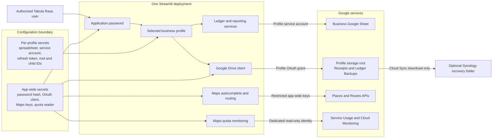
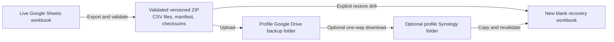

# Architecture

Project Tabula Rasa is one Streamlit application serving one or more isolated
business profiles. A profile selects its own Google Sheets workbook,
service-account credential, optional Google Drive authorization, and recovery
destinations. The application password and OAuth client are intentionally
deployment-wide. The optional Google Maps browser and Routes credentials are
also app-wide; the separate quota-monitoring identity is app-wide as well.
They are never profile identities.

## System context

The selected profile determines which workbook, service account, refresh token,
Drive folders, recovery settings, caches, and duplicate-submission guards are
used for the operation. The application currently grants an authenticated user
access to every configured profile; it does not provide per-profile user
authorization.

## Identity and storage boundaries

| Concern | Credential or identity | Data location | Scope |
| --- | --- | --- | --- |
| Application sign-in | Application password hash | App-wide secrets | Entire deployment |
| Ledger reads and writes | Profile Sheets service account | Profile Google workbook | One profile |
| Receipts and cloud backups | Shared OAuth client plus profile refresh token | Profile Drive root and managed children | One profile |
| Address suggestions and route mileage | Restricted browser and server Maps keys | Google Places and Routes APIs | Entire deployment |
| Maps quota and usage monitoring | Dedicated Maps quota service account with read-only scope | Service Usage and Cloud Monitoring in the explicit Maps project number | Entire deployment |
| Local configuration | Operating-system file permissions | .streamlit/secrets.toml and business_profiles.json | Local deployment |
| Hosted configuration | Streamlit Secrets | Hosted deployment | Hosted projection of each profile |
| NAS recovery copy | DSM account and separate Cloud Sync authorization | Profile-specific NAS root | One profile |

The Sheets service account edits the ledger workbook. A human Google account
authorizes the Drive files used for receipts and cloud backups. Neither
credential automatically grants the permissions of the other. Google Drive
folders do not need to be shared with the Sheets service account.

The browser Maps key is sent only to the autocomplete component and depends on
website plus API restrictions. The Routes key remains server-side and is sent
only to the Routes API. Neither key is sourced from or grants access to a
business profile, workbook, service account, or Drive authorization. Quota
monitoring uses a separate app-wide service-account JSON mapping and the
`cloud-platform.read-only` and `monitoring.read` scopes; it never reuses profile
Sheets credentials or human Drive OAuth. The
ledger persists only the existing visible address and user-confirmed mileage;
it does not retain complete Google responses or polylines.

Local profile configuration is plaintext and must remain on a protected,
non-synchronized filesystem. The hosted representation is an explicit allowlist
containing the profile name, spreadsheet ID, Sheets service-account credential,
and validated Drive authorization plus its storage root and managed children.
Local backup paths and Synology metadata are intentionally excluded.

## Ledger source of truth

Google Sheets remains the active ledger and storage source of truth. Accounts,
categories, Payees, Tags, transactions, mileage, mixed-use source records, and
receipt references remain in the selected profile's workbook; local files and
backup archives are not alternate ledgers. Transaction and mileage rows store
Tag associations as validated lists of stable IDs, while display names resolve
from the same profile's Tags worksheet so a later rename does not rewrite
ledger rows.

Cost-based mixed-use expenses use a dedicated `MixedUseExpenses` worksheet as
the authoritative source collection. Each source contains the normal editable
Expense inputs, the full total, business-use percentage, currency-rounded
allocated amount, allocation rationale, and stable source and projection IDs.
The corresponding Transactions row remains an ordinary Expense projection and
stores generic `source_type` and `source_id` provenance. Source-aware CRUD
updates the existing projection or removes both records while preserving the
source-authoritative and read-only-projection invariants. These are
non-transactional multi-row writes. Pre-write validation, stable identity,
bounded uncertain-write readback, and actionable partial-state guidance are
preferred to an application-level transaction protocol.
This Phase A contract is storage/domain-only; it does not expose a user-facing
mixed-use workflow.

### Bounded remote mutation policy

Google Sheets is the active source of truth, but it is not a transactional or
serializable database. The application therefore does not emulate ACID
semantics with dependency snapshots, transaction managers, repeated
postcondition checks, or automatic repair loops. Native batch requests are
appropriate when they reduce a logically coupled mutation, but a batch is not
treated as a general rollback boundary.

Every mutation still protects correctness at the boundary by reading fresh
records before writes, validating domain and referential constraints, enforcing
selected profile identity, rejecting stale expected-record edits, and
generating stable IDs before creates. The supported network policy is
deliberately small:

1. Attempt the requested write once.
2. If commit status is uncertain, read the affected stable ID or final state
   once. A confirmed requested state is success.
3. Retry once only when the fresh read proves the operation is absent and the
  retry cannot duplicate or corrupt data. Otherwise, invalidate affected
   caches and stop with an actionable inspection/recovery message.

A successful Google response is authoritative; an uncertain response can be
confirmed only by the one bounded readback described above. The application
does not add a second success-path read merely to defend against unsupported
manual row reordering or other arbitrary cross-client interleavings. Affected
caches are invalidated after a confirmed or uncertain write, before later reads
can reuse stale rows. This boundary keeps duplicate prevention and stale-write
protection while avoiding a growing state-machine that pretends Sheets offers
guarantees it does not provide.

### Recoverable cross-service partial failure

Drive and Sheets operations are also not atomic. Receipt workflows prepare a
stable receipt identity and content hash, upload at most once plus one safe
identity-based retry after an uncertain Drive response, then link the known
file in Sheets. If linking is uncertain, one fresh transaction/source read can
confirm success; otherwise the workflow stops and tells the user what to
inspect. A successfully uploaded but unlinked file remains in the profile's
Drive storage and is surfaced as an **Unreferenced Receipt** for explicit
recovery. The app does not delete that file as simulated rollback.

This same rule applies to future multi-service work: make partial state
detectable and recoverable, keep recovery scoped to the selected profile and
configuration revision, and expose a user-facing recovery boundary when
automatic repair would require a distributed transaction simulation.

### Current formats and explicit migration

Normal runtime primarily understands the current workbook schema and current
backup format. A genuinely new/empty workbook may be bootstrapped, but a
populated historical workbook is validated and rejected with an actionable
instruction to run the explicit workbook migration tool
(`scripts/migrate_workbook.py`). Historical backup conversion likewise lives
in `scripts/migrate_legacy_backup.py`; production
restore accepts only the current format and validates the converted output
using the normal current-format validator.

Migration tools have a narrower trust boundary than production runtime. They
recognize supported standard application outputs, perform deterministic
transformations, and fail clearly when the recognized contract is not met.
Archive migration preserves its source archive; `scripts/migrate_workbook.py`
intentionally upgrades the selected workbook in place and should be run only
after the operator has secured a recoverable backup. The tools do not
permanently carry every old schema into startup or reproduce adversarial
validation for inputs they are explicitly designed to convert.

### Proportionality and review drift

Defensive complexity is justified by the combination of realistic likelihood,
impact, detectability/recoverability, and implementation/test/maintenance
cost. High-impact data-loss, duplicate, stale-write, security, and
cross-profile risks deserve strong controls. A low-likelihood state with a
clear manual recovery path does not automatically justify hundreds of lines
of production and test machinery.

When a review round successively adds retry callbacks, snapshots, state
branches, or success-path readbacks for narrower variants of the same race,
perform a holistic mission check. Classify a finding on two independent axes:
whether it can technically occur, and whether it is inside the supported
product threat/concurrency model at a proportional cost. The smallest safe
response may be a local stable-ID check, a stop-and-inspect error, or an
evidence-backed dispute. Batch related accepted fixes into one coherent review
head instead of repeatedly expanding the implementation for every theoretical
interleaving.

## Responsibility-based module boundaries

The structural refactor follows ownership and data-flow seams, not a fixed
line-count target. A cohesive moderately large module is preferable to
artificial fragmentation. Stable public facades and package re-exports keep
unrelated callers from changing while the implementation moves behind them.
Lower-level storage, client, and schema helpers must not depend on Streamlit
page renderers, and shared helpers are justified only when they clarify a
real responsibility or remove real duplication.

The current decomposition uses these seams:

| Responsibility | Current boundary |
| --- | --- |
| Sheets storage facade | `tabula_rasa/storage/google_sheets/__init__.py` keeps `GoogleSheetsStorage` and re-exports intentionally public names. |
| Sheets primitives | `tabula_rasa/storage/google_sheets/errors.py`, `tabula_rasa/storage/google_sheets/schema.py`, `tabula_rasa/storage/google_sheets/validation.py`, `tabula_rasa/storage/google_sheets/client.py`, and a small `tabula_rasa/storage/google_sheets/base.py` own errors, current schema, API access, validation, and shared row/cache/read/write helpers. |
| Sheets domains | `tabula_rasa/storage/google_sheets/accounts.py` owns account and category hierarchies; `tabula_rasa/storage/google_sheets/payees.py`, `tags.py`, `transactions.py`, `mileage.py`, `mixed_use.py`, `receipts.py`, and `backup.py` own the other cohesive domain operations. Historical migration code stays in scripts. |
| Receipt page workflow | `tabula_rasa/page_renderers/transactions/receipt_workflows.py` owns reusable upload/recovery state; `tabula_rasa/page_renderers/transactions/receipt_editor.py` owns editor rendering; `tabula_rasa/page_renderers/transactions/receipt_display.py` owns listing/unlink UI. `tabula_rasa/page_renderers/transactions/receipts.py` may remain a thin compatibility facade. |
| Mileage page | `tabula_rasa/page_renderers/mileage_routing.py`, `tabula_rasa/page_renderers/mileage_form.py`, `tabula_rasa/page_renderers/mileage_ledger.py`, and `tabula_rasa/page_renderers/mileage_locations.py` separate route state, forms, ledger behavior, and location helpers; `tabula_rasa/page_renderers/mileage.py` remains orchestration-focused. |
| Transaction ledger page | `tabula_rasa/page_renderers/transactions/ledger_filters.py`, `tabula_rasa/page_renderers/transactions/ledger_bulk.py`, `tabula_rasa/page_renderers/transactions/ledger_editor.py`, and `tabula_rasa/page_renderers/transactions/transaction_copy.py` separate search/filter state, bulk actions, single-record editing, and provenance/copy behavior; `tabula_rasa/page_renderers/transactions/ledger.py` composes them. |
| Drive integration | `tabula_rasa/google_drive/__init__.py` preserves `GoogleDriveClient`; `tabula_rasa/google_drive/oauth.py`, `tabula_rasa/google_drive/client.py`, `tabula_rasa/google_drive/folders.py`, `tabula_rasa/google_drive/receipts.py`, and `tabula_rasa/google_drive/backups.py` separate identity/auth, generic requests, managed folders, receipts, and backups. |
| Local profile administration | `local_profile_admin.py` remains the page entry point and profile-summary composer; `local_profile_admin_forms.py`, `local_profile_admin_readiness.py`, `local_profile_admin_security.py`, `local_profile_admin_support.py`, and `local_profile_admin_synology.py` own the distinct form, readiness, deployment-security, shared setup, and Synology responsibilities. |
| Tests | `tests/storage/google_sheets/`, `tests/google_drive/`, `tests/mixed_use_storage/`, and `tests/receipt_recovery/` follow the production/workflow seams and keep shared fixtures in local support modules rather than duplicating them per domain. |

The current Sheets package implements the first slice with a stable facade,
explicit primitive modules, and a flat set of domain mixins. `base.py` is kept
to genuinely shared row/lock primitives for now; any later split of remaining
shared behavior must have a clear ownership boundary and preserve imports and
behavior. This is composition for compatibility, not a new storage framework.

The local administration review found durable seams between profile forms,
readiness checks, deployment-security guidance, local Synology metadata, and
the page-level profile summary/orchestration. Its entry point stays stable,
while private helpers are imported and tested from their owning modules rather
than re-exported as permanent compatibility aliases. These boundaries are
architectural ownership guidance, not a demand that every row of code become a
separate class or file.

## Receipt boundary

Receipt bytes live in the selected profile's Google Drive Receipts folder.
Transactions store stable receipt references in the profile's Transactions
worksheet. A reference contains the Drive identity and integrity metadata
needed for display, retry, backup inventory, and recovery.

The transaction-creation workflow validates every selected file, saves the
transaction first, then uploads and links receipts. If receipt work is partial,
the confirmed transaction remains saved and unresolved files have a retry path.
An uncertain Drive response gets one stable-identity readback and, only when no
file exists, one retry. Sheets link uncertainty uses the storage layer's single
fresh readback. An uploaded-but-unlinked file is never deleted as rollback and
remains available through Unreferenced receipt.

Session recovery stores only the target, exact profile storage identity,
prepared receipt identity/content, uploaded reference when known, and last
error. A workbook or receipt-folder change rejects and clears that state rather
than carrying it across configurations.

Removing a receipt from a transaction removes only the ledger reference. It
does not delete the Google Drive file; the file remains available as an
unreferenced receipt for relinking. Multi-file post-creation uploads, safe
filename handling, checksums, and uncertain-response recovery are part of the
receipt contract.

## Backup and recovery boundary

Backups are recovery artifacts, not alternate live ledgers. Current archives
contain the ledger CSVs, a manifest, checksums, and a receipt metadata
inventory; receipt bytes are recovered independently from the protected Drive
or Synology copy. Restoration always targets a new blank workbook and refuses
the configured live workbook. See [Backup and recovery](BACKUP_RECOVERY.md).

Synology is an independent copy path operated by DSM Cloud Sync. The app stores
the expected profile-root destination, schedule, and retention policy but does
not configure DSM, connect to the NAS, or report transfer health. Destination
deletions remain disabled so Drive retention cannot erase the independent copy.

## Accounting and hierarchy invariants

- Transfers change account balances but do not affect income or expenses.
- Mileage is separate from financial transactions.
- Accounts and categories have at most two layers. Parent and child accounts
  share a balance-sheet classification; parent and child categories share an
  Income or Expense kind.
- Stable account and category IDs remain attached to transactions when a
  record is renamed, promoted, or reparented.
- Account family totals combine direct parent activity with direct child
  activity exactly once. Category summaries preserve direct activity and child
  detail without double-counting.
- Account subtype and balance-sheet classification are separate. Bank and Cash
  are assets; Credit card and Short-term debt are liabilities; Equity is equity;
  and Other may use any classification.
- Asset opening balances are normally positive. Liability and equity opening
  ledger balances are normally negative and are presented conventionally in
  reports.
- Current earnings are income minus expenses and are included in total equity.
- Reports flag any difference in Assets = Liabilities + Equity.
- This is a record-keeping tool, not tax or accounting advice.

## Profile isolation invariants

Every workbook read and write, import, export, receipt operation, backup,
recovery action, cache, prepared-export snapshot, and duplicate guard must use
the selected profile key and its configuration revision. A global fallback must
never substitute another profile's workbook, credential, token, folder,
recovery destination, or cached data.

When the profile changes, page-local selections and pending notices are cleared
or rebuilt. The new profile's workbook is initialized and accessed only under
its own key. Hosted projections do not grant local administration or reveal
local-only recovery metadata.

## Implementation map

| Area | Primary implementation |
| --- | --- |
| Streamlit shell and routing | tabula_rasa/app.py |
| Shared presentation tokens and CSS | tabula_rasa/presentation.py |
| Profile selection and readiness | tabula_rasa/business_profiles.py and tabula_rasa/profile_readiness.py |
| Local profile persistence | tabula_rasa/local_profile_store.py |
| Sheets storage, current v10 backup format, and restore validation | `tabula_rasa/storage/google_sheets/` |
| Legacy backup conversion (v1–v9 to v10) | scripts/migrate_legacy_backup.py |
| Legacy workbook conversion and historical schema definitions | `scripts/migrate_workbook.py`, `scripts/migrate_payees.py`, and `scripts/migration_schemas.py` |
| Drive OAuth and file operations | tabula_rasa/google_drive/__init__.py, with `oauth.py`, `client.py`, `folders.py`, `receipts.py`, and `backups.py` responsibility modules |
| Drive administration and Picker | tabula_rasa/google_drive_admin.py and tabula_rasa/google_drive_picker.py |
| Maps autocomplete and route distance | tabula_rasa/address_autocomplete.py and tabula_rasa/maps_routing.py |
| Receipts and recovery metadata | tabula_rasa/receipt_manifest.py and tabula_rasa/receipt_recovery.py |
| Synology settings | tabula_rasa/synology_recovery.py |

Setup, OAuth administration, and recovery procedures belong in the specialized
guides linked from the root [README](../README.md), not in this architecture
overview.
