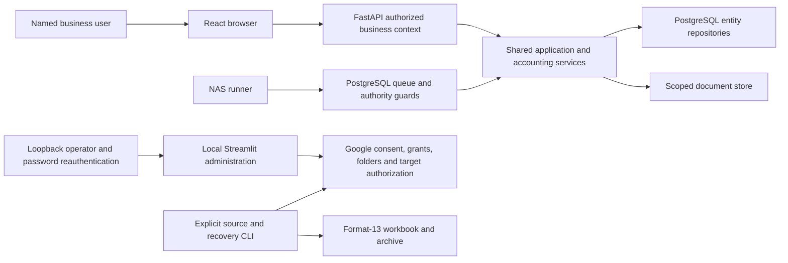

# Architecture

Bookkeeping uses React/FastAPI/PostgreSQL. Streamlit serves protected local operator
administration only. Preserved Google Sheets sources and format-13 archives support
explicit migration and recovery commands; they are not a fallback live ledger.
The broader commercial initiative retains separate identity, provider, deployment,
recovery and release acceptance boundaries. Source cleanup proves no deployment or
commercial activation.

## System context

## Identity and storage boundaries

Named sessions and server-resolved business membership authorize PostgreSQL requests.
A client profile/entity identifier is not authorization. The local application
password and shared Google OAuth client are deployment-wide; local administration
requires the explicit flag, loopback binding and fresh password unlock independently
of named business membership. `app.py` renders only that administration shell and
public legal routes. It performs no ledger initialization, default seeding or recurring
reconciliation on startup or profile selection.

Google grants and workbook/Drive folder selections remain profile-scoped. Sheets and
Drive use the selected human grant through the shared OAuth client and narrow
`drive.file` scope. Picker access and Google Editor capability remain distinct from
business membership. Version-2 local profile configuration rejects service-account
profiles; the old profile and receipt-association converters are retired. Configure
current grants through [Setup](SETUP.md) and [Google Drive](GOOGLE_DRIVE.md).

Native in-app business creation initializes PostgreSQL books. It does not acquire or
replace a Google grant or provision every Drive folder. The operator-assisted
[connection procedure](identity/CONNECTIONS_AND_CLAIMS.md) retains credential custody,
encrypted grant staging and authorized activation. Local profile registration and
blank-workbook bootstrap remain operator source/recovery actions.

Maps keys and read-only quota-monitoring credentials are deployment-wide and separate
from each business's Google grant. Browser/HTTP Maps lookup, route and quota adapters
retain their shared owners. The old Streamlit autocomplete and quota sidebar adapters
are retired. No provider response or credential belongs in logs or exports.

## Ledger source of truth

`composition.create_application` requires explicit trusted PostgreSQL authority and
a configured database for the selected profile/entity. Sheets and maintenance entries
fail closed; an unavailable PostgreSQL database never falls back to Sheets. The caller
owns pool/schema lifecycle. [Cutover](accounting/CUTOVER.md) owns preparation,
activation, committed divergence and the bounded pre-divergence rollback. After
committed PostgreSQL writes, recover PostgreSQL and document bytes separately.

## Responsibility-based module boundaries

Application services and pure domain modules own normalization, references, accounting,
recurring rules, stable identities, mixed-use allocation, assets and depreciation.
HTTP handlers and repositories remain thin adapters; cleanup introduces no alternate
accounting engine, state machine or compatibility wrapper. PostgreSQL operations own
transactions, loaded baselines, aggregate versions, authorization and authority guards.
Financial CSV generation reuses `application/financial_csv.py`, `ledger_queries.py`
and `ledger_presentation.py`; these shared calculations outlive the deleted pages.

| Owner | Concrete retained consumer |
| --- | --- |
| `application/`, pure accounting/reference/recurrence modules | HTTP composition, PostgreSQL repositories and jobs; extraction and independent export verification |
| `composition.py`, `infrastructure/postgres/composition.py` | Migrated HTTP runtime and `scripts/cutover_bookkeeping.py` smoke/authority checks |
| `local_profile_admin*.py`, `google_drive_admin.py`, Picker and Google OAuth | `app.py` local operator entry point, including grant replacement, folder administration and recovery target authorization |
| Sheets client/schema, locks, cache, append-many bootstrap and blank-target restore | Local Google Validate ledger, `validate_google_sheets.py`, `migrate_sheets_to_postgres.py`, `restore_google_sheets_backup.py` and backup commands |
| Sheets account/category/payee/tag/transaction/mixed-use/asset reads and reference lookups | `validate_google_sheets.py`, backup export validation, receipt inventory preparation and receipt recovery |
| Sheets mileage read adapter | `validate_google_sheets.py` through `list_mileage_trips`; no Sheets mileage mutation adapter remains |
| Sheets backup/archive and shared final-format validators | `backup_google_sheets.py`, `validate_google_sheets_backup.py`, blank-target restore and independent migration preflight |
| Sheets receipt remap, source/projection parity, managed row update and bounded uncertain readback helpers | `receipt_backfill.prepare_backup_receipt_manifest` from backup CLI and `receipt_recovery.recover_receipts_from_synology` from recovery CLI |
| Shared recurring rules and format-13 recurring provenance validation | PostgreSQL recurring service/queue, migration extraction, archive validation and restore; no Sheets generation engine remains |
| `infrastructure/postgres/jobs.py`, `recurring_jobs.py`, job CLI and NAS monitor | PostgreSQL recurring dispatch, reconciliation and the NAS runner/heartbeat |
| `presentation.py`, `ledger_auth.py`, public legal routes | Local administration styling, login, password reauthentication and footer |

The former Sheets application service graph, ordinary bookkeeping writers, Streamlit
page contexts/renderers and UI-only pending recurrence/submission state are retired.
Read and receipt recovery helpers retain only their actual operator/CLI consumers.
Tests populate synthetic workbook rows directly rather than keeping obsolete mutation
APIs alive for fixture construction.

## Recurring execution

PostgreSQL shared recurring rules preserve schedule/date identities, duplicate
prevention, catch-up and independent occurrence commits. Queue reconciliation,
entity/time-zone authority fencing, failures/retries and NAS monitoring retain their
existing owners and operational contracts in [jobs](operations/JOBS_AND_AUDIT.md).
Page loads and startup are read-only. Removing Streamlit triggers changes neither
worker authority nor a deployed timer/heartbeat configuration.

## Frozen Sheets source boundary

Only [format 13](SHEETS_SOURCE_CONTRACT.md) workbooks and archives are supported.
Schema validation, checksum/manifest validation, receipt relationships, mixed-use
source/projection parity, recurring provenance, journals and asset/depreciation history
remain required. Unsupported formats fail before target mutation. No historical
converter runs implicitly. Source extraction reads raw worksheets without replaying
business writes or jobs. Backup export validates its serialized normalized final
format through the same archive validator used by recovery.

Blank target initialization and restoration refuse a configured live workbook.
Retained remote receipt repair validates fresh profile-scoped references at its
mutation boundary, uses stable receipt identities, invalidates affected caches and
performs one bounded uncertain-write readback and at most one safe retry. Confirmed
writes are not blindly repeated. Source/projection receipt updates preserve parity.
Uncertain uploads remain recoverable; unlinking a current PostgreSQL receipt preserves
its document bytes. [Recovery](BACKUP_RECOVERY.md) owns the operator procedures.

No cleanup operation deletes ledgers, receipts, backup generations, exports,
credentials, migration evidence or recovery artifacts. Retention policy is unchanged.
Canonical PostgreSQL export versioning and immutable deployed forward schema history
remain separate from the frozen Sheets format.

## Accounting and hierarchy invariants

- Transfers change account balances but do not affect income or expenses.
- Mileage is separate from financial transactions.
- Accounts and categories have at most two layers. Parent and child accounts
  share a balance-sheet classification; parent and child categories share an
  Income or Expense kind.
- Stable account and category IDs remain attached to transactions when a
  record is renamed, promoted, or reparented.
- Account family totals combine direct parent activity with direct child
  activity exactly once. Category summaries preserve direct activity and child
  detail without double-counting.
- Account subtype and balance-sheet classification are separate. Bank and Cash
  are assets; Credit card and Short-term debt are liabilities; Equity is equity;
  and Other may use any classification.
- Asset opening balances are normally positive. Liability and equity opening
  ledger balances are normally negative and are presented conventionally in
  reports.
- Current earnings are income minus expenses and are included in total equity.
- Reports flag any difference in Assets = Liabilities + Equity.
- This is a record-keeping tool, not tax or accounting advice.

## Profile isolation invariants

Every operator workbook/grant/folder/cache/recovery operation uses the explicit selected
profile. Native business requests and queued jobs use server-authorized entity scope.
Switching business must not reuse another business's cached data, loaded baseline,
receipt folder, grant or pending form. Protected local configuration is not a named
user authorization store and is never a fallback for an unresolved business.

## Commercial PostgreSQL design

[ADR 0001](adr/0001-canonical-accounting-schema.md) defines entity-scoped tables,
constraints, disjoint Simple Ledger/journal projections, signed opening values,
Source-owned recurring/mixed-use/depreciation relationships and loaded baselines.
Application/domain services retain accounting behavior; the schema maps their repository
contracts without creating another accounting engine.

`infrastructure/postgres/` owns the SQLAlchemy Core/Psycopg/Alembic runtime. [Database
operations](database/POSTGRESQL.md) covers connection/transaction boundaries, forward
migrations, native test infrastructure and integrity rules. The local Streamlit administrator does not assemble bookkeeping services;
its retained Google/source/recovery operations do not require a database URL.

Provider-neutral migration plans live in `migration/`, read-only Sheets extraction in
`infrastructure/sheets_migration.py`, and target loaders/checkpoints in
`infrastructure/postgres/migration.py`. [Migration](accounting/SHEETS_MIGRATION.md)
defines deterministic complete units, dry runs, restart and reconciliation. Loading
alone does not establish whole-profile acceptance or activate authority.

`postgres/composition.py` assembles reference, transaction/journal, recurring,
mixed-use, asset, mileage and import services using shared operations, versions and
loaded baselines. Receipt services require an explicit authorized `DocumentStore`: SQL
owns metadata and relationships; the store owns bytes.

`PostgresLedgerQueryRepository` and `ReportingService` read entity-scoped native
projections through one committed read-only REPEATABLE READ snapshot. Batched reads
preserve disjoint simple/journal streams and historical references. Reporting uses its
own outer query operation, never a partially written mutation. See [reporting
coverage](database/POSTGRESQL.md#reporting-repository).

Recurring reconciliation commits independent occurrences. Initial mixed-use pairs and
asset postings retain their atomic operation boundaries. See [secondary
repositories](database/POSTGRESQL.md#recurring-mixed-use-and-asset-repositories). Live
activation requires [acceptance and cutover](accounting/CUTOVER.md), complete export,
concurrency verification and recovery evidence. Named memberships own authorization; a
profile key is not an authorization model.

## Commercial browser/API runtime decision

Hosted synthetic Drive composition (technical-alpha validation) reuses the profile-owned
`infrastructure/drive_composition.py`, `GoogleDriveDocumentStore` and
`EntityDocumentStore` with PostgreSQL receipt metadata. The default HTTP runtime loads
one explicit environment/origin/entity-bound server file, never legacy profile/Streamlit
configuration. Its fixed synthetic gate cannot authorize a private migrated profile. The
same small Drive composition owner also serves operator and migrated-profile services. See
[Hosted synthetic receipt storage](storage/STAGING_RECEIPTS.md) for configuration,
preflight, custody and evidence boundaries.

[ADR 0002: Commercial web stack and runtime
topology](adr/0002-commercial-web-runtime.md) selects React/TypeScript with Vite, React
Router, TanStack Query and React Hook Form; FastAPI/Pydantic/Uvicorn over the existing
Python services; and a same-origin compiled-SPA/API container on Render with Neon
PostgreSQL. [Foundation conventions](browser/FOUNDATION.md) defines DTO/error/context,
query/cache/form and validation ownership. [Deployment](operations/DEPLOYMENT.md)
defines environment bindings and promotion. The former Streamlit bookkeeping runtime is retired.

The HTTP composition resolves server-authorized entity context before invoking
`create_postgres_services`, retaining `create_application` authority/environment checks
for migrated profiles; handlers translate transport models and call the existing
application/query owners. OpenAPI generates browser transport types without making
application services depend on HTTP DTOs. Protected forms carry the original loaded
baseline through responses, forms and edit/delete commands, following the shared
database mutation contract.

Identity and tenancy owns real sessions, memberships, authorization and onboarding;
platform operations owns durable jobs, audit and operations. The ADR defines their
context, cookie/CSRF, request-ID, health and worker seams. No client-selected
profile/entity ID grants authorization. [Commercial development and
deployment](browser/RUNTIME.md) defines package ownership, local commands,
environment/secret boundaries, restricted synthetic alpha access and deployment's
persistent staging/manual setup checkpoint. Production authority/recovery and external
beta retain the separate PostgreSQL persistence, identity and tenancy, platform
operations and external release and customer lifecycle gates.

## Commercial identity decision

[ADR 0003](adr/0003-commercial-identity-and-tenancy.md) selects ZITADEL Cloud hosted
OIDC login, durable opaque PostgreSQL sessions, stable internal users, organization-wide
memberships and five server-owned roles. It extends the existing
RequestContext/session/ScopeBoundary seams and canonical business entities; it does not
grant access to local operator administration. [Commercial
identity](identity/PROVIDER_SETUP.md) owns the operator checkpoints, threat cases and
identity control plane and hosted identity rollout handoff within the identity layer.
Restricted synthetic alpha, lasting owner cutover and external beta keep their
independent stage gates.

## Complete entity export

[Canonical entity export](accounting/EXPORT.md) provides independently validated,
dependency-complete PostgreSQL collections. Export, whole-profile acceptance and
operational recovery retain independent validation; a successful migration or
source-code cleanup alone establishes none of those operational outcomes.
