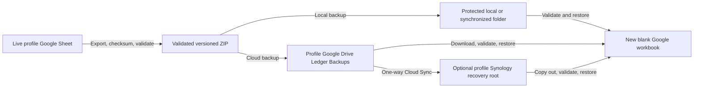

# Backup and recovery

This is the operator guide for creating, validating, copying, and restoring
Tabula Rasa backups. Backups are recovery artifacts, not alternate live
ledgers. Every restore targets a new blank Google workbook and refuses the
configured live workbook.

## Recovery topology



Google Drive is the primary cloud-native destination. Local storage and
Synology are additional failure boundaries. The app does not use local
storage as the active ledger.

## Archive format and safety

The current backup format is version 7. Each archive contains:

- Accounts.csv;
- Categories.csv;
- Payees.csv;
- Transactions.csv;
- Mileage.csv;
- receipts.json; and
- manifest.json.

The manifest records the format version, UTC backup time, source workbook
title, worksheet headers, row counts, and SHA-256 checksums for every archive
data file.

receipts.json is a profile-scoped metadata inventory of referenced and
intentionally unreferenced app-managed receipt files. It includes stable
receipt identities, transaction associations, original and stored filenames,
MIME types, sizes, checksums, old Drive IDs, and available timestamps. Receipt
bytes are not embedded in every ledger archive.

Current-format backups require the selected profile's configured Drive receipt
folder. Immediately before creation, the app and command-line tools refresh
Sheets and Drive, backfill missing receipt integrity metadata, initialize only
empty-string legacy receipt associations, and reconcile active references.
An explicit empty list remains intentionally unlinked. If preparation or
validation is incomplete, no backup is created.

The validator and restore path accept formats 2 through 7:

| Format | Meaning |
| --- | --- |
| 2 | Accounts, Categories, and Transactions; no Mileage or receipt references |
| 3 | Adds Mileage; no transaction receipt references |
| 4 | Adds transaction receipt references; no receipt inventory |
| 5 | Adds checksummed receipts.json inventory |
| 6 | Supported legacy format adding account and category parent_id hierarchy |
| 7 | Current format with managed Payees and transaction payee_id references |

Before upgrading an existing workbook, run the one-time payee migration:

```text
python scripts/migrate_payees.py --secrets .streamlit/secrets.toml --profile PROFILE_KEY
```

It deduplicates legacy payee text using normalized Unicode and whitespace,
updates transaction references, and is safe to rerun. Older backups are
accepted during restore; their payee text is mapped only to payees already in
the target workbook, otherwise the reference is left unset.

Older compatible archives restore records at Layer 1 when hierarchy columns
are absent. A format-1 archive must first be converted to format 2.

## Create a backup in the application

Open **Data & backup** for the selected profile. The page shows Cloud backup,
Recovery status, Exports, and Imports in that order.

- **Upload fresh backup now** prepares, validates, and uploads an archive to
  the selected profile's Drive backup folder.
- **Verify latest cloud backup** downloads the selected app-managed archive
  into the running application and validates its manifest, checksums, and
  stored Drive hash. It does not read or modify the live workbook.
- **Prepare downloadable exports** prepares profile-scoped transaction and
  mileage CSVs and a complete backup when receipt preparation succeeds.

If a complete backup cannot be prepared, the transaction and mileage CSV
downloads remain available. Prepared exports are tied to the selected profile,
configuration revision, and confirmed workbook data revision; a confirmed
ledger write makes an older prepared snapshot ineligible.

## Command-line backup

Create a protected local archive:

```powershell
python scripts\backup_google_sheets.py --profile PROFILE_KEY --local-dir backups\PROFILE_KEY --keep 30
```

The `--local-dir` switch selects local mode. Use it without a path to select the
profile's configured `backup_folder_path` or the ignored fallback
`backups/PROFILE_KEY/`; provide a path after the switch to override that
location. Without `--local-dir`, the command uses Google Drive. Single-profile
commands use a configured path exactly. The command validates before success,
uses a new timestamped filename, never overwrites an archive, and retains the
newest requested generations.

Create a Google Drive backup after the profile has a valid Drive grant and
Ledger Backups folder:

```powershell
python scripts\backup_google_sheets.py --profile PROFILE_KEY --keep 30
```

Google Drive is the default destination; --google-drive is an explicit
equivalent. The uploader uses the profile refresh token and backup folder,
records the archive hash and profile in private app-properties, makes
uncertain retries idempotent, and applies retention to app-managed archives.
Google Drive Desktop is not required.

The keep value must be at least 2 and defaults to 30. Backups contain private
ledger data and must never be committed.

## Schedule weekly backups

The Windows registration script provides Monday, Tuesday, and Wednesday at
10:00 PM as retry opportunities for one weekly backup. The default all-profile
task evaluates each profile independently; a failure or weekly duplicate for
one profile does not prevent later profiles from running. A successful
current-format archive with a verified receipt inventory suppresses later
attempts in that local ISO week. An older ledger-only archive does not.

All-profile cloud backup:

```powershell
python scripts\backup_google_sheets.py --all-profiles --google-drive --keep 30
```

All-profile local backup:

```powershell
python scripts\backup_google_sheets.py --all-profiles --local-dir --keep 30
```

Register a cloud task:

```powershell
powershell -ExecutionPolicy Bypass -File scripts\register_weekly_backup_task.ps1 -AllProfiles -GoogleDrive -TaskName "Project Tabula Rasa Weekly Backup"
```

Register a local or synchronized-folder task:

```powershell
powershell -ExecutionPolicy Bypass -File scripts\register_weekly_backup_task.ps1 -AllProfiles -Local -TaskName "Project Tabula Rasa Weekly Local Backup"
```

Existing installations may still have the historical task named `Tabula Rosa
Weekly Backup` or another earlier Project Tabula Rasa task identity. Before
registering the current task, manually rename or remove each legacy task in
Windows Task Scheduler and verify that only the intended task remains. The
registration script intentionally does not rename or remove existing tasks, so
leaving both identities enabled creates duplicate weekly backup attempts.

Omitting both `-Profile` and `-AllProfiles` uses all-profile behavior. A single
profile task remains available with `-Profile` and `-GoogleDrive` or `-Local`. In
a multi-profile installation, when using `-BackupDirectory`, also supply
`-Profile`; the registration script does not add a profile selector, and the
task otherwise exits without creating a backup. An explicit `-BackupDirectory`
is rejected in all-profile mode so profiles cannot share a destination. Tasks
use `MultipleInstances IgnoreNew`. Both local and cloud-native tasks use
Windows Task Scheduler's `Interactive` logon type under the registering
Windows account, so the task does not run while that account is logged out.
Cloud-native mode uses Google APIs directly and does not require Google Drive
Desktop. The task does not perform a missed-run catch-up.

## Validate an archive

Validate every copied or downloaded archive before relying on it:

```powershell
python scripts\validate_google_sheets_backup.py "C:\Safe-Recovery\tabula-rasa-backup-YYYYMMDDTHHMMSSZ.zip"
```

Successful validation confirms supported format, exact ZIP structure, manifest
integrity, headers, checksums, row counts, IDs, ledger relationships, and the
receipt inventory's profile, identities, filenames, sizes, checksums,
duplicates, and transaction associations. It also identifies older
ledger-only sources.

Do not modify a failed archive. Preserve it privately, choose another
generation, and validate again.

## Restore into a new blank workbook

1. Create a new blank Google spreadsheet.
2. Share it as Editor with the selected profile's Sheets service-account email.
3. Copy its spreadsheet ID.
4. Validate the archive locally.
5. Restore it with:

   ```powershell
   python scripts\restore_google_sheets_backup.py "C:\Safe-Recovery\tabula-rasa-backup-YYYYMMDDTHHMMSSZ.zip" --profile PROFILE_KEY --target-spreadsheet-id NEW_SPREADSHEET_ID --initialize
   ```

The restore validates before writing, refuses every configured live workbook,
refuses populated or incompatible target worksheets, initializes missing
headers when requested, restores all supported tables, and rereads the target
to verify rows.

Validate the new workbook through the normal profile path without changing the
configured business:

```powershell
python scripts\validate_google_sheets.py --profile PROFILE_KEY --spreadsheet-id NEW_SPREADSHEET_ID
```

This override is read-only and reports the workbook title and sanitized row
counts. It cannot be combined with --write-test. Spot-check headers and
representative relationships, then delete or clearly label the drill workbook.

## Recover receipt bytes and remap Drive IDs

Ledger restoration does not restore receipt bytes. For a format 5, 6, or 7
archive, copy the matching profile Receipts directory from the protected
Synology recovery set to a safe local path, then recover against the new
workbook:

```powershell
python scripts\recover_synology_receipts.py "C:\Safe-Recovery\tabula-rasa-backup-YYYYMMDDTHHMMSSZ.zip" "C:\Safe-Recovery\Receipts" --profile PROFILE_KEY --target-spreadsheet-id NEW_SPREADSHEET_ID
```

The command refuses every configured live workbook. Before a Drive change it
validates the archive, confirms the receipt inventory belongs to the selected
profile, and checks referenced transactions in the restored target. Each file
is checked for size and SHA-256. Stored filenames, stable identity, integrity
metadata, and provenance are preserved while old diagnostic Drive IDs are
remapped to confirmed new IDs.

Retries identify files by stable receipt identity and checksum. A matching
Drive file is downloaded and verified before reuse. Unreferenced files are
restored without attachment. Missing, corrupt, conflicting, and failed entries
are counted and skipped while valid entries continue.

Receipt-reference reconciliation is bounded optimistic concurrency. The
initial fresh Transactions snapshot is only a planning cache. Before any
cached skip or ledger write, a second full snapshot must match every live
transaction ID and receipt-reference cell. If state changed, the plan is
recomputed from the new snapshot for at most three attempts. A stable plan
updates only affected receipt-reference cells in one batch. An uncertain
batch response is read back and the whole plan is recomputed before another
write; the same batch is never blindly resubmitted.

The recovery order is:

1. Restore the archive into a new blank workbook.
2. Connect or confirm the selected profile's receipt folder.
3. Recover bytes from the matching Synology version.
4. Verify referenced receipts through remapped Drive IDs.
5. Verify unreferenced receipts remain available without automatic attachment.

Formats 2, 3, and pre-inventory format 4 can restore ledger data but are
identified as ledger-only sources for receipt recovery.

## Convert a format-1 archive

Convert the historical archive offline:

```powershell
python scripts\convert_backup_v1_to_v2.py "C:\Safe-Recovery\tabula-rasa-backup-YYYYMMDDTHHMMSSZ.zip"
```

The converter validates the source, infers missing classifications, renames
the historical Loan subtype to Short-term debt, normalizes legacy active
values, writes a separate format-2 archive, records source hash and conversion
time, and validates the result. It never overwrites the original.

## Optional Synology recovery copy

Synology is a second recovery boundary. The current supported topology is one
recursive Cloud Sync download task per opted-in profile:

- remote source: the profile's Drive storage root;
- expected children: Receipts and Ledger Backups;
- local destination: a distinct profile-specific NAS root;
- direction: Download remote changes only; and
- destination deletions: disabled.

Project Tabula Rasa records the expected destination, schedule, and retention
policy but does not connect to DSM, configure Cloud Sync, or prove transfer
health. DSM logs are the source of truth. The NAS may continue synchronizing
while the app and Windows computer are offline.

### Prepare the NAS

1. In DSM, create a protected shared folder such as Tabula_Rasa_Backups with
   sufficient capacity.
2. Give only the Cloud Sync service and required administrators access; use
   explicit permissions and review DSM's effective Preview values.
3. Create one non-overlapping subfolder per profile, for example:

   ```text
   /volume1/Tabula_Rasa_Backups/heathcote-advisory
   /volume1/Tabula_Rasa_Backups/rok-collectibles
   ```

4. Protect DSM administrator access with strong credentials and MFA. If
   shared-folder encryption is used, keep its recovery material outside the
   NAS and test remounting after a reboot.

Each enabled profile must have a distinct destination. The app rejects
equivalent, shared, or nested normalized NAS paths.

### Record a profile's recovery settings

Run the loopback-only profile administrator:

```powershell
powershell -ExecutionPolicy Bypass -File scripts\run_local_profile_admin.ps1
```

In Account settings > Recovery, select the business, enable the optional
Synology recovery copy, review the derived profile destination, and save the
schedule and retention policy. The app stores layout profile-root
automatically; there is no layout selector.

Optional app-wide defaults belong only in local secrets:

```toml
[synology_recovery_defaults]
base_path = "/volume1/Tabula_Rasa_Backups"
schedule = "Continuous"
retention_policy = "Retain all synchronized generations until quarterly manual review."
```

The base path is never used directly as a destination; the profile key is
appended. Saving this record changes local metadata only. Disabling it removes
the record but does not delete a DSM task or NAS archive.

Synology metadata is excluded from hosted Streamlit Secrets. A hosted runtime
without the local record says that the settings are unavailable and directs
administrators to local Account settings and DSM. It does not infer health.

### Configure Cloud Sync

Authorize Cloud Sync with the Google account that owns the profile's Drive
storage root. Do not use a Shared with me item, shortcut, Computers location,
or unsupported Workspace Shared Drive.

Create one task for each profile:

| Setting | Required value |
| --- | --- |
| Provider | Google Drive |
| Remote path | Profile storage root containing Receipts and Ledger Backups |
| Local path | Matching profile-specific NAS root |
| Direction | Download remote changes only |
| Destination deletions | Do not remove destination files when removed from source |
| Schedule | Saved profile schedule |
| Google document conversion | Disabled |

Inspect both source and destination. Ledger Backups should contain only
timestamped tabula-rasa-backup-YYYYMMDDTHHMMSSZ.zip files; Receipts contains
the app-managed receipt files. Do not place credentials, exported Secrets,
temporary CSVs, or unrelated files in these folders. Destination-deletion
protection intentionally retains old NAS archives and unlinked receipts after
Drive retention removes source files.

### First-copy and retry check

Create a fresh verified Drive backup, wait for Cloud Sync to report current,
confirm both children arrived, and copy an archive to a safe local recovery
folder. Never restore or validate a partially synchronized file.

For a basic retry drill, let two generations synchronize, confirm both remain,
pause the task, upload another verified backup, confirm DSM shows the task is
paused or not current, resume it, and confirm the pending archive arrives
intact. Review the DSM log.

## Retention and recovery evidence

Google Drive and command-line modes retain the newest 30 app-managed
generations by default. Retention deletes only canonical app-managed backup
files and requires at least two generations. Synology destination deletion is
disabled; apply any manual NAS retention only after validating another
generation and keeping the recovery periods still needed.

Keep a private record of the profile key, archive name and time, validator
result, storage location, restore command output, recovery workbook ID, receipt
recovery result, drill date, and administrator. Do not put credentials, private
ledger data, full account addresses, or identifiers in GitHub or the repository.

Application credentials and configuration are not in backup archives. Rebuild
after a deployment loss by restoring protected app and profile configuration,
validating each workbook, reconnecting unavailable Drive grants, confirming
storage roots and children, exporting hosted Secrets, and validating a current
backup.

## Troubleshooting

### The scheduled task creates no backup

Confirm the Windows account, virtual environment, profile key, destination,
Drive grant, and selected backup folder. In all-profile mode, inspect the
sanitized per-profile status.

### A weekly backup is skipped

That is expected when a valid current-format archive with a verified receipt
inventory already exists in the current local ISO week.

### Cloud authorization cannot refresh

Reconnect the profile in local Account settings, confirm folders, export
hosted Secrets, and retry.

### Restore refuses the target

Create a new blank workbook, share it with the selected profile's Sheets
service account, verify the target is not any configured live workbook, and
use `--initialize`.

### An archive fails validation

Do not restore or alter it. Preserve the copy, confirm synchronization had
completed, choose another generation, and validate again.

### Receipt recovery reports missing or corrupt entries

Confirm the matching protected NAS version and completed Cloud Sync. Do not
rename files or copy them blindly into Drive. Correct the recovery copy and
retry; identity and checksum rules prevent unnecessary duplicate uploads.

## Implementation map

| Responsibility | Implementation |
| --- | --- |
| Backup format and storage validation | tabula_rasa/storage/google_sheets.py |
| Local and Drive backup command | scripts/backup_google_sheets.py |
| Scheduled task registration | scripts/register_weekly_backup_task.ps1 |
| Archive validation | scripts/validate_google_sheets_backup.py |
| Workbook restore | scripts/restore_google_sheets_backup.py |
| Receipt preparation and manifest | tabula_rasa/receipt_backfill.py and tabula_rasa/receipt_manifest.py |
| Receipt recovery and Drive-ID remapping | scripts/recover_synology_receipts.py and tabula_rasa/receipt_recovery.py |
| Format-1 conversion | scripts/convert_backup_v1_to_v2.py |
