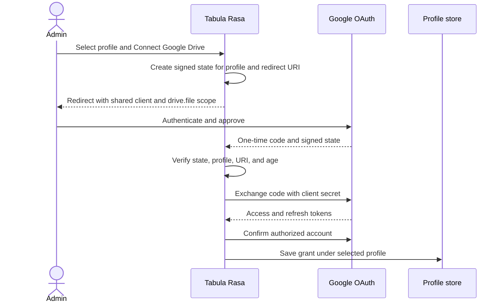
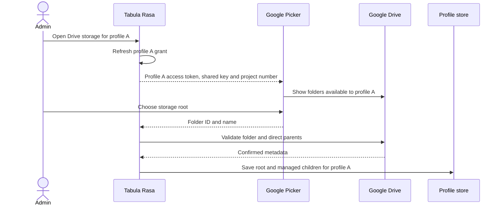

# Google Drive

This guide configures Google Cloud, OAuth, Google Picker, and the per-profile
Drive connection used for receipts and cloud backups. Google Sheets access is
separate: each profile continues to use its own Sheets service account. See
[Architecture](ARCHITECTURE.md) for the boundary between these credentials and
[Setup](SETUP.md) for initial profile creation.

## Configuration model

One shared Google Cloud OAuth application serves all profiles. Each profile
has an independent human Google account grant, refresh token, storage root,
Receipts child, and Ledger Backups child.

| Value | Scope | Secret? |
| --- | --- | --- |
| OAuth client ID | Deployment-wide | Browser-visible |
| OAuth client secret | Deployment-wide | Server-side |
| Picker API key | Deployment-wide | Browser-visible; restrict it |
| Cloud project number | Deployment-wide | Not secret |
| Redirect URIs | Deployment-wide | Configuration |
| Refresh token | One profile | Server-side |
| Access token | One profile, short-lived | Memory and Picker only |
| Storage root and child IDs | One profile | Configuration |

Profiles may use different Drive-owning Google accounts. No profile needs its
own OAuth client, Picker key, or Cloud project. The current app password still
allows an authenticated user to select every configured profile.

## OAuth and Picker flow

The local Account settings flow binds a signed, expiring OAuth state to one
existing profile and one configured redirect URI. The authorization code is
one-time input and is not persisted.



After authorization, the administrator uses Google Picker to select a storage
root or asks the app to create one. The app validates the selected folder for
the selected profile and provisions or reuses the managed Receipts and Ledger
Backups children. Existing Drive files are not moved, merged, or deleted.



Only the short-lived access token and restricted Picker API key reach the
browser. The client secret and refresh token remain server-side. The selected
profile determines the token and folder used by every subsequent Drive call.

## Google Cloud project

Use a project such as tabula-rasa-oauth-client rather than a project dedicated
to one business's Sheets service account.

1. Enable the Google Drive API and Google Picker API.
2. In Google Auth Platform, configure Branding with the application name
   Project Tabula Rasa.
3. Choose External audience when profiles may use personal accounts or
   accounts outside one Workspace organization.
4. During Testing, add each human Drive-owning account as a test user. Do not
   add service-account client_email addresses.
5. Under Data Access, request only:

   ```text
   https://www.googleapis.com/auth/drive.file
   ```

6. Create a Web application OAuth client with these example JavaScript origins:

   ```text
   http://localhost:8501
   http://127.0.0.1:8501
   https://tabula-rasa.streamlit.app
   ```

7. Add the exact corresponding redirect URIs:

   ```text
   http://localhost:8501/
   http://127.0.0.1:8501/
   https://tabula-rasa.streamlit.app/
   ```

8. Create a Picker API key. Restrict it to the Picker API and the approved
   HTTP referrers, using /* after each origin.
9. Record the client ID, client secret, Picker key, and numeric Cloud project
   number. The number is under IAM & Admin > Settings; it is not the project ID.
10. Before real use, publish the app and confirm Audience shows In production.

Replace the example hosted hostname with the actual deployment origin and
callback URI when they differ. Production callbacks must use HTTPS.

## Local app-wide secrets

Add the shared values to the ignored .streamlit/secrets.toml:

```toml
app_password_hash = "scrypt$..."

[google_drive_oauth]
client_id = "CLIENT_ID.apps.googleusercontent.com"
client_secret = "CLIENT_SECRET"
redirect_uris = [
  "http://localhost:8501/",
  "http://127.0.0.1:8501/",
  "https://tabula-rasa.streamlit.app/",
]
picker_api_key = "PICKER_API_KEY"
project_number = "NUMERIC_CLOUD_PROJECT_NUMBER"
```

Never commit or display this file, its values, OAuth tokens, or service-account
JSON. Do not put tokens in a ledger workbook.

## Connect a profile

Connection and folder changes are performed through the loopback-only local
profile administrator:

```powershell
powershell -ExecutionPolicy Bypass -File scripts\run_local_profile_admin.ps1
```

1. Sign in and open Account settings.
2. Re-enter the application password.
3. Select the intended profile and open its Google Drive OAuth step.
4. Select Connect Google Drive.
5. Sign in with the human account that should own that profile's Drive files.
6. Select an existing storage root in Picker or create an app-managed root.
7. Select Provision storage folders. The app creates or reuses the Receipts
   and Ledger Backups children.
8. Repeat for each profile.
9. Export and replace hosted Streamlit Secrets:

   ```powershell
   python scripts\export_streamlit_secrets.py
   ```

The hosted app cannot safely write profile changes back to Streamlit Secrets.
Perform connection, reconnection, folder selection, and disconnection locally,
then export the complete hosted projection. Disconnection revokes the saved
grant and removes local Drive settings without deleting Drive files or changing
the Sheets service account.

## Testing and production publishing

Testing mode requires every human account to be listed as a test user and
offline grants expire after seven days. Publish the OAuth application to
production before ordinary use. Workspace administrators may still block
third-party applications.

After publishing:

1. Reconnect every affected profile.
2. Confirm or reselect its storage root and managed children.
3. Export the local profiles again.
4. Replace the hosted Secrets document.

This replaces refresh tokens issued under Testing. The drive.file scope is
non-sensitive, though brand verification may still be required for public
application branding.

## Token and identifier lifecycle

| Value | Lifetime | Browser exposure | Storage |
| --- | --- | --- | --- |
| Client ID | Until rotated or deleted | Yes | App-wide configuration |
| Client secret | Until rotated or deleted | Never | App-wide secrets |
| Signed state | 10 minutes | Redirect URL | Not persisted |
| Authorization code | One exchange | Callback URL | Not persisted |
| Refresh token | Until revoked, expired, or invalidated | Never | Profile settings |
| Access token | Short-lived | Temporarily supplied to Picker | Memory |
| Picker API key | Until rotated or deleted | Yes | Restricted app-wide configuration |
| Project number | Stable | Yes | App-wide configuration |
| Folder IDs | Until folders or access change | Selected root may reach Picker | Profile configuration |

## Reconnect, rotate, or change folders

### Grant revoked or refresh fails

Reconnect that profile in local Account settings. Its Sheets service-account
access is unaffected.

### Drive-owning account changes

Disconnect the old grant, reconnect with the intended account, confirm or
provision destinations, and export hosted Secrets. Existing folder selections
remain only when the new account can validate them; otherwise select new
destinations.

### Storage root changes

Disable the profile's Synology recovery record first when it is enabled. Select
and provision the new Drive root, then configure the new DSM source and save
the recovery record again. Changing a root does not move or delete existing
files.

### OAuth client secret rotation

1. Update local app-wide secrets.
2. Confirm existing grants can refresh.
3. Reconnect profiles whose grants were invalidated.
4. Export and replace hosted Secrets.
5. Retire the old secret only after validation succeeds.

## Security requirements

- Google passwords and MFA responses are handled only by Google.
- The client secret and refresh tokens never enter Picker.
- Restrict the browser-visible API key by API and HTTP referrer.
- Accept callbacks only with a valid recent signed state and configured URI.
- Keep tokens, account details, and root/child IDs under the selected profile.
- Validate Drive file IDs against that profile before saving them.
- Use app-properties and profile identity for receipt and backup listing and
  idempotent retry behavior.
- Keep Drive folders Restricted. Do not share them publicly or with other
  profiles unless a separate approved workflow requires it.
- Regular My Drive folders are supported. Google Workspace Shared Drive,
  Shared with me, shortcut, and Computers-only folder flows are not supported.

## Troubleshooting

### Google rejects the callback URI

Compare the browser origin and exact redirect URI in Google Cloud and local
secrets. Production callbacks must be HTTPS and must include the trailing slash
when configured that way.

### Picker opens the wrong account

Reconnect the selected profile with the intended Google account. Picker uses
that profile's access token even when the browser has several accounts signed in.

### No refresh token is issued

Revoke the prior grant in Google and reconnect. The app requests offline access
and explicit consent; an absent refresh token cannot support persistent Drive
operations.

### The grant expires every seven days

The project or original grant is still in Testing. Publish it to production,
reconnect the profile, and export hosted Secrets.

### A selected folder cannot be validated

Use a regular folder owned by the authorized account. Do not use a Shared with
me item, shortcut, Computers location, or Workspace Shared Drive.

### Hosted folders or tokens are stale

Run the exporter after the local change and replace the complete hosted Secrets
document. Hosted Streamlit cannot update these values itself.

## Implementation map

| Responsibility | Implementation |
| --- | --- |
| OAuth state, code exchange, refresh, and Drive operations | `tabula_rasa/google_drive/` (`oauth.py`, `client.py`, `folders.py`, `receipts.py`, and `backups.py`) |
| Callback and per-profile administration | tabula_rasa/google_drive_admin.py |
| Browser Picker | tabula_rasa/google_drive_picker.py |
| Local credential persistence | tabula_rasa/local_profile_store.py |
| Hosted Secrets export | scripts/export_streamlit_secrets.py |

## Official references

- [Google OAuth verification](https://support.google.com/cloud/answer/13463073)
- [Google Drive API scopes](https://developers.google.com/workspace/drive/api/guides/api-specific-auth)
- [Google Picker web guide](https://developers.google.com/workspace/drive/picker/guides/web-picker)
- [Google API Services User Data Policy](https://developers.google.com/terms/api-services-user-data-policy)
