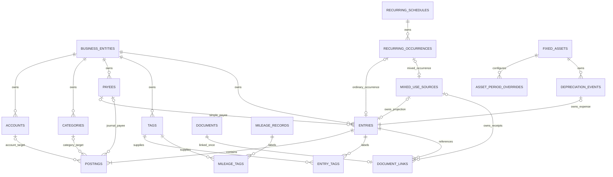

# ADR 0001: Canonical accounting schema and persistence conventions

Status: Proposed v1 implementation contract; subject to maintainer review.

Issue: [#243](https://github.com/Roklion/Project_Tabula_Rasa/issues/243),
under [PostgreSQL EPIC #220](https://github.com/Roklion/Project_Tabula_Rasa/issues/220)
and [commercialization initiative #124](https://github.com/Roklion/Project_Tabula_Rasa/issues/124).

## Context and scope

The commercial datastore represents accounting concepts, while the current
Streamlit/Sheets application remains functional. The persistence-neutral
services and ports completed in
[#219](https://github.com/Roklion/Project_Tabula_Rasa/issues/219) are the adapter
boundary. This ADR specifies tables, projections, integrity rules, and migration
units; it neither installs a database nor changes production code or current UX.
Executable migrations belong to #244 and repository implementations to
#245–#252. Read this together with [Architecture](../ARCHITECTURE.md).

The initiative requires incremental delivery: #245/#246 and usable #247 reads
enable the #221 commercial web/API milestone without waiting for all secondary
domains. Identity/membership belongs to #222; durable jobs and audit policy to
#223; customer delivery/retention to #224. Production authority changes only
through #258 after #253 concurrency/integrity, #257 whole-profile reconciliation,
#259 recovery rehearsal, and #260 complete entity-export evidence. This ADR
does not authorize cutover, indefinite dual writes, or reverse migration.

### Existing owners and reuse

| Evidence inspected | Existing responsibility retained |
| --- | --- |
| `application/contracts.py`, `accounting_contracts.py`, `reporting_contracts.py`, `services.py` | Capability boundaries, stable records, expected snapshots, and normalized reporting models. |
| `accounting_postings.py`, `journal.py`, `transaction.py`, `ledger_reporting.py` | Simple-to-posting translation, balancing/reference rules, current earnings, signs, and hierarchy rollups. |
| `reference_data.py`, `hierarchy.py` | Normalized reference names, classifications, and two-level hierarchies. |
| `application/recurring.py`, `recurring.py`, `recurrence.py` | Cadence, stable occurrence identities, conversion, and per-schedule failure isolation. |
| `mixed_use.py`, `mixed_use_records.py`, `application/mixed_use.py` | Currency-rounded allocation, source authority, projection preparation, and immutable provenance. |
| `asset.py`, `depreciation.py`, `depreciation_posting.py`, `application/assets.py` | Quarterly schedules, overrides, retirement, posted-period locks, and source-owned non-cash expenses. |
| `application/mileage.py`, `application/documents.py`, `application/imports.py`, `receipt_records.py` | Mileage normalization, portable documents, receipt recovery, and import duplicate classification. |
| `storage/google_sheets/schema.py`, domain storage mixins, `infrastructure/google_sheets_*.py` | Current-format fields, ID/provenance encodings, and compatibility adapter behavior. |

The new logic is infrastructure-owned relational persistence, constraints,
aggregate versions, and deterministic migration mapping. No second accounting
calculation, allocation algorithm, recurrence engine, or UI workflow is introduced.

## Decisions

1. One business entity owns one ledger in v1. Every bookkeeping relationship
   includes that entity's ID. There is no deployment-wide default ledger.
2. Simple transactions and advanced journals share `entries` and `postings`.
   An immutable `projection_kind` selects exactly one current repository/read
   projection. Persisted simple postings never also become advanced journals.
3. Accounts remain balance-sheet targets. Categories remain distinct Income or
   Expense accounting targets, with their own hierarchy. Tags are independent
   analytical labels and never posting targets. No hidden duplicate P&L account
   or tag-as-category mapping is required.
4. Opening balances remain signed, undated account initial values. They are
   not also entries/postings. Existing report owners add them once and retain
   any accounting-equation discrepancy; migration never invents balancing equity.
5. Source ownership uses typed foreign keys and explicit relationship rules.
   Recurrence is a separate occurrence association, so a recurring mixed-use
   projection has both a mixed-use owner and recurring provenance.
6. Stable domain IDs are text, preserving existing UUIDs, deterministic IDs,
   and valid non-UUID identities. Provider locators are separate from identities.
7. PostgreSQL transactions, relational constraints, and aggregate versions
   protect commercial mutations. Sheets locks and uncertain-write machinery
   remain in the Sheets adapter. Services consume neither SQL nor ORM objects.
8. Migration loads existing owners and accounting records as complete units;
   generation services are never called to recreate history. Inspectable
   incomplete states are explicit, never fabricated as valid accounting pairs.
9. Backup input supports exactly the final current format, v13. Earlier
   versions are rejected, not retained as compatibility formats or upgraded
   by the PostgreSQL migration path. Backup format version is separate from
   database migration revisions and optimistic record versions.

## Relationship model

All diagram edges between bookkeeping rows are entity-qualified FKs; the table
catalog below also specifies hierarchy, source tag, and asset acquisition edges.
A posting targets exactly one account or category. The two optional target
edges are an exclusive choice, not two simultaneous targets.

## Storage conventions

### Entity scope, identity, and common columns

`business_entities.id` is the ledger root. Unless a table explicitly specifies
another key, each object table has these columns:

| Column | SQL type/nullability | Rule |
| --- | --- | --- |
| `entity_id` | `text NOT NULL` | FK to `business_entities(id)`; immutable. |
| `id` | `text NOT NULL` | Nonblank stable domain identity; immutable. PK `(entity_id, id)`. |
| `created_at` | `timestamptz NOT NULL` | UTC creation instant; preserve known source value. |
| `updated_at` | `timestamptz NOT NULL` | Last persisted change; initial value equals creation when no source update exists. |
| `incarnation_id` | `text NOT NULL` | Immutable UUID4 for this persisted lifetime; prepared before creation and reused for its retries. Separates recreated deterministic IDs from an earlier deleted record. |
| `version` | `bigint NOT NULL DEFAULT 1` | Positive, monotonically incremented aggregate baseline; never a timestamp or PostgreSQL `xmin`. |

Join/detail tables declare their keys below. Every one has `entity_id NOT NULL`
and an entity FK even when it also references an entity-scoped parent. Each FK
to an object is `(entity_id, target_id) -> target(entity_id, id)`, including
self-references. Never reference a naked target ID or allow `entity_id = NULL`.
An entity ID, object ID, or posting ID cannot be changed by normal mutation.

New object IDs are generated before the mutation (UUID4 text where no existing
deterministic identity rule applies). ID uniqueness is entity-local, so two
entities may contain the same migrated source ID. A generated entry's ID keeps
the existing recurrence/depreciation algorithm. Join identities derive from
their parent keys rather than adding opaque IDs.

Existing transaction and journal IDs occupy one canonical entry namespace.
Preserve both when distinct; for a collision, retain the transaction ID and map
the journal to a deterministic UUID5 through `migration_id_mappings`, rewriting
its posting parent references. Do not silently overwrite either entry. The
manifest records the mapping namespace and algorithm version. Generated owner
IDs are preserved; if an anomalous owner ID cannot be preserved safely, migration
stops rather than changing future generation seeds implicitly.

### Values and normalization

| Value | Storage and compatibility rule |
| --- | --- |
| Money | `numeric(28,2)`; exact Decimal conversion, finite values only. Normalize cents in the existing domain owner before SQL; reject overflow and reject persisted-source values that would change accounting meaning. No `money`, binary float, or locale-formatted text. |
| Posting amount | Nonnegative unsigned money plus `side` (`Debit`/`Credit`). Ordinary simple amounts and journal lines are positive; only a source-owned depreciation period may have zero amounts. |
| Opening balance | Signed money. Debit-positive, credit-negative; do not force liabilities/equity to positive values. |
| Percentage | `numeric(8,5)`, `0 < value <= 100`; preserve the domain's five-place precision and Decimal rounding. |
| Mileage | `numeric(28,1)`, finite and `> 0`; current one-decimal normalization. No conversion to monetary entries. |
| Accounting/calendar dates | SQL `date`; ISO `YYYY-MM-DD` in compatibility dictionaries. Inclusive reporting boundaries. No UTC conversion of a ledger date. |
| Instants | `timestamptz`; serialize UTC ISO strings in dictionary contracts. Empty source timestamps use the manifest's fixed extraction instant, recorded as synthesized in migration metadata; never wall-clock time on each retry. Invalid nonempty timestamps fail dry-run. |
| Enums | `text` with named `CHECK` constraints using the exact values below. No native PostgreSQL enum lifecycle dependency. |
| Optional IDs/dates | SQL NULL for absence; compatibility dictionaries return `""`, while typed models use their existing optional values. |
| Text | Required labels nonblank; optional descriptive text `NOT NULL DEFAULT ''`. Preserve descriptions, references, rationale, and filenames without logging their contents. |
| Collections | Typed join tables, not encoded receipt cells, JSON tag arrays, or comma-separated IDs. Output collections follow current ordering (tag IDs sorted; journal positions explicit; receipt link positions retained). |

Domain rounding currently uses Decimal cent quantization (half-even under the
normal application context). Do not replace allocation or depreciation rounding
with SQL `round()`; PostgreSQL numeric coercion must not become a second rule.
Every numeric column also has `CHECK (value <> 'NaN'::numeric)` (substituting
its column name, allowing NULL only where specified). Fixed precision rejects
infinities; positivity alone does not reject PostgreSQL numeric NaN. See
[numeric types](https://www.postgresql.org/docs/current/datatype-numeric.html).
Keep v1 single-currency ledger behavior (USD); multi-currency/FX is outside this
model. Entity currency is immutable once accounting data exists.

For accounts, `name_key = clean_text(name).casefold()`; uniqueness covers the
whole entity. Categories use the same key unique within `(entity_id, kind)`.
Payees and Tags use the existing NFKC, collapsed-whitespace, casefold rules in
`reference_data.py`. Store `name_key text NOT NULL` with deterministic bytewise
comparison (`COLLATE "C"`); recompute it in adapter writes/migration. Do not
substitute SQL `lower()` or locale collation for these Unicode rules. A name
change increments its reference row's version. Historical joins resolve the
managed name, so renaming does not rewrite accounting rows.

## V1 table and column catalog

Notation: `?` means nullable; all other columns are NOT NULL. `money` means
`numeric(28,2)`, `percent` means `numeric(8,5)`. Common object columns above are
implicit unless overridden. An `FK` below always includes `entity_id`.
Named constraints and explicitly listed indexes are required; equivalent names
may follow #244's migration conventions. Foreign-key indexes are not assumed
to be created automatically.

### Ledger root and reference data

| Table | Additional columns | Keys, constraints, and indexes |
| --- | --- | --- |
| `business_entities` | `id text` PK; `name text`; `currency_code text DEFAULT 'USD'`; `created_at`, `updated_at`, `incarnation_id`, `version` as above. No `entity_id` on the root itself. | Nonblank identity/name/incarnation; currency CHECK `USD`; positive version. No user/member/OAuth/password columns. |
| `accounts` | `name text`, `name_key text`, `type text`, `classification text`, `opening_balance money DEFAULT 0`, `active boolean DEFAULT true`, `parent_id text?` FK accounts. | Unique `(entity_id,name_key)` including inactive records. Type CHECK `Bank/Cash/Credit card/Short-term debt/Equity/Other`; classification CHECK `Asset/Liability/Equity`. Fixed type/classification CHECK as in `reference_data.py`; Other may use any classification. `parent_id != id`; deferred two-level/same-classification hierarchy enforcement. Index `(entity_id,parent_id)`. |
| `categories` | `name text`, `name_key text`, `kind text`, `parent_id text?` FK categories. | Kind CHECK `Income/Expense`; unique `(entity_id,kind,name_key)`; `parent_id != id`; deferred two-level/same-kind hierarchy enforcement. Index `(entity_id,parent_id)`. No active flag in the current category contract. |
| `payees` | `name text`, `name_key text`, `active boolean DEFAULT true`. | Unique `(entity_id,name_key)` including inactive rows; create reuses/reactivates the existing identity as current services require. |
| `tags` | `name text`, `name_key text`, `active boolean DEFAULT true`. | Unique `(entity_id,name_key)` including inactive rows. A Tag is reusable across entries, mixed sources, schedules, assets, and mileage. |

### Accounting substrate

| Table | Additional columns | Keys, constraints, and indexes |
| --- | --- | --- |
| `entries` | `txn_date date`, `projection_kind text`, `simple_kind text?`, `description text`, `reference text`, `payee_id text?` FK payees, `mixed_use_source_id text?` FK mixed sources, `depreciation_asset_id text?` FK fixed assets. | UNIQUE `(entity_id,id,projection_kind)` supports the posting FK. `projection_kind` CHECK `simple/journal`; simple requires `simple_kind` in `Income/Expense/Transfer`, journal requires NULL. Journal has no entry-level payee/reference/source fields: payee/source IDs NULL, reference empty. At most one of the two owner IDs populated; owned entries must be simple Expense. Partial unique `(entity_id,mixed_use_source_id)` WHERE present. Index `(entity_id,txn_date,id)` and `(entity_id,projection_kind,txn_date,id)`; reference FK indexes for payee and asset. |
| `postings` | `entity_id text`, `id text`, `entry_id text` FK entries, `projection_kind text`, `position integer`, `account_id text?` FK accounts, `category_id text?` FK categories, `side text`, `amount money`, `payee_id text?` FK payees, `description text`. | PK `(entity_id,projection_kind,id)` preserves the separate simple-derived and journal posting ID namespaces. FK `(entity_id,entry_id,projection_kind)` to UNIQUE `(entity_id,id,projection_kind)` on entries. Unique `(entity_id,entry_id,position)`; `position > 0`; exactly one target ID non-NULL; side CHECK `Debit/Credit`; finite amount `>= 0`. Journal posting identity is unique across all journal entries in an entity. Indexes `(entity_id,account_id,entry_id)`, `(entity_id,category_id,entry_id)`, `(entity_id,payee_id)`; entry-position unique index serves aggregate reads. No independent row version: entry owns the baseline. |
| `entry_tags` | `entity_id text`, `entry_id text` FK entries, `tag_id text` FK tags. | PK `(entity_id,entry_id,tag_id)`; reverse index `(entity_id,tag_id,entry_id)` for OR-within-tag filtering. Current journal projection has no tags; adapters reject journal associations in v1. Entry version covers edits. |

There is no separate financial `transactions` table and no persisted running
balance, P&L total, monthly total, journal total, or simple amount field. Simple
kind is input/projection metadata; amount and targets are reconstructed from the
two postings. Journal totals are calculated from lines. Do not persist two
independently mutable copies of a transaction.

### Mixed-use sources

| Table | Additional columns | Keys, constraints, and indexes |
| --- | --- | --- |
| `mixed_use_sources` | `txn_date date`, `total_expense money`, `business_use_percentage percent`, `allocated_amount money`, `account_id text` FK accounts, `category_id text` FK categories, `payee_id text?` FK payees, `description text`, `reference text`, `allocation_rationale text`, `expected_projection_entry_id text`, `relationship_state text DEFAULT 'complete'`. | Positive total/allocation, allocation `<= total`; percentage in `(0,100]`; rationale/non-FK expected identity nonblank. Expected identity unique `(entity_id,expected_projection_entry_id)`. State CHECK `complete/missing_projection/projection_mismatch`; deferred relationship checks below. Category must be Expense. Index `(entity_id,txn_date,id)` and FK indexes `(entity_id,account_id/category_id/payee_id)` individually. |
| `mixed_use_tags` | `entity_id text`, `source_id text` FK mixed sources, `tag_id text` FK tags. | PK `(entity_id,source_id,tag_id)`; reverse `(entity_id,tag_id,source_id)`. Source version owns these links. Complete pair's entry tags must match; source mutation updates both in one transaction. |

The actual projection is the entry with `mixed_use_source_id = source.id`;
this is a typed FK, not a loose `source_type/source_id` string. The expected
projection ID preserves the source's original `linked_transaction_id`, even
when a legacy partial write left that entry absent. It is an identity assertion,
not a dangling SQL relationship. Complete pairs require actual ID = expected ID.

`allocated_amount` is source-owned persisted allocation output from
`mixed_use.py`, validated by that owner. Postings record its financial projection;
the complete-pair constraint checks the two copies agree. Only the allocated
business portion posts. Personal remainder is not converted to an extra expense
or transfer, preserving current Simple Ledger balances.

New runtime writes always produce `complete` pairs atomically. Only explicit
migration/inspection tooling may retain `missing_projection` (no actual entry)
or `projection_mismatch` (one actual, balanced, same-entity entry whose parity
fails). The deferred checker validates the declared state against actual rows;
a flag cannot excuse an unbalanced entry, missing reference, or foreign entity.
These states are visible through `sources()` and complete export diagnostics;
normal list/get/edit/link/generation paths stop with current inspection guidance.
They must never trigger auto-regeneration or be labeled reconciled for cutover.
An orphan projection whose owner is absent is unrepresentable under the FK:
dry-run must report it and block load/activation until an operator resolves it.

### Recurring schedules and occurrences

| Table | Additional columns | Keys, constraints, and indexes |
| --- | --- | --- |
| `recurring_schedules` | `name text`, `source_kind text`, `recurrence_unit text`, `recurrence_interval integer`, `anchor_date date`, `start_date date`, `end_date date?`, `status text`, `amount money`, `total_expense money?`, `business_use_percentage percent?`, `account_id text` FK accounts, `category_id text` FK categories, `payee_id text?` FK payees, `description text`, `reference text`, `allocation_rationale text`, `attention_code text`, `attention_at timestamptz?`. | Nonblank name; implicit kind Expense. Source CHECK `transaction/mixed_use`; unit CHECK `day/week/month/year`; interval `> 0`; status CHECK `active/paused/ended`. Transaction template has positive amount, NULL `total_expense`/`business_use_percentage`, and empty `allocation_rationale` (`''`); mixed template has valid positive total/percentage/rationale and a positive amount equal to the calculated allocation from `validate_mixed_use_allocation`, preserving the current `RecurringSchedules.amount` field. Expense category. CHECK `anchor_date = start_date`. End >= start unless status ended (current supported early end). FK indexes for account/category/payee; index `(entity_id,status,start_date,id)`. Attention changes update timestamp but do not advance the editable template version. |
| `schedule_tags` | `entity_id text`, `schedule_id text` FK schedules, `tag_id text` FK tags. | PK `(entity_id,schedule_id,tag_id)`; reverse `(entity_id,tag_id,schedule_id)`. Schedule version covers template tag edits. |
| `recurring_occurrences` | `entity_id text`, `schedule_id text` FK schedules, `scheduled_date date`, `source_kind text`, `occurrence_type text`, `entry_id text?` FK entries, `mixed_use_source_id text?` FK mixed sources, `created_at timestamptz`. | PK `(entity_id,schedule_id,scheduled_date)`; occurrence CHECK `initial/generated`. Source `transaction` requires entry only, source `mixed_use` requires mixed source only. Unique `(entity_id,entry_id)` and `(entity_id,mixed_use_source_id)` for populated targets. Index `(entity_id,scheduled_date,schedule_id)`; target uniqueness serves reverse lookups. Deferred checks tie source kind to schedule/target and exclude depreciation. Immutable provenance; current occurrence removal policy below. |

There is no additional occurrence UUID requirement: the natural key reserves
one current occurrence date independent of `initial/generated`. Initial conversion
retains an existing transaction/source ID; generated targets retain the existing
`occurrence_id(schedule,date,role)` IDs, including `generated-source` and
`generated-projection` roles for mixed use. Derive the current four recurring
fields on both source and projection from the *same* occurrence row. Changes
to a schedule template do not rewrite historical occurrence amounts/metadata.
Cadence and next-due calculations remain in `recurrence.py`/`recurring.py`.

No failed-job/attempt state is confused with an accounting occurrence. Attention
stays schedule metadata, including the current pending-initial-link marker.
Durable workers/run history are #223's separate concern.

### Fixed assets and depreciation

| Table | Additional columns | Keys, constraints, and indexes |
| --- | --- | --- |
| `fixed_assets` | `name text`, `asset_type text`, `notes text`, `acquisition_date date`, `depreciation_start_date date`, `cost_basis money`, `salvage_value money`, `useful_life_quarters integer`, `depreciation_method text`, `expense_category_id text?` FK categories, `accumulated_depreciation_account_id text?` FK accounts, `payee_id text?` FK payees, `reference text`, `source_entry_id text?` FK entries, `retired_date date?`, `status text`. | Asset type CHECK current `asset.py::ASSET_TYPES`; method CHECK `Straight-line`; cost `> 0`; `0 <= salvage < cost`; quarters `> 0`; start >= acquisition; status CHECK `active/retired`, retired iff retired_date present, retirement >= acquisition. Optional settings remain optional until posting; populated expense category must be Expense, offset must have type `Other` and classification `Asset`. Acquisition source must be a simple transaction (no new restriction to one asset per acquisition). Index `(entity_id,status,acquisition_date,id)` plus individual FK indexes. |
| `asset_tags` | `entity_id text`, `asset_id text` FK assets, `tag_id text` FK tags. | PK `(entity_id,asset_id,tag_id)`; reverse `(entity_id,tag_id,asset_id)`. Asset version covers links. |
| `asset_period_overrides` | `entity_id text`, `asset_id text` FK assets, `sequence integer`, `amount money`, `reason text`, `created_at timestamptz`, `updated_at timestamptz`. | PK `(entity_id,asset_id,sequence)`; positive sequence within useful life; nonnegative finite amount; nonblank reason. Asset aggregate version covers changes. Schedule/retirement limits and posted-period locks remain domain rules. |
| `depreciation_events` | `entity_id text`, `asset_id text` FK assets, `sequence integer`, `entry_id text` FK entries, `scheduled_date date`, `amount money`, `created_at timestamptz`. | PK `(entity_id,asset_id,sequence)`; unique `(entity_id,entry_id)`; sequence `> 0`, amount finite `>= 0`; deferred same-owner/date/amount/target checks. Entry must be simple Expense with `depreciation_asset_id = asset_id`. Index `(entity_id,scheduled_date,asset_id)`. Immutable posted history; asset aggregate version advances on posting. |

`expense_category_id` is the current misnamed
`depreciation_expense_account_id` field's actual Expense-category relationship.
The application-facing compatibility dictionary retains its old field name.
`depreciation_events` identifies an existing non-cash Simple Ledger Expense,
not an additional advanced journal. The Expense debits the category and credits
the Other/Asset accumulated-depreciation account. Its two simple postings may
both be zero for a durable zero-valued quarter; its stable entry ID is
`depreciation_entry_id(asset.id,sequence)`. Migration and later schedule posting
must recognize this same identity. Pending quarters are derived, not preloaded
as financial entries. Event rows index committed history without a second total;
the event amount must equal the underlying postings.

### Mileage, documents, and links

| Table | Additional columns | Keys, constraints, and indexes |
| --- | --- | --- |
| `mileage_records` | `trip_date date`, `miles numeric(28,1)`, `vehicle text`, `start_location text`, `destination text`, `business_purpose text`, `notes text`. | Finite miles `> 0`; nonblank start/destination/purpose; index `(entity_id,trip_date,id)`. No financial-entry relationship or calculated tax amount. |
| `mileage_tags` | `entity_id text`, `mileage_id text` FK mileage, `tag_id text` FK tags. | PK `(entity_id,mileage_id,tag_id)`; reverse `(entity_id,tag_id,mileage_id)`; mileage version covers edits. |
| `documents` | `stored_filename text`, `original_filename text`, `mime_type text`, `byte_size bigint?`, `sha256 text?`, `store_kind text`, `store_scope_key text`, `storage_key text`, `open_url text`. | Canonical `id` is `DocumentMetadata.document_id`, not a provider file ID. Nonblank `stored_filename`, `store_kind`, and `storage_key`; nonnegative byte size when known; SHA-256 CHECK 64 lowercase hex characters when known. Unique `(entity_id,store_kind,store_scope_key,storage_key)`; id uniqueness also deduplicates stable uploads. Optional historical integrity fields are explicit, never claimed verified. |
| `document_links` | `entity_id text`, `document_id text` FK documents, `entry_id text?` FK entries, `mixed_use_source_id text?` FK mixed sources, `position integer`, `created_at timestamptz`. | PK `(entity_id,document_id)` preserves current one-receipt/one-logical-target ownership. Exactly one target populated. Entry target must be simple and not source-owned; mixed target represents both source/projection views. Depreciation has no receipts. Position `> 0`; partial unique `(entity_id,entry_id,position)` or `(entity_id,mixed_use_source_id,position)` for each target; those indexes also serve reverse reads. Target aggregate version covers link changes. |

Bytes, Drive folders/APIs, OAuth grants, tokens, and access checks belong to
DocumentStore/control-plane adapters, never these rows. An opaque scope/locator
contains no secret. The current store kind is `google_drive`; future adapters
may define another stable kind without modifying accounting tables. Adapter
resolution binds the ledger entity to its authorized external store scope;
the database's entity FK alone does not authorize a Drive fetch.

New uploads have full integrity metadata. Existing portable receipt IDs are
preserved; references without a portable ID receive a reproducible entity/store/
locator-derived UUID5 and a mapping record. The Drive file ID remains solely
`storage_key`. Preserve known checksums, sizes, original/stored names, and URLs;
do not fetch or move bytes to manufacture missing metadata during ledger load.
Inventory-only/unreferenced documents may have no `document_links` row. Store
inventory remains authoritative for uploaded files whose metadata/link mutation
did not commit, so failed linking cannot hide recoverable uploads.

Mixed source receipts have one source-owned link set; the transaction projection
reads that same set. Unlink removes metadata associations only. It never invokes
DocumentStore.delete, and neither SQL rollback nor ledger deletion deletes bytes.
The current maximum of 100 receipts per target remains a boundary validation;
#251 must serialize additions on the target aggregate to enforce it concurrently.
Adding journal/asset/mileage receipt workflows is outside v1 and needs a later
typed relationship extension, not an unchecked polymorphic target string.

### Import and migration provenance

| Table | Columns | Keys, constraints, and indexes |
| --- | --- | --- |
| `import_batches` | Common object columns; `source_kind text`, `format_version text`, `status text` (`prepared/complete/failed`). | Source CHECK `csv/quickbooks`; bookkeeping provenance only, no uploaded raw file/credentials. A completed batch and its accepted rows commit together. |
| `import_records` | `entity_id text`, `batch_id text` FK import batches, `source_position integer`, `record_kind text` (`entry/mileage`), `entry_id text?` FK entries, `mileage_id text?` FK mileage, `fingerprint text`, `created_at timestamptz`. | PK `(entity_id,batch_id,source_position)`; position `> 0`; target XOR matches kind; entry target simple; target FK indexes and `(entity_id,fingerprint)`. Fingerprints follow existing import normalization, not global uniqueness: identical legitimate manual records remain supported. Repeated batch identity cannot reimport its rows. |
| `migration_runs` | Common object columns; `source_profile_key text`, `source_workbook_key text`, `source_kind text` (`current_workbook/v13_backup`), `source_backup_version smallint?`, `manifest_version text`, `mapping_version text`, `source_snapshot_sha256 text`, `extracted_at timestamptz`, `status text` (`prepared/loading/failed/validated`). | One explicit source-profile/workbook/target binding per run; nonblank identity/version fields, valid snapshot digest. Source-kind/version CHECK requires NULL backup version for current_workbook, exactly non-NULL 13 for v13_backup. No financial row payload, credentials, or private artifact bytes. Index `(entity_id,source_snapshot_sha256,id)`. Validated means migration validation, not production backend activation. |
| `migration_units` | `entity_id text`, `run_id text` FK runs, `unit_key text`, `unit_kind text`, `unit_sha256 text`, `status text` (`pending/loaded/failed`), `loaded_at timestamptz?`. | PK `(entity_id,run_id,unit_key)`; digest identifies immutable normalized unit content. Loaded iff loaded_at present; unit status and its bookkeeping rows commit together. No unchecked cross-entity pointer. |
| `migration_id_mappings` | `entity_id text`, `run_id text` FK runs, `source_record_kind text`, `source_id text`, `target_record_kind text`, `target_id text`, `mapping_reason text`. | PK `(entity_id,run_id,source_record_kind,source_id)`; unique `(entity_id,run_id,target_record_kind,target_id)`. This is immutable mapping evidence, not a live polymorphic FK. Typed domain tables enforce all actual links; migration validation verifies each mapping's target. Index `(entity_id,target_record_kind,target_id)`. |

`import_records` is target-owned provenance: its target FK may use ON DELETE
CASCADE so deleting an eligible ordinary entry/trip also removes that attribution
row. The completed batch identity remains and cannot be replayed to recreate
deleted rows. V1 does not promise permanent import deletion history; #223's audit
policy owns that extension. This exception avoids making imported transactions
undeletable through an otherwise ordinary CRUD path.

Import bookkeeping fingerprints and source positions are private metadata and
must not enter logs/errors. Current Sheets import code persists resulting rows,
not a complete historical import-batch log. Migration must not invent unknown
source batches: preserve available facts, use migration-run mappings for
worksheet extraction provenance, and state missing historical import attribution.

Migration metadata is enough to reproduce/inspect mapping and restart; private
source snapshots and detailed diagnostics stay in protected operator artifacts.
No generic event-store, SQL transaction-manager framework, or JSON copy of each
worksheet row is introduced. #223 may later attach audit events to the root
entity and stable object IDs. A future audit reference is not current authorization.

## Posting and projection contract (#246/#247)

### Simple mapping

Each simple entry has exactly two postings in the same order produced by
`accounting_postings.py`. Their stable IDs are `entry.id + ':1'` and `':2'` in
the simple posting namespace. Amounts agree, line descriptions are empty, and
entry-level metadata owns the simple payee/description/reference. Simple posting
payee IDs are NULL. The adapter maps these rows back to current field names.

| Simple kind | Position 1 | Position 2 | Projected fields |
| --- | --- | --- | --- |
| Income | Debit account A, amount M | Credit Income category C, amount M | `account_id=A`, `category_id=C`, `amount=M`, destination empty. |
| Expense | Debit Expense category C, amount M | Credit account A, amount M | `account_id=A`, `category_id=C`, `amount=M`, destination empty. |
| Transfer | Debit destination account B, amount M | Credit source account A, amount M | `account_id=A`, `to_account_id=B`, `amount=M`, category empty; A != B. |

Examples: Income 100 increases the debit-positive account by 100 and income by
100; Expense 30 credits that account by 30 and increases expenses by 30;
Transfer 20 reduces A by 20 and increases B by 20 with no P&L effect. A mixed
total 100 at 25% creates an Expense of 25 only. A depreciation period 10 uses
the same Expense mapping against its non-cash Other/Asset account.

Advanced journals use the original ordered posting IDs, targets, sides,
amounts, payees, and descriptions. They have at least two positive lines with
contiguous positions 1..N, at least one debit and credit, and equal totals.
Targets are account/category
FKs; `target_type/target_id` are decoded from the target choice. Never convert
a simple pair to a journal merely because it has two balanced lines.

### Mutually exclusive reads

`TransactionRepository.list` and `LedgerTransaction` read only
`projection_kind='simple'`. `JournalRepository.list/get` and `LedgerJournal`
read only `projection_kind='journal'`. Neither query selects all canonical
postings as a second activity stream. `LedgerQueryRepository.read_ledger()`
returns inactive/historical accounts, categories, and the two disjoint entry
sets in one coherent committed snapshot. A repository may implement views or
explicit SELECTs; view names are not part of the application contract.

`ReportingService`/`ledger_reporting.py` continue to own filters, direct/family
rollups, current earnings, and totals. The relational adapter returns the
existing native dates/Decimals/collections. It does not pre-add opening values,
collapse child activity into parents, or copy report calculations into SQL.
SQL filtering in a future optimization must preserve the current inclusive
dates and OR-within-target/tag semantics and must not drop lines from a complete
journal. The current port returns an entire `LedgerSnapshot`, not a new partial
posting query contract.

### Opening balances counted once

`ReportingAccount.opening_balance` reads `accounts.opening_balance`. For account
A, the shared calculation is opening A + account debits - account credits
from the disjoint simple/journal projections. There are no opening entries in
either projection and no implicit equity/current-earnings closing postings.
Current earnings remains Income category activity minus Expense category
activity; balance-sheet total equity includes it once. Liability/equity raw
balances remain credit-negative and are sign-flipped for display.

For example, Cash opens at 100 and Equity at -100. Income 40, Expense 10,
and Transfer 5 from Cash to a zero-opening Bank produce Cash 125, Bank 5,
display equity 100 plus current earnings 30. Assets 130 = Equity 130. A
journal debiting Cash 2 and crediting Income 2 yields Assets 132 and current
earnings 32, not a second copy of the simple entries. Parent/child openings
and activity remain direct values and are rolled up once by the existing owner.

Current openings have no effective date and apply to existing historical/as-of
reports. V1 preserves that behavior rather than inventing a cutover date. An
unbalanced opening set keeps the existing equation warning; a database balance
constraint applies to each *entry*, not to a fabricated aggregate opening journal.
Future dated openings, locked periods, and mandatory corrections require a
separate accounting-policy change under #223.

## Integrity, transactions, and concurrency (#244/#253)

### Enforced integrity

Row-local properties use NOT NULL/CHECK; identities use PK/UNIQUE; all live
relationships use entity-qualified FKs. Aggregate invariants require deferred
constraint triggers, not a CHECK that reads other rows. This PostgreSQL-specific
mechanism has a concrete integrity benefit: multi-line mutations may be
temporarily incomplete inside a transaction, but cannot commit incomplete or
unbalanced final entries. See the PostgreSQL documentation on
[constraints](https://www.postgresql.org/docs/current/ddl-constraints.html) and
[constraint triggers](https://www.postgresql.org/docs/current/sql-createtrigger.html).

Required deferred checkers run on relevant INSERT/UPDATE/DELETE paths and
inspect the final aggregate for:

- Entry completeness and balance, simple exact two-line shape/IDs/targets,
  journal positive line/position rules, and the zero-depreciation exception.
- Account/category two-level hierarchy and classification/kind agreement.
  Changes to parent as well as child rows recheck affected descendants.
- Mixed complete-pair ownership/identity, date, amount, targets, payee,
  reference, deterministic description, tags, and source receipt projection.
  Declared inspectable states match actual relationships; they cannot relax FKs
  or posting balance. Owner deletion cannot leave a live projection.
- Recurring schedule/source-kind and target agreement; ordinary occurrence
  points to simple Expense without a mixed/depreciation owner; mixed occurrence
  points to its authoritative source. Schedule cadence/template changes do not
  retroactively recalculate or invalidate already committed occurrences.
- Depreciation event's asset owner, entry identity, sequence/date, amount, and
  configured targets; every depreciation-owned entry has exactly one event,
  and committed events are immutable. Direct writes cannot
  convert an ordinary entry into a zero-valued depreciation exception.
- Allowed tag/document target kinds, source document ownership, and required
  depreciation settings when an event exists.

Changing a referenced category kind or account classification/type also rechecks
affected simple entries, mixed sources, schedules, and asset settings. It cannot
silently turn an Expense target into Income or an asset offset into a liability.
Immutable entry projection/owner identity and committed occurrence/event
provenance are enforced on updates as well as creation. The explicit recurring
conversion may add its first occurrence association to an existing eligible
entry; normal edits cannot repoint that association.

Pure domain preparation additionally validates finite precision, allocation
rounding, asset schedules/overrides/retirement locks, active-reference selection,
and immutable provenance. Do not reimplement these algorithms as SQL stored
procedures. #244/#253 must document each constraint's name and stable safe
error translation; report IDs/codes without quoting private rows or raw SQL
parameters. Native integration tests must exercise direct constraint failures.

Deferral alone is not concurrency control. Every posting/link/detail mutation
locks and advances its parent aggregate version, including mutations made
through specialized repositories. PostgreSQL triggers protect balance/shape
under direct writes by acquiring the parent entry lock before altering postings
and checking the final state; account/category hierarchy mutations serialize on
the entity root before inspecting/changing edges. Coupled operations lock roots
in deterministic entity/table/ID order. #253 verifies concurrent operations
through independent connections rather than assuming trigger snapshots suffice.

### Operation boundaries

| Logical operation | Commit unit |
| --- | --- |
| Simple/journal create/edit/delete or bulk operation | Entry aggregates, postings, tags/metadata links, and participating inline payee/tag creation together; bulk selection is all-or-nothing. |
| Mixed-use create/edit/delete/link | Source aggregate and existing projection/postings/tags/links together; never independent nested commits. |
| Asset posting | Asset baseline/lock, each selected new period event, its simple entry/postings, and event metadata in one asset-post command transaction. |
| Initial recurring create/convert | Schedule plus initial occurrence and existing/new target pair together, preserving target IDs. |
| Recurring reconciliation | Each due occurrence is its own transaction, including mixed source/pair and occurrence reservation. Previously committed occurrences remain committed if a later occurrence fails. One failed schedule stops that schedule and leaves unrelated schedules runnable. |
| Imports/default bootstrap | Each supported submitted batch/bootstrap operation and participating references together, using existing domain/duplicate rules. |
| Receipt upload then link | Bytes remain a DocumentStore operation; SQL metadata/link is a separate atomic operation. No cross-provider rollback. |

The composed PostgreSQL adapters share one infrastructure-owned connection/
transaction for a supported operation. Nested reference/transaction/source
calls join that context; only its outer boundary commits. This is a narrow
composition convention, not an application-level transaction-manager abstraction.
Callbacks still execute once after fresh boundary validation.

The current recurring service appends each successful returned occurrence to
`generated`. Consequently #248 must return from occurrence creation only after
its occurrence transaction commits, not after releasing a savepoint in an
uncommitted all-run transaction. On SQL failure, roll back that transaction
before attention writes or the next schedule. Mark attention in a new boundary;
preserve current policy: clearing and persisting error attention are best effort;
the returned attention map retains the failure even if its metadata write fails.
An uncommitted/rolled-back record never appears in successful generated results.
Whole-run all-or-nothing reconciliation
would violate this behavior.

For reporting and complete export, use one read-only REPEATABLE READ transaction
for all component SELECTs. READ COMMITTED per-statement snapshots are not enough
for `LedgerSnapshot` coherence; see PostgreSQL
[transaction isolation](https://www.postgresql.org/docs/current/transaction-iso.html).
Mutations normally use READ COMMITTED with aggregate locks, versions, and
constraints; do not add global workbook/process locks or an unconditional
post-success readback. DB commit is authoritative. Uncertain connection loss
is classified at the adapter boundary using the stable operation/record identity,
not a blind mutation retry or a copied Sheets recovery state machine.

### Loaded-record baseline policy

`version` represents the aggregate, not editable form data. An entry version
advances for line/tag/receipt/provenance changes, a mixed source version for
source or projection mutations, an asset version for overrides/history/links,
and mileage/reference versions for their supported changes. Schedule attention
and derived display/next-due fields are outside its editable baseline. Denormalized
display-name refreshes do not advance the referring entry's version.

#253 owns additive persistence-neutral baseline transport. Use an opaque token
encoding the entity, aggregate kind/ID, incarnation, and version returned when the caller
loads the record, carried separately from proposed editable fields. It grants
no authorization. Existing full expected snapshots remain supported and compare
normalized persisted fields/relationships, excluding derived display fields;
the adapter handles comparison while holding the aggregate lock.

The guard checks both incarnation and version. A deleted generated occurrence
may later be recreated with its deterministic domain ID under existing cadence
rules, but gets a new incarnation; an old loaded token cannot edit that new
record even if its counter is again 1. Migrators prepare/persist incarnation
metadata once in their frozen manifest and reuse it on restart, rather than
changing a loaded unit's baseline on every retry. This is concurrency identity,
not retention of historical backups or a new event-history feature.

Supported commercial edit/delete/bulk callers in #221 must provide their loaded
token/expected snapshot. A guarded update/delete compares that version (or the
complete expected record) in the same transaction and returns a stale conflict
when it no longer matches. Re-reading immediately before submit does not replace
the user's loaded baseline. Two callers load version 1; one commits version 2;
the other's later edit or delete with version 1 must fail, even if its submission
begins after the first commit.

Current Account/Category and Mileage mutation ports lack baselines; #245/#250
consume #253's additive contract change. Payee/Tag/Transaction and several
source ports permit omitted expected values; documented legacy/internal calls
retain that compatibility path, using fresh locking/domain checks without a
claim of stale-form protection. Journal update/delete currently require an
expected entry; retain that stricter contract. No service signatures change in
this documentation ticket.

## Delete, merge, and correction behavior

Live references default to `ON DELETE NO ACTION`, with same-transaction
deferral only for coupled aggregates that require it. Owned import-attribution
rows use the explicitly documented target cascade. Do not use `SET NULL`
to lose accounting provenance. Accounts with history remain inactive rather
than disappearing. Category/Payee/Tag removal refuses current references;
managed merges explicitly repoint all relevant entry/posting/source/schedule/
asset/mileage links, deduplicate tag joins, and advance affected baselines in
one transaction before removing the source reference. Reuse the current
reference-use semantics, including schedules; inactive historical data remains
resolvable. A category hierarchy deletion preserves the existing refusal of
children/references. The current Account port has no delete capability.

Aggregate-owned detail rows (postings, tag joins, overrides) may use CASCADE
only from their aggregate, after boundary checks. Document links are explicitly
removed with a deleted eligible target or cascaded as owned metadata; document
rows and bytes remain. A source-aware mixed deletion removes its occurrence,
link metadata, pair, and source atomically. Generic transaction/bulk mutation
rejects derived mixed/depreciation entries. Assets with posted history cannot
be deleted, and posted depreciation events/entries cannot be edited/deleted
through generic routes. Saved historical overrides also prevent asset deletion
and lock schedule terms as the current asset domain requires. Acquisition-source
references refuse deletion unless the supported asset workflow first changes
the relationship.

Current editable ordinary recurring occurrences may be deleted: remove their
occurrence association with the target in the same operation. V1 records current
occurrences, not permanent tombstones or skip instructions. Reconciliation uses
the current latest-occurrence/cadence rules; it does not promise regeneration
of deleted historical gaps. Ending a schedule retains historical occurrences.
Schedule source kind and occurrence provenance are immutable; the explicit
initial conversion is the supported operation that establishes provenance.

V1 preserves ordinary transaction/journal edit and delete behavior and introduces
no mandatory reversal-only workflow, draft/post state machine, close-period rule,
or automatic year-end closing. A user may still create a compensating journal
through the existing service. A first-class reversal relation, audit actor
schema, and period lock/correction permissions require #223/#222's explicit
policy and a later schema migration; downstream v1 agents must not invent them.
Entity destruction is not a cascade reachable from normal bookkeeping services;
#224/#222 own retention, export, and authorized deletion lifecycle.

## Repository-to-table mapping (#219)

All capabilities are bound to one explicit entity by composition, including
callbacks and any caches. `fresh/force_refresh` concerns adapter caching and
never substitutes another entity. Dictionary serialization preserves current
field names; reporting models remain native. These are all the current ports
in `application/services.py`, including the byte-store boundary.

| Repository/port | Canonical tables and read models | Mutation/mapping responsibility |
| --- | --- | --- |
| `LedgerSetupRepository` | `business_entities`, accounts/categories | `ledger_name` reads root name; ensure_defaults uses current default definitions and normalized uniqueness transactionally. No workbook name/worksheet bootstrap in SQL. |
| `AccountRepository` | accounts -> `AccountRecord`/`ReportingAccount` | Type/classification/hierarchy and signed opening values preserved; #253 baseline addition for commercial edits. |
| `CategoryRepository` | categories -> `CategoryRecord`/`ReportingCategory` | Income/Expense kind and hierarchy preserved, child/reference deletion guards. |
| `PayeeRepository` | payees and all typed payee FKs | Reuse/reactivate, rename, remove/merge, normalized uniqueness, expected records; historical names resolve through joins. |
| `TagRepository` | tags and entry/mixed/schedule/asset/mileage tag joins | Shared entity-local Tag identity, reference guards and atomic merges over every association. |
| `TransactionRepository` | simple entries/postings, entry tags or source tags, document links, occurrences, owners | `TransactionRecord` reconstructs simple fields; prepare_workspace is read preparation only. Build receives fresh references in the shared operation transaction; direct updates of derived owners refused. |
| `JournalRepository` | journal entries/postings and line payees | Complete `JournalEntry` with stable ordered IDs; expected whole-entry edits/deletes; no simple or depreciation projection returned as a journal. |
| `LedgerQueryRepository` | accounts/categories plus disjoint simple/journal read models | One coherent `LedgerSnapshot`, including inactive references; service owns filtering/report calculations. |
| `RecurringRepository` | schedules/tags, occurrences, their simple entries or mixed sources/pairs | `RecurringSnapshot` reconstructs current schedules/transactions/mixed_sources and fresh references; callbacks and attention obey isolated commit units. |
| `MixedUseRepository` | mixed sources/tags, owned entry/postings, occurrences, source document links | Source-authoritative pair CRUD; `linked_transaction_id` from expected projection identity; list/get parity checks and inspection stops; never arbitrary projection CRUD. |
| `AssetRepository` | assets/tags/overrides/events and their simple entries/postings | `AssetRecord` old keys, JSON override dictionary serialized at boundary; `post` indexes preserved source-owned Expense records, not new journal entries. |
| `MileageRepository` | mileage/tags plus import provenance when known | Native `MileageTrip`/`MileageTag`; fresh tag validation, positive mileage and import duplicate rules; #253 additive commercial update/delete baseline. |
| `ReceiptRepository` | documents/links and eligible target aggregate | Portable `DocumentReference`/`ReceiptAssociation`; SQL link/unlink with entity/ownership checks. Mixed source-aware adapter reads the shared source link set. |
| `DocumentStore` | External bytes/inventory; documents persist accepted metadata | Existing Drive adapter remains; no DB repository calls Drive. Composition maps authorized entity/profile scope to the store. |
| `TransactionImportRepository` | references, simple entries/postings/tags/links, import batches/records | Preview remains pure/current normalization; commit revalidates duplicate selection and inserts participating references/accounting in one transaction. |

Full-entity bookkeeping export in #260 reads these same canonical relationships
plus retained migration/import mappings in one coherent snapshot, including
inspectable supported states and explicit diagnostics. It excludes unrelated
entities, authentication/membership data, credentials, and bytes. Filtered CSVs
and managed backups are different capabilities.

## Current Sheets-to-canonical mapping (#254–#256)

Extraction accepts the supported current workbook format (`schema.py`). When
the source is a backup archive, it accepts **only backup format v13** with the
required manifest, checksums, headers, and domain/reference validation. V1–v12
archives are rejected before any target mutation. Missing/invalid version data
and unknown future versions are also rejected; a valid checksum does not make
an unsupported format acceptable. There is no automatic conversion, version
fallback, or retained old-format reader in this PostgreSQL extraction/load
contract. Existing separately invoked legacy-conversion scripts are outside
this ticket and are not part of, or called by, the migration path; any archive
presented to that path must already be independently validated as v13.

Persist the accepted backup format (`13`) in the versioned migration manifest
when archive input is used. A resumed run revalidates that same format and
source digest rather than loosening the gate. Do not confuse the accepted source
backup version with `manifest_version`, `mapping_version`, a database schema
migration revision, or an aggregate `version` baseline. #260's future canonical
entity-export format is a different artifact and does not add legacy backup
readers. Profile key + configured workbook identity bind to one manifest target
entity. They are migration provenance, never commercial membership authorization.

| Current record/field | Target and normalization |
| --- | --- |
| Profile key/workbook name/defaults | Explicit run/entity mapping; entity name from ledger identity; current bootstrap defaults only for new/empty ledgers. Tokens, secrets, folder credentials, and local backup settings are excluded. |
| Accounts all fields | Same account ID/name/type/classification/opening_balance/active/created_at/parent_id; normalized name key and baseline metadata added, no balancing entry. |
| Categories all fields | Same ID/name/kind/parent; add deterministic timestamps/version where absent. Never turn them into Tags. |
| Payees/Tags all fields | Preserve IDs, names, active state, creation metadata; same Unicode uniqueness rules. Display-only payee/tag names resolve from IDs. |
| Transactions id/date/kind/amount/account/destination/category | One simple entry and the exact two canonical postings above. Preserve transaction ID and deterministic simple line IDs. |
| Transactions description/reference/payee/created_at | Entry metadata/FK; normalized timestamp, no copied payee name as source of truth. |
| Transactions tag_ids | Decode stable IDs into entry joins, or matching source joins for a mixed pair; sorted collections on output. |
| Transactions source_type/source_id | `mixed_use_expense` -> entry mixed source FK; `depreciation` -> entry asset FK + event. Empty means ordinary entry. Unknown/unpaired source fields fail dry-run. Project current source_type/source_id back from typed ownership. |
| Transactions four recurring fields | One occurrence association with original schedule/date/source_kind/initial-or-generated role; never a second occurrence for a mixed projection. |
| JournalEntries / JournalPostings | Same entry metadata and each original line ID/parent/position/target/side/amount/payee/description; journal projection discriminant. Preserve complete balanced aggregates. Record any entry-ID collision mapping. |
| MixedUseExpenses all input/allocation fields | Same source ID and source fields; expected projection identity from linked_transaction_id; actual entry owns source FK. Preserve original projection ID/postings and descriptions, references, tags, and receipts; validate allocation/parity without regenerating. |
| RecurringSchedules all fields | Same ID/name/template/cadence/date/status, references/tags, timestamps and attention fields; kind becomes constrained implicit Expense. Occurrence facts come from existing target provenance, not extrapolated schedule dates. |
| Assets all fields | Same ID/type/terms/status/retirement/references; source_transaction_id -> source_entry_id; depreciation_expense_account_id -> expense_category_id; schedule_overrides -> per-sequence rows retaining amount/reason. |
| Existing depreciation Transactions | Resolve asset + `depreciation_entry_id(asset,sequence)` against the existing schedule, then load one event and existing Expense pair, including zero-valued periods. Do not run AssetService.post. |
| Mileage all fields | Same IDs/dates/one-decimal miles/text/created_at and Tag IDs; no ledger postings. |
| Receipt reference cells / available inventory metadata | Decode using `receipt_records.py`; portable receipt/document identity, opaque Drive locator, integrity/name metadata -> documents; one logical owner link. Mixed copies coalesce to one source link only when parity holds. Preserve unreferenced metadata without moving bytes. |
| Existing import/source attribution | Preserve known current facts; do not claim nonexistent historical batch/actor/timestamp records. Manifest mapping records extraction identity and synthesized metadata. |

Normalized fields must not silently change balances, dates, identities, or
supported provenance. Duplicate normalized names, mismatched tags/receipt
owners, unknown IDs, invalid hierarchies, unbalanced/incomplete journals,
unsupported source types, and invalid depreciation identities are explainable
dry-run failures. Valid inactive/historical references load normally. No source
mutation, period regeneration, automatic pair repair, or dual-writing occurs.

### Dependency-complete load units

The dependency is a domain graph, not a "Transactions tab first" import.
#254 owns unit planning/idempotency; #255 and #256 cooperate on a *single* unit's
rows. A unit may be planned by the core loader while its owner comes from the
secondary loader. All references must resolve before committing it.

| Unit | Contents required together | Prerequisites and order inside the transaction |
| --- | --- | --- |
| Entity/reference foundation | Entity, accounts/hierarchy/openings, categories/hierarchy, payees, tags | Entity first; parents before children; validated same-entity graph. This is one foundation unit or FK-complete chunks with stable keys. |
| Ordinary simple entry | Existing entry, exact simple postings, tags, receipt metadata/links, available import attribution | Reference foundation, documents before links; entry before postings/detail joins. No unknown owner fields. |
| Advanced journal | Existing header and all original postings/line payees | Reference foundation; whole balanced journal together. No header-only milestone accepted. |
| Mixed source/pair | Original source and projection identities, allocation inputs/output, existing Expense/postings, source/projection tags and coalesced document links | References/documents first; source before entry FK, then postings/joins; deferred complete-pair check at commit. An explicit inspectable-source unit may instead preserve a declared missing/mismatched pair with diagnostics, never count as repaired. |
| Recurring schedule foundation | Original schedule/template/tags/status/attention | References first. Needed before any of its occurrence units. No generation during load. |
| Ordinary recurring occurrence | Existing simple unit + original occurrence association | Schedule first; entry/postings then occurrence. Retain existing initial ID; generated ID/role/date checked, not recalculated from today's template. |
| Mixed recurring occurrence | Mixed source/pair unit + *one* occurrence association | Schedule then source, projection/postings/joins, occurrence referencing source. Both current views derive the same recurring metadata. |
| Asset/history unit | Original asset, overrides/tags/terms, every existing depreciation Expense/posting pair and matching event | References and any acquisition source entry first; asset/overrides, then existing entries/postings, then events. All posted terms and stable asset-period identities checked; future quarters stay unposted. |
| Mileage unit | Existing trip and tags, known import attribution | Reference foundation; no accounting dependencies. |
| Unreferenced document unit | Existing metadata/portable identity/locator with no link | Entity + known external store binding; bytes stay outside target. Linked documents load with their owner's unit. |

An asset acquisition can itself be a recurring or mixed-use projection, so load
that complete acquisition unit before the asset/history unit. If the source
contains a dependency cycle or a missing required owner, dry-run reports the
actual graph and stops; disabling FKs or inventing a placeholder owner is not
a solution. Schedule foundation and its independent occurrences need not share
one giant transaction, but every committed occurrence has its owner. Existing
entries already loaded by a prerequisite are reused by stable ID only after
content/owner equality checks; neither loader inserts a second copy.

Each unit has a stable manifest key/digest and a `migration_units` record in the
same commit. On restart, a loaded matching unit is skipped; differing content
for the same run/key is a conflict, and a failed uncommitted unit can be retried.
Mapping rows are deterministic and immutable. Resume only the same frozen
source snapshot/target binding. A different source snapshot requires a new
explicit run into an empty/rebuilt inactive target or #258's controlled final
reconciliation procedure; no overwrite or partial refresh of an active ledger.
Roll back failed units normally; whole-run abandonment uses an explicitly
approved inactive migration target reset, never the configured live Sheets file.

Core-only fixtures can achieve core acceptance independently. When secondary
owners/history/problem states are incomplete, #255's totals are provisional
evidence only. #257 must verify the complete profile: stable counts/IDs and
mapping, balances/P&L/date ranges, openings, hierarchies, owner/projection/event
relations, receipts/tags, and supported secondary state. #258 also requires
#260's complete entity export before migrated-entity activation. Commercial
production additionally requires #253 and #259 evidence as the EPIC states.

## Boundaries and resolved questions

| Question | V1 decision / implementation owner |
| --- | --- |
| Is entity scope an organization or authorization model? | One ledger root only. #222 attaches its organization/entity ownership FK through a later control-plane migration; membership grants and actor schema stay there. No speculative user/member tables or trusted client profile selection. |
| Do Categories become tags or hidden revenue/expense accounts? | Neither. They remain typed accounting targets and preserve their existing hierarchy/report semantics; Tags remain separate joins. |
| Can simple and journal repositories both expose one entry? | No. Immutable discriminant and disjoint reads, tested by #246/#247. |
| Are opening values duplicated as postings? | No. Signed account initial values only; dated openings/closing policy require later accounting-policy work. |
| Is depreciation a new journal in v1? | No. Current non-cash source-owned Expense plus event index; preserve IDs/zero periods. |
| Does failure isolation permit half an SQL source/pair? | No. Pair writes are atomic; recurring occurrences commit independently; explicit historical inspectable states retain diagnostics without weakening entry/entity constraints. |
| How do identity and audit attach later? | Through stable entity/object identities. #222/#223 own memberships, actors, audit event content, period locks, and correction policies. They must not be invented by repository slices. |
| Is a schema/tool/provider choice still needed? | #244 chooses driver/migration tooling and supported PostgreSQL release. This ADR requires ordinary relational types plus deferred constraint triggers, partial indexes, and coherent SQL snapshots; it requires no extensions, provider-specific hosting, or native enum. |
| How are baselines transported? | Row/aggregate version and loaded-record policy fixed here; #253 adds neutral token/expected transport and #221 carries it through forms/API. Legacy no-baseline calls remain explicitly limited. |
| Which historical backup formats are retained? | None before v13. Archive input must be v13 and fully validated; earlier, missing, malformed, or unknown versions fail before writes. #254 implements this strict gate without conversion/fallback. |
| What remains for export/recovery/launch? | #260 versioned complete entity artifact; #259 real restore/PITR; #258 authority switch; #224 customer lifecycle. None changes v1 accounting identity/projection rules. |

No unresolved product choice is required to implement v1 table shapes or the
core repositories. The named downstream issues own tool selection, operational
policy, and additive interface implementation; they are not reasons to create
incompatible accounting schemas. A deliberate change to a decision here must
update this ADR and its mappings before dependent slices consume it.

## Validation handoff

This ticket validates documentation against current contracts/domain owners and
checks repository/link integrity; it does not claim executable SQL validation.
#244/#253 use real PostgreSQL, not SQLite substitutes. Required evidence for
the implementing slices includes:

- Two synthetic entities with overlapping local IDs: all direct FK, owner,
  tags, documents, migration mappings, and export attempts remain isolated.
- Independent expected totals for the simple/journal/opening example above,
  transfers, liability/equity signs, parent/child direct activity, and zero
  depreciation. Persisted simple pairs appear in exactly one reporting stream.
- Direct SQL attempts to commit unbalanced, incomplete, wrong-kind, cross-entity,
  duplicate posting, invalid hierarchy, and incorrectly owned records fail;
  supported complete aggregates commit. Concurrent parent/detail mutations
  exercise deferred-checker locking rather than only sequential constraints.
- Two loaded baselines on independent connections reject the later stale edit
  and delete; inline payee/tag creation rolls back with its failed entry.
- A failed recurring SQL occurrence leaves earlier successful occurrences
  committed, a healthy schedule still commits, returned generated records are
  durable, attention follows policy, and rerun cannot duplicate a date/owner.
- Deterministic migration of a recurring mixed source/pair and an asset/history
  unit preserves original identities, relationships, receipts, and amounts;
  interruption/restart reuses exact entries and creates no regenerated history.
- Supported inspectable sources survive inspection/export with diagnostics,
  while unrepresentable anomalies block load/acceptance. Missing historical
  metadata is explicit; source data and document bytes remain unchanged.
- A valid v13 archive passes the format gate with its manifest/checksums and
  domain validation. Otherwise-valid v1–v12 archives, missing/malformed versions,
  and unknown future versions fail before target writes, including on resume;
  no historical converter is invoked by the PostgreSQL path.
- A concurrent-write reporting/export scenario proves one coherent snapshot;
  core query plans use the entity/date, target, and reverse-tag indexes at
  representative beta scale. Add indexes only for demonstrated query needs.

Maintainers retain requirements, approval, and merge authority. Implementing
this ADR does not by itself satisfy the initiative's beta or production gates.
