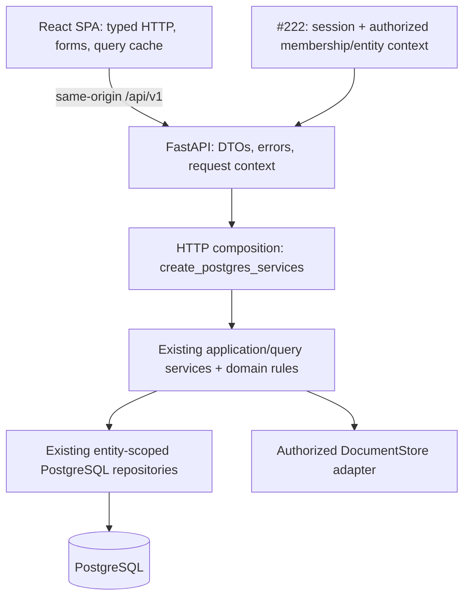

# ADR 0002: Commercial web stack and runtime topology

Status: Selected implementation contract for #276; subject to maintainer review.
Date: 2026-10-07.

Issue: [#276](https://github.com/Roklion/Project_Tabula_Rasa/issues/276), under
[web/API EPIC #221](https://github.com/Roklion/Project_Tabula_Rasa/issues/221)
and [commercialization initiative #124](https://github.com/Roklion/Project_Tabula_Rasa/issues/124).

## Context and scope

#219 completed the persistence-neutral application boundary. #220 supplies
canonical PostgreSQL repositories, including the core #245/#246/#247 paths.
This decision unblocks #277 API, #278 browser shell, and #279 deployment without
waiting for long-tail migration or production activation. It selects their
implementation contract; those tickets build the runtime. No HTTP endpoints,
browser workflows, identity system, infrastructure resources, or cutover are
implemented by this ADR.

The existing Streamlit/Sheets application remains the operational internal
edition and a behavioral reference. Commercial HTTP contracts represent domain
resources and commands, never worksheet rows, Streamlit session state, reruns,
or local profile configuration. Simple Ledger remains an input/display model
over canonical postings. Accounting rules remain in Python application/domain
owners.

Read with [Architecture](../ARCHITECTURE.md), [ADR 0001](0001-canonical-accounting-schema.md),
[PostgreSQL concurrency](../POSTGRESQL_CONCURRENCY.md), and the
[commercial development/deployment contract](../COMMERCIAL_WEB.md).

### Existing owners and reuse

| Inspected implementation | Responsibility retained |
| --- | --- |
| `application/services.py` and domain services/contracts | `ApplicationServices`, bookkeeping validation, orchestration, and query behavior. |
| `infrastructure/postgres/composition.py`, `config.py`, `runtime.py` | Explicit entity-scoped service composition, safe database settings, one pool per process, adapter-owned operation/commit boundaries. |
| `composition.py`, PostgreSQL cutover controller, `infrastructure/entity_documents.py` | Trusted migrated-profile authority/environment checks and entity-to-existing-document-store binding; preserve #258 activation controls. |
| `application/baselines.py`, PostgreSQL operation guards | Portable loaded-record token and stale/missing-baseline enforcement; #280 transports these through real forms. |
| `application/documents.py` and PostgreSQL receipt metadata adapter | `DocumentStore`, portable document identity, recoverable upload/link outcomes; metadata in SQL, bytes outside SQL. |
| `design.md`, current pages and canonical architecture/developer guides | Product character, accounting behavior, responsive/accessibility baseline, reference workflows, validation and migration policies. |

Reuse these owners directly. New logic belongs to HTTP transport/composition,
browser presentation/state, generated transport types, and release packaging.
There is no new parallel domain algorithm, repository facade, transaction
manager, retry/recovery state machine, or commercial profile-permission model.

## Selected stack

| Concern | Decision |
| --- | --- |
| Browser | React with strict TypeScript; Vite build/dev server; client-rendered SPA. |
| Routing | React Router Data Mode (`createBrowserRouter`); loaders may delegate to the query cache, never own a second data layer. |
| Remote state | TanStack Query over `openapi-fetch`; native Fetch underneath. Entity-qualified query keys and explicit invalidation. |
| Forms | React Hook Form; native input semantics and small presentation validation. Python remains authoritative for domain rules. |
| Styling | Shared CSS custom properties and CSS Modules using `design.md` tokens; native semantic HTML. No mandatory UI kit or second design system. |
| Browser toolchain | Node.js 24 LTS and npm; one `web/package.json` and committed `web/package-lock.json`; `npm ci` in CI/builds; ESLint with TypeScript/React Hooks rules. |
| HTTP API | Python 3.12, FastAPI, Pydantic v2 transport DTOs, Uvicorn ASGI server. |
| Persistence | Existing synchronous SQLAlchemy Core/Psycopg/Alembic PostgreSQL infrastructure; PostgreSQL 18 baseline. |
| Contract generation | FastAPI OpenAPI export, `openapi-typescript` generation, `openapi-fetch` typed client; no handwritten duplicate TypeScript response models. |
| Testing | Existing pytest/Ruff plus API tests; Vitest/React Testing Library for browser logic, Playwright for browser workflows. |
| Hosting | Render Docker web services; suitable free tiers are permitted for technical development/staging under the stage-specific amendment below. Paid capacity and recovery guarantees remain a separate commercial activation gate. Neon managed PostgreSQL; separate environments. |
| Release | One container per environment containing the compiled SPA and Python API. Node is build-only. |

#277/#278 pin compatible stable library releases and container patch/digest
versions when scaffolding; no `latest` production dependency or floating install.
They retain these framework/runtime families. Ordinary patch/security upgrades
do not reopen this ADR; a framework/provider/topology replacement requires an
amendment with evidence of a material blocker.

React documents the tradeoffs of a Vite-built app without an SSR framework.
We accept the explicit routing/data choices here because the bookkeeping app
is an authenticated work surface without a search-indexing requirement.
[React build guidance](https://react.dev/learn/build-a-react-app-from-scratch),
[React Router modes](https://reactrouter.com/start/modes),
[TanStack Query](https://tanstack.com/query/latest/docs/framework/react/overview),
[Node releases](https://nodejs.org/en/about/previous-releases),
[React Hook Form](https://github.com/react-hook-form/react-hook-form).

### Rendering and client state

No server rendering, React Server Components, Node BFF, or browser-to-database
connection. Public marketing can have a separate implementation later without
changing bookkeeping contracts. Browser routes use history navigation; the
Python HTTP composition serves the compiled SPA as well as API routes.

Keep remote state in the query cache, navigation/filter state in the URL where
useful, and draft/selection state in the form/component. Do not introduce a
global Redux-style store, persisted ledger cache, or offline write queue for
alpha. Clear private cache, drafts and pending selections on logout, membership
change or entity switch. Query keys include authorized entity identity and must
not reuse results across users/sessions.

Capture a loaded baseline separately from editable fields. Background refetches
must not replace a dirty form's baseline or draft. Success invalidates affected
entity/resource queries; validation/conflict preserves the draft and shows an
explicit review/reload action. An unavailable/uncertain mutation never triggers
an automatic client retry or success notice. Disable query-library mutation
retries; bounded read retries may be used for transient read failures.

## HTTP/application boundary

`tabula_rasa/http/` is the transport package. Its composition root constructs
one `Database` per API process at lifespan startup, calls
`create_postgres_services(database, authorized_entity_id, ...)` for a resolved
request scope, and disposes the pool at shutdown. A service graph containing an
entity or credential binding is never a process-global default. The shared pool
is deployment configuration; repository/service contexts remain entity-scoped.

For migrated profiles, enter through the existing `create_application` trusted
composition (which calls the PostgreSQL factory) so #258's recorded authority,
environment/database and document-folder binding checks remain enforced. Do not
bypass them by calling the low-level factory directly. Fresh synthetic entity
fixtures use explicit test/development composition without claiming a migrated
profile's acceptance or activation. New customer onboarding/authorization is
#222; legacy profile configuration is never part of the browser contract.
See [Bookkeeping acceptance and cutover](../BOOKKEEPING_CUTOVER.md).

The #299 owner-operated procedure uses this same production application and
authorization seam with non-commercial recovery acceptance. The existing stored
`rehearsal` cutover value supports persistent authority independently of HTTP
environment names; it does not relax request authorization or select a different
runtime. `open_migrated_runtime` extends the existing pool/composition owner for
that integration. #294 supplies the separately verified NAS recovery route;
#298 retains commercial evidence/sign-off. Neither the factory nor the named
procedure supplies missing identity, deployment or browser workflows.

Handlers validate/translate DTOs, obtain authorized context, call the existing
service, and map committed results/errors. They do not issue SQL, compute
postings/balances/depreciation, bootstrap workbooks, or orchestrate new storage
retries. Concrete infrastructure imports stay in HTTP composition; application
and domain modules import no FastAPI/Pydantic transport model or ORM type.
Repositories retain their supported transaction boundaries. Do not wrap every
request in a transaction: reporting needs its own read-only snapshot, and
recurring occurrences commit independently.

The services and database adapters are synchronous. Run a complete service
invocation in a synchronous handler (`def`) or one explicitly offloaded call;
do not call blocking database services directly from `async def`, or split an
operation across threadpool calls/context boundaries. Middleware may be async.
FastAPI documents its synchronous handler
[threadpool behavior](https://fastapi.tiangolo.com/async/).

### Transport contract

Reserve `/api/v1` for JSON resources and explicit command routes, with entity
paths such as `/api/v1/entities/{entity_id}/accounts`. A path ID selects the
requested resource; server-side membership resolution determines whether it
can be used. Body fields, query parameters, profile keys, headers and baseline
tokens never prove authorization. Reject disagreement with resolved context.

Pydantic models belong to `http/models/`, with explicit request/response mapping.
Do not serialize service dictionaries wholesale. Represent IDs and baselines
as opaque strings, dates as ISO `YYYY-MM-DD`, instants as UTC ISO strings, and
money/other exact decimal quantities as decimal strings. JavaScript floating
point must not become the accounting calculation owner. SQL versions, provider
locators, credentials, and worksheet representations are not transport fields.

For protected interactive edit/delete/merge commands, require the original
loaded `baseline` separately from changes and pass it as the service's existing
`expected` input. Multi-record commands carry the complete applicable baseline
set. Never read a fresh token on submission to manufacture compliance. #280
implements/validates this bridge, including two independently loaded clients;
it closes #253's caller dependency independently of the full web epic.

#277 establishes one error envelope: `error.code`, safe `error.message`, optional
field errors, and `request_id`. Map malformed/transport or domain validation to
422, not found to 404, missing identity to 401, denied membership to 403, stale
conflict to 409, unavailable storage to 503 and unexpected failure to a generic
500. Preserve `baseline_required`, `baseline_invalid` and `stale` as stable
codes (422, 422, 409 respectively). Do not leak raw exception strings, submitted
values, SQL, document contents, or credentials in errors/logs. #277 owns the
complete domain-code mapping rather than treating every storage error alike.

Export deterministic OpenAPI without database/credential access to
`contracts/http/openapi.json`; generate `web/src/api/schema.d.ts` from it.
Commit both generated artifacts. #277 owns export and #278 owns generation;
CI regenerates/checks the pair for drift and type-checks the web client.
Use a schema-only composition with no production settings, network calls or
lifespan startup. Generated types describe transport only; runtime validation
remains server-side. Development schema/docs are available; hosted interactive
docs/schema are restricted by the deployment/session gate.
[openapi-typescript](https://openapi-ts.dev/introduction) and
[openapi-fetch](https://openapi-ts.dev/openapi-fetch/).

## Deployment decision

Use one same-origin Render **Docker web service** per hosted environment, with
Neon as the external managed database. The multi-stage image builds `web/dist`
with Node, then copies it into the Python runtime. Uvicorn serves `/api/v1`,
health/version endpoints, static assets, and the SPA entry point. Render provides
TLS termination; only the Python HTTP port is exposed. There is no runtime
Node service, Nginx tier, Render Static Site, Kubernetes or Redis dependency.

Serve hashed assets with immutable caching, the SPA entry point with
revalidation, and private API/session/document responses with `Cache-Control:
no-store`. Route API, auth, health and assets before SPA fallback. Only browser
navigation GET/HEAD requests accepting HTML may receive `index.html`; unknown
API routes/methods and missing assets return their actual errors. Directory
index serving alone is not a history-route fallback.
[Starlette StaticFiles](https://www.starlette.io/staticfiles/).

The browser always calls relative `/api/v1` URLs. CORS is disabled by default;
local Vite proxies API calls to loopback rather than using a second browser
origin. A future distinct API origin is an ADR change, not a per-feature choice.
Validate the configured public origin/Host and trust forwarded headers only
from the hosting proxy, with its ingress boundary documented/tested by #279.
Start with one Uvicorn worker per container, horizontally scalable once #223
proves the required operational behavior. Budget database pools across all
workers/instances; sessions and durable jobs cannot live only in process memory.

The 2026-10-07 stage amendment in #124/#221/#279 permits suitable free-tier
Render/Neon capacity for technical development/staging, with persistent
PostgreSQL and plan limitations recorded at the operator checkpoint. Use
continuously available capacity when the intended usage requires it. Commercial
production capacity/recovery acceptance remains separately owned by #224/#298.
The earlier 2026-10-07 operator amendment permits Neon Free for
the current pre-activation stage: production and retained UAT use distinct
branches/endpoints in one Neon project, with separately scoped connection
configuration and access controls. The production root is the #259 recovery
source; isolated recovery targets must not overwrite production or retained UAT.
Keep synthetic non-production data only and no automatic production cloning.
Shared-project administration, capacity and recovery-history limits create a
common operational boundary; branches are not an independent project-access
boundary. Before commercial activation under #220/#258/#223, review and approve
environment isolation, roles/secrets and operational blast radius; separate
projects remain the proposed stronger isolation direction, rather than a
prerequisite for the current Free-plan drills. The later stage amendment extends
plan flexibility to technical Render hosting without changing provider/topology.
See [the recovery contract](../POSTGRESQL_RECOVERY.md) for current Free-plan
limits and the future protection/objective gates.
Start with direct/unpooled TLS connections and the existing small application
pool. Pooler adoption requires verifying the implemented transaction/migration
contract. Select Neon PostgreSQL 18 and geographically close Render/Neon US
regions during #279 provisioning; confirm availability and connection limits at
the manual checkpoint. Provider selection is settled; account IDs, resource
names, domain ownership, capacity and recovery-plan procurement are operator
configuration. No resources or paid plans are purchased by this decision.

This fits the existing Neon UAT configuration direction in
[PostgreSQL development](../POSTGRESQL.md#local-setup). The operator-selected Neon
UAT environment completed #254's synthetic two-profile framework drill on
2026-10-06, as recorded in the migration guide. That evidence does not establish
a deployed commercial browser/API or realistic migrated-profile acceptance.
#279 verifies an explicitly authorized compatible staging target or provisions
a separate one, preserving the retained UAT database and deployed migration
chain. Remaining source reconciliation/acceptance and recovery gates stay with
their owners; do not repeat or relabel the completed framework checkpoint.
[Render Docker hosting](https://render.com/docs/docker),
[Render deployment lifecycle](https://render.com/docs/deploys),
[Render prebuilt images](https://render.com/docs/deploying-an-image),
[Neon environment branching](https://neon.com/branching).

### Release and environment separation

GitHub Actions builds a `linux/amd64` image into GitHub Container Registry
(GHCR). Render consumes it as an image-backed service (`runtime: image`), pinned
by digest; it does not rebuild source independently per environment. CI triggers
hosted dev after validated `main`; staging promotes an explicit tested digest;
production later promotes that same staging-tested digest. Builds receive no
database or identity secrets. #279 implements image delivery and explicit
promotion, with deploys serialized per environment. Retain registry digests
needed for rollback. A release records Git SHA/image digest and expected
Alembic head. Retain the authoritative current-revision CI full-suite gate and
native PostgreSQL checks described in [Development](../DEVELOPMENT.md#authoritative-ci-and-required-check);
browser/API quality checks grow with #277/#278/#287. Affected local validation
supports development while CI and advisory review proceed concurrently.

Migrate explicitly in the deployment lifecycle; never at startup.
The deployment workflow runs the existing PostgreSQL `current`,
`upgrade`, and `health` commands with a separate migration-role secret. A failed
migration/readiness check stops promotion; a failed post-deploy smoke stops
further promotion and redeploys the prior schema-compatible image. Render's
pre-deploy command is a lifecycle seam, not permission to give
schema privileges to the running application: #279 runs the migration in a
separate controlled job, then triggers the application deployment. Do not make
the migration secret available to the application container.

Schema changes use expand/contract while old/new code may overlap. Readiness
accepts only schema revisions explicitly declared and tested compatible by the
image, initially just the current Alembic head. For a schema-changing release,
deploy a compatibility bridge supporting the old and target revisions before
migrating; then deploy the target image. An old image's strict head-only check
must not unexpectedly remove it from service during that overlap. If compatible
overlap cannot be demonstrated, use an explicit maintenance/drain procedure
instead of attempting a rolling deploy. Application
rollback redeploys a prior compatible image; it never automatically downgrades
or restores a database. Real recovery/PITR and document recovery are #259/#223;
production activation follows [#258's cutover contract](../BOOKKEEPING_CUTOVER.md),
with #253/#257/#259/#260/#261 evidence.
Selecting Neon does not establish a recovery guarantee or pass a restore drill.

## Identity/session integration seam (#222)

#277 defines a replaceable server-side context resolver returning an immutable
actor/organization/entity/capability context. It checks the requested entity
against authenticated active membership **before** composing services or
binding document/OAuth credentials. Missing/denied context fails closed. List
and command routes share it; no anonymous/default entity fallback is permitted.
Membership changes/revocation must be reflected server-side, not only by hiding
browser navigation. Persisted identity, membership, roles, invitations and the
identity provider are #222's decisions/implementation.

Reserve `/api/v1/session` and `/api/v1/auth/*` for that integration. Use a
server-managed opaque session in a host-only HttpOnly, Secure, SameSite=Lax
cookie (`__Host-tabula_session`, `Path=/`, no `Domain`) on hosted HTTPS. No bearer
or refresh tokens in localStorage or ledger query state. Store/revoke sessions
durably under #222; the browser receives only safe identity/context and a
session-bound CSRF token. Unsafe browser requests require the CSRF header and
validated Origin; OAuth callbacks use the provider flow's state/nonce checks.
Exact expiration, provider callback and recovery policies remain #222. Plain
loopback development uses an explicitly separate non-Secure development cookie;
never relax hosted cookie policy because local HTTP needs it.

Before #222, #277 tests/local development may inject a fixed trusted synthetic
entity context. Enable it only in explicit development/test mode on loopback.
Hosted dev/staging alpha may use the same fixed synthetic scope only behind a
temporary **deployment-wide HTTP Basic gate over TLS**, implemented by #279,
covering browser, API, schema and document paths (health probes excepted).
Credentials are environment-specific server secrets, not the Streamlit password.
Origin/CSRF protections still apply to unsafe requests. No request can choose a
different trusted scope. The gate provides operator access, not commercial
users/memberships; production rejects trusted-context mode entirely. #222
replaces it before external beta or customer data. Do not expose ungated
bookkeeping routes while waiting for commercial identity.

## Operations integration seams (#223)

#277 supplies a bounded server-generated request ID, returned as `X-Request-ID`
and in errors. An external supplied correlation value is untrusted: normalize
and bound it separately rather than using it as actor/entity identity or raw
log text. Structured JSON logs contain request ID, method, route **template**,
status, duration, release and safe failure code; no raw URLs/query strings,
request/response bodies, cookies, Authorization headers, database URLs or
receipt/ledger contents. Actor/entity identifiers are added only from trusted
context under #223's data-minimization policy. Disable/sanitize default access
and exception logging that would bypass this allowlist. Browser errors retain
safe request IDs without sending draft values to telemetry.

Reserve `GET /health/live` for process liveness, `GET /health/ready` for bounded
database connectivity plus declared compatible-schema checks, and
`GET /version` for public safe release identity. Readiness returns 503 for unavailable/incompatible
database and never runs migrations; use it as Render's health check. Probes
expose only minimal safe status and perform no bookkeeping reads/writes.
Document-store/identity dependency diagnostics and metrics belong to #223, not
a remote-service scan on every health request.
[Render health checks](https://render.com/docs/health-checks).

Background work is a separately deployed worker/scheduler using the same Python
application services and authorized entity scope. Never start recurring
reconciliation on API/browser startup, page loads, or per-replica timers, and
never treat FastAPI in-process background tasks as durable jobs. #223 selects
queue/scheduler technology and owns durable IDs, retry policy, run history,
audit and alerts; this ADR reserves `tabula_rasa/jobs/` and a separate worker
release/process boundary without installing a queue in alpha. Carry trusted
actor/entity and correlation context into jobs, not a browser session or SQL
connection. SQL metadata and external document bytes retain separate ownership.

## Browser and responsive baseline

Technical alpha supports the latest two stable desktop Chrome, Edge, Firefox
and Safari versions, plus current/previous major iOS Safari and Android Chrome
on current/previous supported Android major releases. Re-evaluate actual tested
versions at each release; no IE, embedded webview, offline/PWA guarantee or
native mobile app is promised. Use Vite's standard modern browser target only
when it covers this matrix; #287 checks features/polyfills against it.

Preserve `design.md`'s desktop-first tables and approximately 760px stacking
boundary. Validate 1440x1000, 1200x900, 900x900 and 390x844, plus 320 CSS px
reflow/zoom. Forms stack, navigation collapses accessibly, table containers may
scroll, and essential accounting columns/actions remain reachable without
page-level horizontal overflow. Keyboard access, visible focus, semantic labels,
error association, non-color status, touch-accessible controls and WCAG 2.2 AA
are the new shell's target. #278 supplies reusable primitives; #287 verifies
bounded Chromium/Firefox/WebKit E2E and actual mobile Safari/Chrome smoke
coverage. Emulation alone does not certify real-device support. Streamlit-only
widget/CSS instructions do not constrain React components.

## Alternatives and consequences

| Alternative | Why not selected for v1 |
| --- | --- |
| Extend Streamlit into commercial identity/front end | Initiative #124 requires beta on the future browser stack; rerun/session semantics would constrain new contracts. |
| Next.js/SSR or a Node BFF | Adds a server/auth/data boundary without a bookkeeping SEO need; Python already owns services and API. Revisit if server rendering becomes a demonstrated requirement. |
| Django/DRF | Useful integrated admin/auth ecosystem, but its ORM/project conventions overlap an established service/Core/Alembic architecture. FastAPI is a smaller transport addition. |
| Flask plus handwritten schemas/client | Viable, but requires separately assembling the selected typed validation/OpenAPI/client seam. |
| Vue/Svelte or HTMX server templates | Viable UI choices; React's routing/query/form ecosystem fits dense interactive tables/forms and browser tests. Choosing one now avoids feature-by-feature framework drift. |
| Separate static host and API origins | Adds CORS/cookie/origin configuration and release skew; same-origin compiled assets are sufficient for alpha. |
| Render-managed PostgreSQL / full AWS stack | Neon aligns with the repository's UAT direction; AWS adds IAM/network/operations setup before alpha. Neither supplies a material benefit that warrants changing the selected baseline now. |
| Kubernetes, microservices, Redis/queue from day one | Adds operating burden without current scale evidence; #223 owns durable jobs when implemented. |

Costs/tradeoffs: two language toolchains, explicit SPA routing/cache/form
conventions, Python serving static assets initially, and combined web/API release
cadence. Render/Neon add paid-provider and cross-provider connectivity/recovery
work. The portable image, ordinary PostgreSQL, transport-only OpenAPI, and narrow
composition boundary keep a later provider move possible without copying domain
logic. These tradeoffs are accepted for independently merged/deployed vertical
slices, not a long-lived rewrite branch.

## Follow-on ownership and decision gate

| Ticket | Implement against this contract |
| --- | --- |
| #277 | `http/` app/composition, DTO/error/context seams, OpenAPI export, health and request IDs; representative PostgreSQL delegation tests. |
| #278 | `web/` Vite shell, Router/Query/client/form primitives, generated types, design tokens and responsive smoke tests. |
| #279 | Render/Neon environment provisioning, image/migration/promotion workflow, temporary alpha gate, secret injection and real persistent staging smoke. |
| #280 | Loaded baseline response/form/mutation bridge and missing/stale failures; explicit #253 closure dependency. |
| #281/#282/#283 | Entity/reference, core ledger/reports, essential documents; default technical-alpha workflow set. |
| #284/#285/#286 | Recurring/mixed-use, assets and mileage slices; do not gate initial alpha unless scope explicitly expands. |
| #287/#288 | Browser quality and staging alpha integration; explicit Streamlit feature/retirement boundary. |
| #222/#223/#224 | Commercial membership/session/onboarding; jobs/audit/operations/recovery; external beta/paid customer lifecycle respectively. |

#276 is satisfied by this decision and its linked runnable-now/planned-command
guide. Scaffold/start/deploy evidence belongs to #277/#278/#279. Accounts,
credentials, DNS and retained database setup are an explicit #279 operator
checkpoint, not grounds to silently select another provider or an in-memory
staging substitute. The first alpha does not certify external-beta readiness,
production authority or retirement of remaining Streamlit-only workflows.
