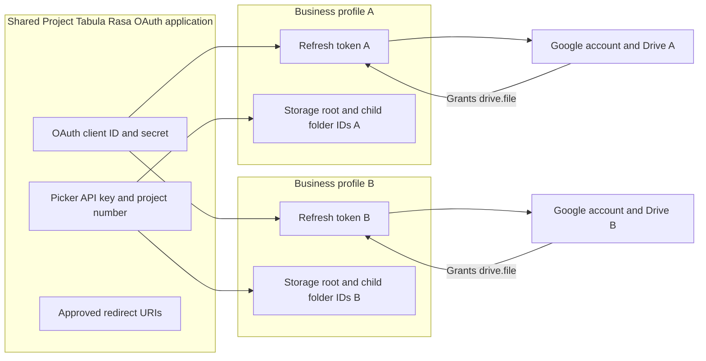
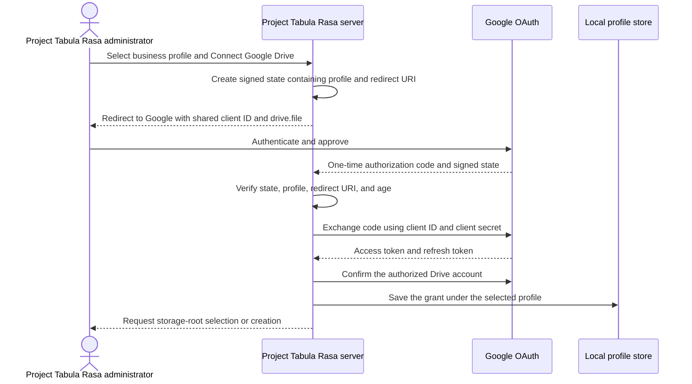
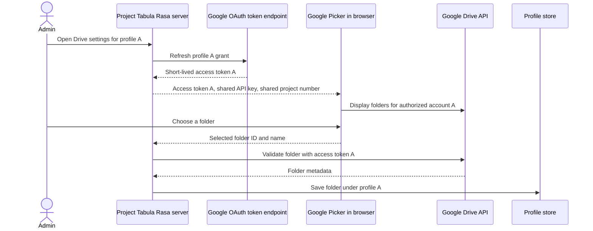
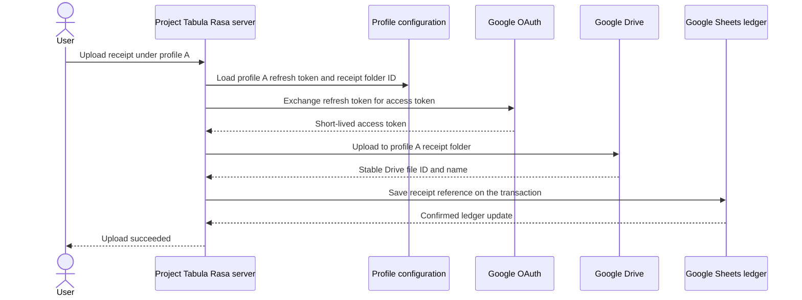

# Google Drive OAuth and per-business access

This guide explains how one Project Tabula Rasa OAuth application accesses separate
Google Drives for multiple business profiles. It is also the setup and
operations guide for Google Picker, per-profile storage roots, receipt folders, cloud backup folders,
token lifecycle, and production publishing.

Google Sheets authentication is separate. Each profile's Sheets service account
continues to read and write its ledger workbook; OAuth is used only for
human-owned Google Drive files.

## Mental model

| Component | Question it answers | Ownership |
| --- | --- | --- |
| OAuth client ID | Which application is requesting access? | Shared by Project Tabula Rasa |
| OAuth client secret | Can the server prove it is that application? | Shared and server-side only |
| Human Google account | Whose Drive is being authorized? | Chosen independently per profile |
| Refresh token | Which persistent permission grant belongs to this profile? | Stored separately per profile |
| Access token | What may this request do right now? | Short-lived and derived per profile |
| Picker API key | Which browser application is using Google Picker? | Shared and browser-visible |
| Cloud project number | Which Drive application is Picker associated with? | Shared and not secret |
| Storage root ID | Which profile-owned Drive folder contains app-managed children? | Selected or created and stored per profile |
| Child folder IDs | Where should this profile store receipts and backups? | Provisioned under the root and stored per profile |

The OAuth client identifies Project Tabula Rasa; it does not identify a business and
does not grant Drive access by itself. Each business's Google account grants the
shared application an independent permission, represented by that profile's
refresh token.

## Shared and per-profile configuration



The application-wide values are configured once:

- Google Cloud project;
- OAuth client ID and client secret;
- redirect URIs;
- Picker browser API key; and
- numeric Cloud project number.

Every business profile stores its own:

- authorized Google account name and email;
- refresh token;
- granted scopes;
- optional storage root ID and name; and
- receipt folder ID and name; and
- backup folder ID and name.

Businesses may authorize different Google accounts while sharing the same OAuth
client. Profiles provision descriptive `Receipts` and `Ledger Backups` children
under the selected root using Drive app-properties identity, not folder names.
No business needs its own OAuth client, API key, or OAuth Cloud project.

## Authentication, authorization, and application access

Three independent controls are involved:

1. **Project Tabula Rasa authentication** checks the application password and permits
   entry to the deployment.
2. **Google authentication** lets Google confirm the human account through its
   own password, MFA, and account-selection flow. Project Tabula Rasa never sees those
   Google credentials.
3. **Google authorization** lets that account approve the `drive.file` scope
   for the shared Project Tabula Rasa OAuth client.

Google OAuth does not provide profile-level authorization inside Project Tabula Rasa.
The application currently treats every authenticated Project Tabula Rasa user as able
to select every configured profile. Use separate deployments or implement
profile-level application authorization when users must be restricted to
particular businesses.

## Initial authorization flow



The signed OAuth state binds the callback to one existing business profile and
one configured redirect URI. It expires after 10 minutes. The authorization
code is one-time input and is not persisted.

## Picker and folder-selection flow



Picker is created with:

```javascript
new google.picker.PickerBuilder()
  .setOAuthToken(accessTokenForSelectedProfile)
  .setDeveloperKey(sharedPickerApiKey)
  .setAppId(sharedCloudProjectNumber)
```

The access token determines which authorized Google account Picker uses. The
API key and project number identify the shared application and remain the same
for all profiles.

Only the short-lived access token and restricted browser API key reach Picker.
The OAuth client secret and persistent refresh token remain server-side.

## Receipt and backup access flow

After onboarding, the user does not need to approve every upload:



Cloud backups use the same token flow but the profile's backup folder ID. The
application creates and validates the ZIP before uploading it and tags managed
files with private app-properties for profile isolation and idempotent retry
handling.

## Permission scope

Project Tabula Rasa requests only:

```text
https://www.googleapis.com/auth/drive.file
```

This non-sensitive, per-file scope permits the application to work with files
and folders the user selects through the application or that the application
creates. It does not provide general access to every file in the account's
Drive.

The storage root and its receipt and backup children can remain **Restricted**. They do not need to be
shared with:

- the profile's Sheets service account;
- Google accounts used by other business profiles; or
- the public.

Current receipt and backup workflows support regular Google Drive folders owned
by the profile's authorized Google account. Organization-owned Google Workspace
Shared Drive folders are not supported in this release.

## Configure the shared Google Cloud project

Use a separate project such as `tabula-rasa-oauth-client`, rather than a project
dedicated to one business's Sheets service account.

1. Enable the **Google Drive API** and **Google Picker API**.
2. Open **Google Auth Platform** and configure Branding.
   Set **App name** to **Project Tabula Rasa**. This is the name Google shows
   on the consent screen; it comes from the Cloud project's OAuth branding,
   not from the Streamlit application code or its client-secret settings.
3. Choose **External** audience when profiles may use personal accounts or
   accounts outside one Workspace organization.
4. During initial Testing, add each human Drive-owning Google account as a test
   user. Do not add service-account `client_email` addresses.
5. Under **Data Access**, add only:

   ```text
   https://www.googleapis.com/auth/drive.file
   ```

6. Create a **Web application** OAuth client with these development and
   production JavaScript origins:

   ```text
   http://localhost:8501
   http://127.0.0.1:8501
   https://tabula-rasa.streamlit.app
   ```

7. Add the exact matching redirect URIs:

   ```text
   http://localhost:8501/
   http://127.0.0.1:8501/
   https://tabula-rasa.streamlit.app/
   ```

8. Create an API key for Google Picker. Restrict it to the Google Picker API
   and the three HTTP referrers above, using `/*` after each origin.
9. Record the OAuth client ID, client secret, API key, and numeric Cloud project
   number. The project number is under **IAM & Admin > Settings** and is not the
   project ID.
10. Before real use, open **Audience**, publish the app, and confirm its status
    is **In production**.

Replace the example Streamlit hostname with the actual deployment origin and
callback URI when they differ.

## Configure local app-wide secrets

Add the application-wide values to the ignored
`.streamlit/secrets.toml`:

```toml
app_password_hash = "scrypt$..."

[google_drive_oauth]
client_id = "CLIENT_ID.apps.googleusercontent.com"
client_secret = "CLIENT_SECRET"
redirect_uris = [
  "http://localhost:8501/",
  "http://127.0.0.1:8501/",
  "https://tabula-rasa.streamlit.app/",
]
picker_api_key = "PICKER_API_KEY"
project_number = "NUMERIC_CLOUD_PROJECT_NUMBER"
```

Never commit this file or paste its values into issues, logs, screenshots,
documentation, or business service-account JSON.

## Connect each business profile

Connections and folder changes are performed through the loopback-only profile
administrator:

```powershell
powershell -ExecutionPolicy Bypass -File scripts\run_local_profile_admin.ps1
```

Then:

1. Sign in to Project Tabula Rasa and open **Account settings**.
2. Re-enter the application password.
3. In the guided workflow, select the intended business profile and continue to
   its **Google Drive OAuth** step.
4. Select **Connect Google Drive**.
5. Sign in with the human Google account that should own that business's Drive
   files and approve access.
6. Back in Project Tabula Rasa, use the single Google Picker selection to choose a
   storage root, or create an app-managed root.
7. Choose **Provision storage folders**. Project Tabula Rasa creates or reuses the
   `Receipts` and `Ledger Backups` children under that root. Existing Drive files
   are not moved, merged, or deleted.
8. Repeat for every profile.
9. Export and replace hosted Streamlit Secrets after all intended changes:

   ```powershell
   python scripts\export_streamlit_secrets.py
   ```

Because Streamlit Community Cloud cannot safely write profile changes back to
its Secrets, connection, reconnection, folder selection, and disconnection are
performed locally and exported to the hosted deployment.

## Testing and production publishing

Testing mode is suitable only for initial development:

- every human Google account must be listed as a test user;
- the audience is limited to those users; and
- Drive grants using offline refresh tokens expire after seven days.

Production mode removes test-user allowlisting and the seven-day
testing-grant lifecycle. Normal tokens can still be revoked or invalidated.
Google Workspace administrators may independently block third-party
applications.

After publishing an existing project from Testing to In production:

1. reconnect every business profile once;
2. select or confirm its folders;
3. export the local profiles again; and
4. replace the hosted Streamlit Secrets document.

This replaces refresh tokens issued under the expiring Testing configuration.
The `drive.file` scope is non-sensitive and does not require the restricted
scope security assessment. Brand verification may still be required to display
the intended public application name and logo.

## Token and identifier lifecycle

| Value | Lifetime | Browser exposure | Storage |
| --- | --- | --- | --- |
| Client ID | Until rotated or deleted | Yes | App-wide secrets/configuration |
| Client secret | Until rotated or deleted | Never | App-wide secrets |
| Signed state | 10 minutes | Through redirect URL | Not persisted |
| Authorization code | One exchange | Through callback URL | Not persisted |
| Refresh token | Until revoked, expired, or invalidated | Never | Per-profile secrets |
| Access token | Short-lived | Temporarily supplied to Picker | Memory only |
| Picker API key | Until rotated or deleted | Yes; restrict by referrer and API | App-wide secrets/configuration |
| Project number | Stable project identifier | Yes | App-wide configuration |
| Storage root and child IDs | Until folders are removed or access changes | Root returned by Picker; children confirmed or created by the app | Per-profile configuration |

The local profile store is plaintext and relies on operating-system file
permissions. Keep it outside shared or automatically synchronized directories.
The hosted copy belongs only in Streamlit's encrypted Secrets settings.

## Revocation, reconnection, and rotation

### A business revokes access

The next refresh attempt fails and Project Tabula Rasa requests reconnection for that
profile. Its Sheets service-account access remains unaffected.

### A business changes Google accounts

Disconnect the existing profile grant, reconnect using the intended account, and
export hosted Secrets again. Root and child selections are preserved only when
the newly authorized account can confirm their availability, parent, and managed
identity metadata; otherwise choose or provision new destinations.

### A folder changes

Use the local Account settings page and its **Google Drive storage** section to
choose a new storage root and provision its managed children, then export hosted
Secrets again after the change.
Changing the stored destination does not move existing Drive files.

### The OAuth client secret is rotated

1. Update `.streamlit/secrets.toml`.
2. Confirm existing grants can refresh.
3. Reconnect affected profiles if Google invalidated their grants.
4. Export and replace hosted Secrets.
5. Retire the old secret only after validation succeeds.

### A profile is disconnected

The application asks Google to revoke the saved grant and removes the profile's
Drive settings locally. This does not delete its Drive files or affect its
Sheets service account.

## Security invariants

- Google passwords and MFA responses are handled only by Google.
- The OAuth client secret and refresh tokens never enter Picker.
- The API key is treated as browser-visible and restricted by API and HTTP
  referrer.
- OAuth callbacks accept only a valid, recent signed state and configured
  redirect URI.
- Refresh tokens, authorized account details, and root/child folder IDs remain isolated
  under their business profile.
- The selected business profile determines the refresh token and folder used
  for every Drive operation.
- Drive file IDs are validated against the profile's authorization before they
  are saved.
- Receipt and backup operations use app-properties and profile identifiers to
  avoid cross-profile listing and unsafe retry behavior.
- No OAuth token or secret is written to the ledger workbook.

## Troubleshooting

### Google rejects the callback URI

Confirm the browser's current origin has an exact configured redirect URI in
both Google Cloud and `.streamlit/secrets.toml`. Production callbacks must use
HTTPS.

### Picker opens the wrong Google account

Reconnect the selected profile using the intended account. Picker uses the
access token supplied by the profile, even if several Google accounts are
signed into the browser.

### Google does not issue a refresh token

Revoke the prior grant in the Google account and reconnect. The application
requests offline access and explicit consent; a missing refresh token cannot be
used for persistent Drive operations.

### A grant expires every seven days

The OAuth project or original grant is still associated with Testing mode.
Publish the application In production, reconnect the profile, and export hosted
Secrets again.

### A selected folder cannot be validated

Confirm the folder is a regular folder owned by the authorized account and is
not available only through **Shared with me**, a shortcut, **Computers**, or a
Google Workspace Shared Drive.

### The hosted app still shows old folders or tokens

Run `scripts\export_streamlit_secrets.py` after the local change and replace the
complete Streamlit Secrets document. The hosted application cannot update those
values itself.

## Implementation map

| Responsibility | Implementation |
| --- | --- |
| OAuth configuration, state, code exchange, refresh, and Drive operations | [`tabula_rasa/google_drive.py`](../../tabula_rasa/google_drive.py) |
| Callback handling and per-profile connection administration | [`tabula_rasa/google_drive_admin.py`](../../tabula_rasa/google_drive_admin.py) |
| Browser Picker component | [`tabula_rasa/google_drive_picker.py`](../../tabula_rasa/google_drive_picker.py) |
| Local per-profile credential persistence | [`tabula_rasa/local_profile_store.py`](../../tabula_rasa/local_profile_store.py) |
| Hosted Secrets export | [`scripts/export_streamlit_secrets.py`](../../scripts/export_streamlit_secrets.py) |
| OAuth and Drive test coverage | [`tests/test_google_drive.py`](../../tests/test_google_drive.py) |

## Official references

- [Manage app audience](https://support.google.com/cloud/answer/15549945)
- [Google OAuth verification](https://support.google.com/cloud/answer/13463073)
- [Choose Google Drive API scopes](https://developers.google.com/workspace/drive/api/guides/api-specific-auth)
- [Integrate Google Picker into web applications](https://developers.google.com/workspace/drive/picker/guides/web-picker)
- [Google API Services User Data Policy](https://developers.google.com/terms/api-services-user-data-policy)
