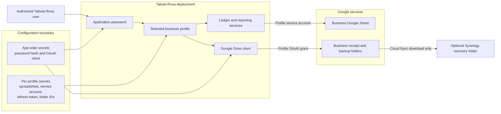
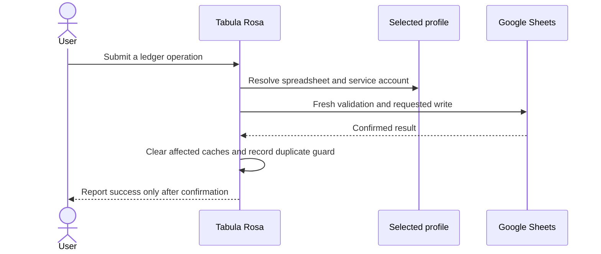
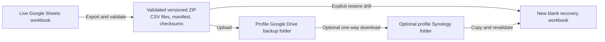

# Architecture overview

Tabula Rosa is a single Streamlit application that serves one or more isolated
business profiles. Each profile selects its own Google Sheets workbook,
service-account credential, optional Google Drive authorization, and recovery
destinations.

## System context

The application password authenticates entry to the deployment. It currently
grants access to every configured profile; it does not provide per-profile user
authorization. The selected profile determines which credential and storage
objects every subsequent operation uses.

## Storage and identity boundaries

| Concern | Identity or credential | Data location | Scope |
| --- | --- | --- | --- |
| Application sign-in | Application password hash | App-wide secrets | Entire deployment |
| Ledger reads and writes | Profile service account | Profile Google Sheet | One shared spreadsheet |
| Receipts and cloud backups | Shared OAuth client plus profile refresh token | Profile Google Drive folders | Files selected or created through the app |
| Local configuration | Operating-system file permissions | `.streamlit/secrets.toml` and `.streamlit/business_profiles.json` | Local deployment |
| Hosted configuration | Streamlit Secrets | Streamlit Community Cloud | Hosted deployment |
| NAS recovery | DSM account and separate Google authorization in Cloud Sync | Profile-specific Synology folder | One configured Drive folder |

The Sheets service account and human Google Drive authorization are deliberately
separate:

- the service account edits the ledger workbook;
- the human Google account owns and selects receipt and backup folders; and
- neither credential automatically grants the permissions of the other.

See [Google Drive OAuth and per-business access](GOOGLE_DRIVE_OAUTH.md) for the
complete identity, token, Picker, and file-access flow.

## Ledger data flow

The active ledger is never stored in a local SQLite database. Accounts,
categories, transactions, mileage, and receipt references remain in the
profile's Google workbook.

## Receipt data flow

The receipt file and its ledger reference have different sources of truth:

1. The file is uploaded to the profile's selected Google Drive receipt folder.
2. Google Drive returns a stable file ID and display name.
3. The transaction stores that reference in the `Transactions` worksheet.
4. Removing a receipt from a transaction removes only the reference. The Drive
   file remains available for relinking.

Files are tagged with private app-properties so the application can find
profile-managed receipts and safely recover from uncertain upload responses.

## Backup and recovery boundaries

Backups are recovery artifacts, not alternate live ledgers. Restoration always
targets a new blank workbook and refuses the configured live workbook. Follow
[Backup and recovery](../operations/BACKUP_AND_RECOVERY.md) for the operational
procedure.

## Reliability invariants

- Related worksheet reads use one multi-range request when available.
- Reads are cached for 10 seconds and affected caches are cleared immediately
  after confirmed writes.
- Edits, deletions, uniqueness checks, and reference checks force a fresh read
  before writing.
- Temporary network and quota failures are retried up to four times with
  exponential backoff.
- Identical completed submissions are suppressed for 10 seconds within the
  same application session and business profile.
- CSV imports and default seeding use batch appends after complete validation.
- Availability errors remain generic, and success is reported only after the
  Google API confirms the write.

An append-only audit worksheet is intentionally deferred. A separate audit
append cannot be guaranteed atomic with its ledger write and could therefore
produce a misleading history. Verified versioned ZIP backups are the current
recovery record.

## Accounting behavior

- Transfers change account balances but do not affect income or expenses.
- Mileage is maintained separately from financial transactions.
- Accounts and categories support exactly two levels. Parent and child accounts
  share a balance-sheet classification; parent and child categories share an
  Income or Expense kind.
- Transactions may reference either layer by stable ID. Reparenting changes
  presentation grouping without rewriting transaction foreign keys.
- Account family totals combine a Layer 1 direct balance with its Layer 2 direct
  balances. Balance-sheet grand totals use every direct account balance once and
  never sum family totals together with their children.
- Category summaries group Layer 1 direct activity and Layer 2 direct activity
  once, while retaining both components for detail views.
- Account subtype and balance-sheet classification are stored separately.
- Bank and Cash accounts are assets.
- Credit card and Short-term debt accounts are liabilities.
- Equity accounts are equity.
- The flexible Other subtype may be classified as an asset, liability, or
  equity.
- Asset opening balances should normally be positive.
- Liability and equity opening ledger balances should normally be negative;
  reports present them as conventional positive balances.
- Current earnings are income minus expenses and are included in total equity.
- Reports flag any difference in `Assets = Liabilities + Equity`.
- This is a record-keeping tool, not tax or accounting advice.

## Implementation map

| Area | Primary implementation |
| --- | --- |
| Streamlit application and workflows | [`tabula_rasa/app.py`](../../tabula_rasa/app.py) |
| Business-profile selection | [`tabula_rasa/business_profiles.py`](../../tabula_rasa/business_profiles.py) |
| Local profile storage | [`tabula_rasa/local_profile_store.py`](../../tabula_rasa/local_profile_store.py) |
| Google Sheets storage and backup format | [`tabula_rasa/storage/google_sheets.py`](../../tabula_rasa/storage/google_sheets.py) |
| Google Drive OAuth and file operations | [`tabula_rasa/google_drive.py`](../../tabula_rasa/google_drive.py) |
| Google Picker component | [`tabula_rasa/google_drive_picker.py`](../../tabula_rasa/google_drive_picker.py) |
| Local profile and Drive administration | [`tabula_rasa/google_drive_admin.py`](../../tabula_rasa/google_drive_admin.py) |
