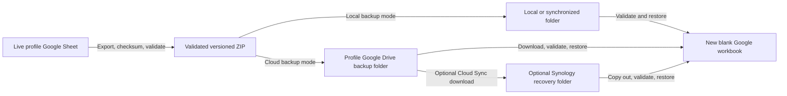

# Backup and recovery

Tabula Rosa creates validated, timestamped ZIP archives from a business
profile's live Google Sheets workbook. An archive can be downloaded manually,
written to local storage, uploaded to the profile's Google Drive backup folder,
and optionally copied to a Synology NAS.

Backups are recovery artifacts, not alternate live ledgers. Every restore must
target a new blank workbook.

## Recovery topology



Google Drive is the primary cloud-native backup destination. Local storage and
Synology are optional additional failure boundaries.

## Archive contents and compatibility

The current backup format is version 5. Each archive contains:

- `Accounts.csv`;
- `Categories.csv`;
- `Transactions.csv`;
- `Mileage.csv`;
- `receipts.json`; and
- `manifest.json`.

The manifest records:

- format version;
- UTC backup time;
- source workbook title;
- worksheet headers;
- row counts; and
- SHA-256 checksums for every CSV and `receipts.json`.

`receipts.json` is a profile-scoped metadata inventory. It records referenced
and intentionally unreferenced app-managed receipts, stable receipt identities,
the association from each transaction's `receipt_references`, original and
stored filenames, MIME types, byte sizes, SHA-256 checksums, old Drive file IDs,
and available Drive timestamps. It does not contain PDF or image bytes, so the
same large receipt files are not duplicated into every retained ledger archive.

Every manifest entry must have a checksum created during upload or a verified
legacy backfill. Backup creation fails rather than silently writing a
checksum-incomplete receipt inventory. Run the profile-scoped backfill before
retrying:

```powershell
.\.venv\Scripts\python.exe scripts\backfill_receipt_checksums.py `
  --profile PROFILE_KEY
```

The current validator and ledger restore path accept formats 2 through 5:

| Format | Contents |
| --- | --- |
| 2 | Accounts, Categories, and Transactions; predates Mileage and receipt references |
| 3 | Adds Mileage; predates transaction receipt references |
| 4 | Adds transaction receipt references; archives created before the receipt inventory remain ledger-only recovery sources |
| 5 | Current format; adds the checksummed `receipts.json` inventory without embedding receipt bytes |

Older compatible formats are migrated in memory during restore. A historical
format-1 archive must first be converted to format 2.

## Create a backup in the application

Open **Data & backup** for the selected business profile.

- **Download complete workbook backup** creates a validated ZIP for manual
  download.
- **Upload fresh backup now** creates, validates, and uploads a ZIP to the
  selected Google Drive backup folder.
- **Verify latest cloud backup** downloads the newest app-managed archive into
  the running application only long enough to validate its manifest, checksums,
  and stored Drive hash.

Cloud verification does not restore data, modify the live workbook, or download
the file to the browser.

## Create a local command-line backup

Create and validate a timestamped archive:

```powershell
python scripts\backup_google_sheets.py --profile PROFILE_KEY --output-dir backups\PROFILE_KEY --keep 30
```

When `--output-dir` is omitted, the command uses:

1. the profile's configured `backup_folder_path`; or
2. the ignored repository `backups/` directory.

The command:

- validates the archive before reporting success;
- uses an exclusive new timestamped filename;
- never overwrites an existing archive; and
- retains the newest requested generations.

`--keep` must be at least 2 and defaults to 30. Backups contain private ledger
data and must never be committed.

## Create a Google Drive command-line backup

The profile must first have a valid Google Drive authorization and selected
backup folder. Follow
[Google Drive OAuth and per-business access](../architecture/GOOGLE_DRIVE_OAUTH.md).

Create a verified cloud backup:

```powershell
python scripts\backup_google_sheets.py --profile PROFILE_KEY --google-drive --keep 30
```

The uploader:

- uses the profile's refresh token and backup folder;
- preserves the ZIP and manifest format;
- records the archive hash and profile in private app-properties;
- makes uncertain retries idempotent; and
- retains the newest requested app-managed generations.

Google Drive Desktop does not need to be installed or running for this mode.

## Schedule weekly backups

The provided Windows task registers Monday, Tuesday, and Wednesday at 10:00 PM
as retry opportunities for one weekly backup. `--once-per-week` verifies an
existing archive before accessing Google Sheets, so a successful Monday run
causes Tuesday and Wednesday to exit without creating duplicates.

### Cloud-native scheduled backup

```powershell
powershell -ExecutionPolicy Bypass -File scripts\register_weekly_backup_task.ps1 `
  -Profile PROFILE_KEY `
  -GoogleDrive `
  -TaskName "Tabula Rosa Cloud Backup - PROFILE_KEY"
```

### Local or synchronized-folder scheduled backup

```powershell
powershell -ExecutionPolicy Bypass -File scripts\register_weekly_backup_task.ps1 `
  -Profile PROFILE_KEY `
  -BackupDirectory "C:\Protected\Tabula-Rosa\PROFILE_KEY" `
  -TaskName "Tabula Rosa Local Backup - PROFILE_KEY"
```

Register a distinct task and destination for every profile. This prevents
archives with identical or nearby timestamps from different businesses from
being mixed together.

The task runs interactively. A local Google Drive Desktop or NAS-mounted path
is available only when the signed-in Windows session and mount are active. If
all three weekly opportunities fail, that week is skipped; starting the mount
after a missed run does not trigger an immediate catch-up.

Cloud-native mode uses Google APIs directly and is independent of Google Drive
Desktop.

## Validate a local archive

Validate any copied or downloaded archive before relying on it:

```powershell
python scripts\validate_google_sheets_backup.py "C:\Safe-Recovery\tabula-rosa-backup-YYYYMMDDTHHMMSSZ.zip"
```

Successful validation confirms:

- supported format;
- exact ZIP structure;
- manifest integrity;
- worksheet headers;
- SHA-256 checksums;
- row counts;
- record IDs; and
- ledger relationships;
- the receipt manifest schema, profile, identities, filenames, sizes, checksums,
  duplicates, and transaction associations; and
- whether an older archive is a ledger-only source without receipt recovery
  metadata.

Do not modify a failed archive. Preserve it for private investigation, choose a
different generation, and validate again.

## Restore into a new blank workbook

Never restore into the configured live workbook.

1. Create a new blank Google spreadsheet.
2. Share it as Editor with the selected profile's Sheets service-account email.
3. Copy its spreadsheet ID.
4. Validate the backup locally.
5. Restore with:

   ```powershell
   python scripts\restore_google_sheets_backup.py `
     "C:\Safe-Recovery\tabula-rosa-backup-YYYYMMDDTHHMMSSZ.zip" `
     --profile PROFILE_KEY `
     --target-spreadsheet-id NEW_SPREADSHEET_ID `
     --initialize
   ```

The command:

- validates before writing;
- refuses the configured live workbook;
- refuses populated or incompatible target worksheets;
- initializes missing required headers when `--initialize` is supplied;
- restores all supported tables; and
- rereads the target to verify restored rows.

Confirm the standard storage path can read the restored workbook without
changing the configured business:

```powershell
python scripts\validate_google_sheets.py `
  --profile PROFILE_KEY `
  --spreadsheet-id NEW_SPREADSHEET_ID
```

The override is read-only and reports the workbook title and sanitized row
counts. It cannot be combined with `--write-test`.

Open the recovery workbook and spot-check headers and representative
relationships. Delete it or clearly label it as a drill afterward so it cannot
be mistaken for the live ledger.

## Recover receipt files and remap Drive IDs

Ledger restoration does not restore receipt bytes. After restoring a version-5
archive, copy the matching profile receipt directory from the versioned
Synology recovery set to a safe local path. Then run the dedicated receipt
operation against the newly restored, non-live workbook:

```powershell
.\.venv\Scripts\python.exe scripts\recover_synology_receipts.py `
  "C:\Safe-Recovery\tabula-rosa-backup-YYYYMMDDTHHMMSSZ.zip" `
  "C:\Safe-Recovery\receipts" `
  --profile PROFILE_KEY `
  --target-spreadsheet-id NEW_SPREADSHEET_ID
```

The command refuses the configured live workbook. Before any Drive change it
validates the archive, selected profile, and presence of every referenced
transaction in the restored target. For each entry it verifies the local byte
size and SHA-256, preserves the manifest's stored filename, refuses filename
conflicts, recreates ownership/integrity/provenance metadata, and remaps the
old diagnostic Drive ID in the restored transaction reference.

Retries identify files by stable receipt identity plus SHA-256. A matching
Drive file is downloaded and verified before reuse, so a retry repairs the
reference without creating another suffixed copy. Unreferenced entries are
restored but remain unattached. Missing, corrupt, conflicting, and failed files
are counted and skipped while other valid entries continue. Formats 2, 3, and
pre-inventory 4 can restore the ledger, but the validator and recovery command
identify them as ledger-only sources.

The required recovery order is:

1. Restore the archive into a new blank workbook.
2. Connect or confirm the selected profile's receipt folder.
3. Recover receipt bytes from the matching Synology version.
4. Verify referenced receipts open through their remapped Drive IDs.
5. Verify unreferenced receipts remain available without automatic attachment.

## Convert a format-1 archive

Convert a historical format-1 archive offline:

```powershell
python scripts\convert_backup_v1_to_v2.py `
  "C:\Safe-Recovery\tabula-rosa-backup-YYYYMMDDTHHMMSSZ.zip"
```

The converter:

- fully validates the source;
- infers missing account classifications;
- renames the historical `Loan` subtype to `Short-term debt`;
- normalizes legacy active values;
- writes a separate `*-format2.zip` archive;
- never changes or overwrites the original;
- records the source hash and conversion time; and
- validates the converted archive with the current validator.

Format 2 predates Mileage, so restoring it leaves the `Mileage` worksheet empty.
It also predates receipt references.

## Retention

Google Drive and command-line backup modes retain the newest 30 app-managed
generations by default.

Retention deletion is intentionally limited to files matching the canonical
backup filename and the application's private metadata rules. Keep at least two
generations and avoid treating one recent archive as sufficient recovery
coverage.

The optional Synology workflow disables destination deletions, so older NAS
generations remain after Google Drive retention removes them. Apply the
documented manual NAS retention policy only after validating another
generation.

## Optional Synology recovery copy

Each business can opt into separate Synology Cloud Sync download tasks for its
Google Drive backup and receipt folders. Both destinations require versioned
retention such as Hyper Backup or snapshots; Cloud Sync alone can reproduce
accidental changes. Tabula Rosa does not connect to DSM, configure either task,
or prove that synchronization succeeded.

Follow the complete
[Synology recovery runbook](SYNOLOGY_RECOVERY.md) to configure folder
permissions, one-way Cloud Sync, retention, validation, retry observation, and
a restore drill.

## Recovery evidence

Keep a private operational record containing:

- profile key;
- archive filename and backup time;
- validator output and expected row counts;
- storage location;
- restore command output;
- recovery workbook ID;
- drill date; and
- administrator.

Do not store this record in Git when it contains private workbook names,
account addresses, paths, identifiers, validation output, or ledger details.

## Credential and configuration recovery

- Local service-account credentials and per-profile Drive grants live in the
  ignored `.streamlit/business_profiles.json`.
- The application password hash and app-wide OAuth/Picker settings live in the
  ignored `.streamlit/secrets.toml`.
- The hosted deployment uses a separate copy in Streamlit Secrets.
- A backup archive does not contain application credentials or configuration
  secrets.
- Retained service-account JSON belongs only in protected credential storage
  outside the repository.

To rebuild a deployment after loss:

1. restore protected application and profile configuration;
2. validate each service account and workbook;
3. reconnect any unavailable Drive grant;
4. confirm receipt and backup folder selections;
5. export hosted Secrets; and
6. validate a current backup before resuming normal operation.

## Troubleshooting

### The weekly task creates no backup

Confirm the task ran in the intended Windows account, the virtual environment
still exists, the profile key is correct, and the configured destination is
available. Cloud mode also requires an active Drive grant and selected backup
folder.

### The command says a weekly backup already exists

That is expected with `--once-per-week`. The command found and validated a
canonical backup in the current local ISO week.

### A cloud backup cannot refresh authorization

Reconnect the profile through the local Business profiles page, select its
folders, export hosted Secrets again, and rerun the backup.

### Restore refuses the target

Create a new blank workbook, share it with the correct profile's service
account, confirm the target ID is not the live workbook, and use `--initialize`.

### A copied archive fails validation

Do not restore it. Confirm the source transfer had completed, preserve the
failed copy, choose another generation, and validate that copy.

## Implementation map

| Responsibility | Implementation |
| --- | --- |
| Backup creation and format | [`tabula_rasa/storage/google_sheets.py`](../../tabula_rasa/storage/google_sheets.py) |
| Local and Drive backup command | [`scripts/backup_google_sheets.py`](../../scripts/backup_google_sheets.py) |
| Scheduled task registration | [`scripts/register_weekly_backup_task.ps1`](../../scripts/register_weekly_backup_task.ps1) |
| Standalone archive validation | [`scripts/validate_google_sheets_backup.py`](../../scripts/validate_google_sheets_backup.py) |
| Restore command | [`scripts/restore_google_sheets_backup.py`](../../scripts/restore_google_sheets_backup.py) |
| Legacy receipt checksum backfill | [`scripts/backfill_receipt_checksums.py`](../../scripts/backfill_receipt_checksums.py) |
| Receipt inventory validation | [`tabula_rasa/receipt_manifest.py`](../../tabula_rasa/receipt_manifest.py) |
| Synology receipt recovery and ID remapping | [`scripts/recover_synology_receipts.py`](../../scripts/recover_synology_receipts.py) |
| Format-1 conversion | [`scripts/convert_backup_v1_to_v2.py`](../../scripts/convert_backup_v1_to_v2.py) |
