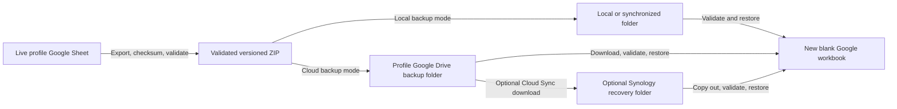

# Backup and recovery

Tabula Rosa creates validated, timestamped ZIP archives from a business
profile's live Google Sheets workbook. An archive can be downloaded manually,
written to local storage, uploaded to the profile's Google Drive backup folder,
and optionally copied to a Synology NAS.

Backups are recovery artifacts, not alternate live ledgers. Every restore must
target a new blank workbook.

## Recovery topology



Google Drive is the primary cloud-native backup destination. Local storage and
Synology are optional additional failure boundaries.

## Archive contents and compatibility

The current backup format is version 6. Each archive contains:

- `Accounts.csv`;
- `Categories.csv`;
- `Transactions.csv`;
- `Mileage.csv`;
- `receipts.json`; and
- `manifest.json`.

The manifest records:

- format version;
- UTC backup time;
- source workbook title;
- worksheet headers;
- row counts; and
- SHA-256 checksums for every CSV and `receipts.json`.

`receipts.json` is a profile-scoped metadata inventory. It records referenced
and intentionally unreferenced app-managed receipts, stable receipt identities,
the association from each transaction's `receipt_references`, original and
stored filenames, MIME types, byte sizes, SHA-256 checksums, old Drive file IDs,
and available Drive timestamps. It does not contain PDF or image bytes, so the
same large receipt files are not duplicated into every retained ledger archive.

Every manifest entry must have a checksum created during upload or verified
during backup-time preparation. Backup creation fails rather than silently writing a
checksum-incomplete receipt inventory. Current-format backup creation also
requires the selected profile's configured Google Drive receipt folder; if the
folder is disconnected or unavailable, the app and command-line workflow fail
instead of recording an empty inventory.

Immediately before every newly created backup, both the app and command-line
workflows run the same profile-scoped receipt preparation. It refreshes the
selected folder and transactions, backfills missing integrity metadata,
initializes only empty-string legacy receipt associations, and reconciles
active references with current Drive metadata. An explicit `[]` reference
remains intentionally unlinked. Sheets and Drive are read again before
`receipts.json` is generated; if preparation is incomplete, no backup is
created. Confirmed preparation writes remain in place so a retry resumes safely.

If preparation fails, resolve the reported Drive or Sheets problem and retry
the backup. It will repeat only incomplete work.

The current validator and ledger restore path accept formats 2 through 6:

| Format | Contents |
| --- | --- |
| 2 | Accounts, Categories, and Transactions; predates Mileage and receipt references |
| 3 | Adds Mileage; predates transaction receipt references |
| 4 | Adds transaction receipt references; archives created before the receipt inventory remain ledger-only recovery sources |
| 5 | Adds the checksummed `receipts.json` inventory without embedding receipt bytes |
| 6 | Current format; preserves optional account and category `parent_id` hierarchy metadata |

Hierarchy affects reporting presentation, not transaction foreign keys or the
backup source of truth. Format-version 6 stores the stable IDs and `parent_id`
links needed to reconstruct Layer 1 totals and Layer 2 detail after restoration.
Supported older archives without hierarchy columns restore all items at Layer 1.

Older compatible formats are migrated in memory during restore. A historical
format-1 archive must first be converted to format 2. Formats 2 through 5
that lack account and category `parent_id` columns restore those records at
Layer 1 with blank parent values. A mixed-rollout archive labeled as format 2
through 5 that already contains the hierarchy columns preserves and validates
its parent relationships during restore.

## Create a backup in the application

Open **Data & backup** for the selected business profile.

- **Download complete workbook backup** creates a validated ZIP for manual
  download.
- **Upload fresh backup now** creates, validates, and uploads a ZIP to the
  selected Google Drive backup folder.
- **Verify latest cloud backup** downloads the newest app-managed archive into
  the running application only long enough to validate its manifest, checksums,
  and stored Drive hash.

Cloud verification does not restore data, modify the live workbook, or download
the file to the browser.

## Create a local command-line backup

Create and validate a timestamped archive:

```powershell
python scripts\backup_google_sheets.py --profile PROFILE_KEY --local-dir backups\PROFILE_KEY --keep 30
```

Local backup mode is selected only when `--local-dir` is present. When it has
no path argument, the command uses:

1. the profile's configured `backup_folder_path`; or
2. the ignored repository `backups/PROFILE_KEY/` directory.

The local folder setting is optional. A blank setting does not require Google
Drive Desktop or a mounted path; the profile-scoped fallback keeps implicit
archives for different businesses separate. Use `--local-dir PATH` for an
explicit single-profile destination.

The command:

- validates the archive before reporting success;
- uses an exclusive new timestamped filename;
- never overwrites an existing archive; and
- retains the newest requested generations.

`--keep` must be at least 2 and defaults to 30. Backups contain private ledger
data and must never be committed.

## Create a Google Drive command-line backup

The profile must first have a valid Google Drive authorization and selected
backup folder. Follow
[Google Drive OAuth and per-business access](../architecture/GOOGLE_DRIVE_OAUTH.md).

Create a verified cloud backup:

```powershell
python scripts\backup_google_sheets.py --profile PROFILE_KEY --keep 30
```

Google Drive is the default backup destination. `--google-drive` remains
available as an explicit equivalent. Use `--local-dir` to select local output.

The uploader:

- uses the profile's refresh token and backup folder;
- preserves the ZIP and manifest format;
- records the archive hash and profile in private app-properties;
- makes uncertain retries idempotent; and
- retains the newest requested app-managed generations.

Google Drive Desktop does not need to be installed or running for this mode.

## Schedule weekly backups

The provided Windows task registers Monday, Tuesday, and Wednesday at 10:00 PM
as retry opportunities for one weekly backup. By default the registration
script creates one stable task that invokes `--all-profiles`; each configured
profile is evaluated independently and a failure or weekly duplicate for one
profile does not prevent later profiles from being attempted. `--once-per-week`
verifies an existing current-format archive with its checksummed receipt
inventory before accessing Google Sheets, so a successful Monday run causes
Tuesday and Wednesday to exit without creating duplicates for that profile. A
valid older ledger-only archive does not suppress creation of the current
recovery format.

The all-profile command uses each profile's own spreadsheet credential, Drive
authorization and folders, and (for local mode) a profile-scoped destination.
The derived fallback is `backups/PROFILE_KEY/`; a configured path is treated as
a root and receives a `PROFILE_KEY/` child for all-profile runs. Single-profile
commands continue to use their configured path exactly. The command prints
only profile keys and sanitized status summaries. The process exits nonzero if
any eligible profile fails; profiles without the required destination are
reported as skipped. Use the single-profile form for an explicit local
destination or repair operation.

### All-profile cloud backup

```powershell
python scripts\backup_google_sheets.py --all-profiles --google-drive --keep 30
```

### All-profile local backup using profile-scoped destinations

```powershell
python scripts\backup_google_sheets.py --all-profiles --local-dir --keep 30
```

### Cloud-native scheduled backup

```powershell
powershell -ExecutionPolicy Bypass -File scripts\register_weekly_backup_task.ps1 `
  -AllProfiles `
  -GoogleDrive `
  -TaskName "Tabula Rosa Weekly Backup"
```

Omitting `-AllProfiles` and `-Profile` has the same all-profile behavior. A
single-profile task remains available when needed for repair or recovery:

```powershell
powershell -ExecutionPolicy Bypass -File scripts\register_weekly_backup_task.ps1 `
  -Profile PROFILE_KEY `
  -GoogleDrive `
  -TaskName "Tabula Rosa Cloud Backup - PROFILE_KEY"
```

### Local or synchronized-folder scheduled backup

```powershell
powershell -ExecutionPolicy Bypass -File scripts\register_weekly_backup_task.ps1 `
  -AllProfiles `
  -Local `
  -TaskName "Tabula Rosa Weekly Local Backup"
```

For an explicit local destination, select one profile and pass
`-BackupDirectory`; the script rejects that override in all-profile mode so
archives cannot be mixed together. The task uses `-MultipleInstances IgnoreNew`
so overlapping instances remain disabled. Hosted deployments should use the
separate scheduler integration tracked by issue #17; this Windows task is for
the local interactive deployment only.

The task runs interactively. A local Google Drive Desktop or NAS-mounted path
is available only when the signed-in Windows session and mount are active. If
all three weekly opportunities fail, that week is skipped; starting the mount
after a missed run does not trigger an immediate catch-up.

Cloud-native mode uses Google APIs directly and is independent of Google Drive
Desktop.

## Validate a local archive

Validate any copied or downloaded archive before relying on it:

```powershell
python scripts\validate_google_sheets_backup.py "C:\Safe-Recovery\tabula-rosa-backup-YYYYMMDDTHHMMSSZ.zip"
```

Successful validation confirms:

- supported format;
- exact ZIP structure;
- manifest integrity;
- worksheet headers;
- SHA-256 checksums;
- row counts;
- record IDs; and
- ledger relationships;
- the receipt manifest schema, profile, identities, Windows/Synology-portable
  filenames, sizes, checksums, duplicates, and transaction associations; and
- whether an older archive is a ledger-only source without receipt recovery
  metadata.

Do not modify a failed archive. Preserve it for private investigation, choose a
different generation, and validate again.

## Restore into a new blank workbook

Never restore into the configured live workbook.

1. Create a new blank Google spreadsheet.
2. Share it as Editor with the selected profile's Sheets service-account email.
3. Copy its spreadsheet ID.
4. Validate the backup locally.
5. Restore with:

   ```powershell
   python scripts\restore_google_sheets_backup.py `
     "C:\Safe-Recovery\tabula-rosa-backup-YYYYMMDDTHHMMSSZ.zip" `
     --profile PROFILE_KEY `
     --target-spreadsheet-id NEW_SPREADSHEET_ID `
     --initialize
   ```

The command:

- validates before writing;
- refuses the configured live workbook;
- refuses populated or incompatible target worksheets;
- initializes missing required headers when `--initialize` is supplied;
- restores all supported tables; and
- rereads the target to verify restored rows.

Confirm the standard storage path can read the restored workbook without
changing the configured business:

```powershell
python scripts\validate_google_sheets.py `
  --profile PROFILE_KEY `
  --spreadsheet-id NEW_SPREADSHEET_ID
```

The override is read-only and reports the workbook title and sanitized row
counts. It cannot be combined with `--write-test`.

Open the recovery workbook and spot-check headers and representative
relationships. Delete it or clearly label it as a drill afterward so it cannot
be mistaken for the live ledger.

## Recover receipt files and remap Drive IDs

Ledger restoration does not restore receipt bytes. After restoring a current
format-version 6 archive, or a compatible format-version 5 archive, copy the
matching profile receipt directory from the versioned Synology recovery set to
a safe local path. Then run the dedicated receipt operation against the newly
restored, non-live workbook:

```powershell
.\.venv\Scripts\python.exe scripts\recover_synology_receipts.py `
  "C:\Safe-Recovery\tabula-rosa-backup-YYYYMMDDTHHMMSSZ.zip" `
  "C:\Safe-Recovery\receipts" `
  --profile PROFILE_KEY `
  --target-spreadsheet-id NEW_SPREADSHEET_ID
```

The command refuses every configured profile's live workbook. Before any Drive
change it validates the archive, confirms its receipt inventory belongs to the
selected profile, and checks the presence of every
referenced transaction in the restored target. For each entry it verifies the
local byte size and SHA-256, preserves the manifest's stored filename, refuses
filename conflicts, recreates ownership/integrity/provenance metadata, and
remaps the old diagnostic Drive ID in the restored transaction reference.

Retries identify files by stable receipt identity plus SHA-256. A matching
Drive file is downloaded and verified before reuse, so a retry repairs the
reference without creating another suffixed copy. Unreferenced entries are
restored but remain unattached. Missing, corrupt, conflicting, and failed files
are counted and skipped while other valid entries continue. Formats 2, 3, and
pre-inventory 4 can restore the ledger, but the validator and recovery command
identify them as ledger-only sources.

The required recovery order is:

1. Restore the archive into a new blank workbook.
2. Connect or confirm the selected profile's receipt folder.
3. Recover receipt bytes from the matching Synology version.
4. Verify referenced receipts open through their remapped Drive IDs.
5. Verify unreferenced receipts remain available without automatic attachment.

## Convert a format-1 archive

Convert a historical format-1 archive offline:

```powershell
python scripts\convert_backup_v1_to_v2.py `
  "C:\Safe-Recovery\tabula-rosa-backup-YYYYMMDDTHHMMSSZ.zip"
```

The converter:

- fully validates the source;
- infers missing account classifications;
- renames the historical `Loan` subtype to `Short-term debt`;
- normalizes legacy active values;
- writes a separate `*-format2.zip` archive;
- never changes or overwrites the original;
- records the source hash and conversion time; and
- validates the converted archive with the current validator.

Format 2 predates Mileage, so restoring it leaves the `Mileage` worksheet empty.
It also predates receipt references.

## Retention

Google Drive and command-line backup modes retain the newest 30 app-managed
generations by default.

Retention deletion is intentionally limited to files matching the canonical
backup filename and the application's private metadata rules. Keep at least two
generations and avoid treating one recent archive as sufficient recovery
coverage.

The optional Synology workflow disables destination deletions, so older NAS
generations remain after Google Drive retention removes them. Apply the
documented manual NAS retention policy only after validating another
generation.

## Optional Synology recovery copy

Each business can opt into separate Synology Cloud Sync download tasks for its
Google Drive backup and receipt folders. Both destinations require versioned
retention such as Hyper Backup or snapshots; Cloud Sync alone can reproduce
accidental changes. Tabula Rosa does not connect to DSM, configure either task,
or prove that synchronization succeeded.

For root-managed profiles, both Drive destinations are app-managed children under
the profile's selected storage root: `Receipts` contains receipt files and
`Ledger Backups` contains verified archives. The stored child IDs remain the
runtime source of truth; folder names are descriptive only.

Follow the complete
[Synology recovery runbook](SYNOLOGY_RECOVERY.md) to configure folder
permissions, one-way Cloud Sync, retention, validation, retry observation, and
a restore drill.

## Recovery evidence

Keep a private operational record containing:

- profile key;
- archive filename and backup time;
- validator output and expected row counts;
- storage location;
- restore command output;
- recovery workbook ID;
- drill date; and
- administrator.

Do not store this record in Git when it contains private workbook names,
account addresses, paths, identifiers, validation output, or ledger details.

## Credential and configuration recovery

- Local service-account credentials and per-profile Drive grants live in the
  ignored `.streamlit/business_profiles.json`.
- The application password hash and app-wide OAuth/Picker settings live in the
  ignored `.streamlit/secrets.toml`.
- The hosted deployment uses a separate copy in Streamlit Secrets.
- A backup archive does not contain application credentials or configuration
  secrets.
- Retained service-account JSON belongs only in protected credential storage
  outside the repository.

To rebuild a deployment after loss:

1. restore protected application and profile configuration;
2. validate each service account and workbook;
3. reconnect any unavailable Drive grant;
4. confirm the profile storage root and provisioned receipt/backup children;
5. export hosted Secrets; and
6. validate a current backup before resuming normal operation.

## Troubleshooting

### The weekly task creates no backup

Confirm the task ran in the intended Windows account, the virtual environment
still exists, the profile key is correct, and the configured destination is
available. Cloud mode also requires an active Drive grant and selected backup
folder.

### The command says a weekly backup already exists

That is expected with `--once-per-week`. The command found and validated a
canonical current-format backup, including its receipt inventory, in the
current local ISO week.

### A cloud backup cannot refresh authorization

Reconnect the profile through the local Business profiles page, select its
folders, export hosted Secrets again, and rerun the backup.

### Restore refuses the target

Create a new blank workbook, share it with the correct profile's service
account, confirm the target ID is not the live workbook, and use `--initialize`.

### A copied archive fails validation

Do not restore it. Confirm the source transfer had completed, preserve the
failed copy, choose another generation, and validate that copy.

## Implementation map

| Responsibility | Implementation |
| --- | --- |
| Backup creation and format | [`tabula_rasa/storage/google_sheets.py`](../../tabula_rasa/storage/google_sheets.py) |
| Local and Drive backup command | [`scripts/backup_google_sheets.py`](../../scripts/backup_google_sheets.py) |
| Scheduled task registration | [`scripts/register_weekly_backup_task.ps1`](../../scripts/register_weekly_backup_task.ps1) |
| Standalone archive validation | [`scripts/validate_google_sheets_backup.py`](../../scripts/validate_google_sheets_backup.py) |
| Restore command | [`scripts/restore_google_sheets_backup.py`](../../scripts/restore_google_sheets_backup.py) |
| Backup-time receipt preparation | [`tabula_rasa/receipt_backfill.py`](../../tabula_rasa/receipt_backfill.py) |
| Receipt inventory validation | [`tabula_rasa/receipt_manifest.py`](../../tabula_rasa/receipt_manifest.py) |
| Synology receipt recovery and ID remapping | [`scripts/recover_synology_receipts.py`](../../scripts/recover_synology_receipts.py) |
| Format-1 conversion | [`scripts/convert_backup_v1_to_v2.py`](../../scripts/convert_backup_v1_to_v2.py) |
