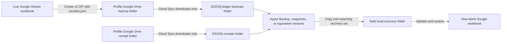

# Optional Synology recovery copy

Each business profile can independently opt in to an isolated recovery copy on
the Synology DS220j. Tabula Rosa uploads verified, timestamped ZIP archives to
that profile's Google Drive backup folder and stores live receipt bytes in its
separate receipt folder. Synology Cloud Sync downloads both folders to the NAS.

The application never mounts, authenticates to, or writes directly to the NAS.
The per-profile Synology fields are non-secret operational records of the Cloud
Sync task that an administrator must configure and monitor in DSM.

Use [Backup and recovery](BACKUP_AND_RECOVERY.md) for archive creation,
validation, scheduling, and blank-workbook restoration. Use
[Google Drive OAuth and per-business access](../architecture/GOOGLE_DRIVE_OAUTH.md)
for the Tabula Rosa Drive connection. DSM uses its own independent Google
authorization.

## How the pieces fit together



Google Drive is the primary automated backup destination. The DS220j is an
additional recovery destination with a separate failure boundary. Cloud Sync
alone is not versioned protection: it must feed Hyper Backup, Snapshot
Replication where supported, or another retention mechanism so accidental
changes are recoverable even if synchronization reproduces them. The NAS does
not read the live workbook, and Tabula Rosa does not send requests to the NAS.
This means neither Google Drive Desktop nor a permanently mapped NAS drive is
part of normal backup operation. Temporary File Station or SMB access is needed
only when an administrator copies an archive out for validation or restoration.

The in-app option is a configuration record, not a Cloud Sync controller.
Enabling it:

- marks that business as expecting a Synology recovery copy;
- records the expected NAS destination, schedule, and retention policy; and
- displays those expectations on **Data & backup**.

It does not install Cloud Sync, create a DSM task, test NAS connectivity, store
NAS credentials, or prove that a file reached the NAS. DSM remains the source
of truth for actual transfer status and logs.

## Prerequisites

- Google Drive backup and receipt folders selected for the business profile
- A verified format-version 5 backup in the backup folder
- Legacy receipt checksum backfill completed for that profile
- DSM administrator access to the DS220j
- Synology Cloud Sync installed
- A protected shared folder with enough capacity for ledger and receipt history
- Hyper Backup, snapshots, or another versioned retention mechanism protecting
  the synchronized destination
- A local recovery location that is outside the repository
- A blank Google workbook for the restore drill

Use the Google account that owns the selected backup folder when authorizing
Cloud Sync. Do not use a folder visible only through **Shared with me**, a Drive
shortcut, the **Computers** area, or a Google Workspace Shared Drive.

## Prepare the NAS destination

### Create the shared folder

In DSM, open **Control Panel → Shared Folder**, select **Create**, and use these
initial settings:

1. Name the shared folder `Tabula_Rosa_Backups`.
2. Select the intended storage volume. The initial DS220j setup uses
   **Volume 1 (ext4)**.
3. Leave the two hide options cleared unless an organization-specific policy
   requires hiding the share from network browsing.
4. Enable **Recycle Bin** and **Restrict access to administrators only**. The
   Recycle Bin protects against accidental manual deletion, but it does not
   replace Cloud Sync's destination-deletion protection.
5. At **Enable additional security measure**, the initial availability-focused
   setup may select **Skip**. The archives contain private financial data, so
   skipping shared-folder encryption is appropriate only when the NAS is
   physically secure, DSM administrator access is strongly protected, and
   untrusted users cannot access the share.

Shared-folder encryption is also supported, but it creates another recovery
dependency. Before selecting it, store the encryption password and exported
recovery key outside the NAS, document how to remount the folder after a reboot,
and test that procedure. Losing the key would defeat the purpose of the recovery
copy.

### Set explicit permissions

Do not rely on blank permission boxes when DSM's **Preview** column shows
inherited Read/Write access. Set explicit permissions according to role:

- Give `admin` **Read/Write**.
- Give the DSM account used to configure and manage Cloud Sync
  **Read/Write**.
- Give a recovery-only account **Read Only**, if one is needed.
- Give unrelated local accounts and `guest` **No Access**.
- In the permission-type selector, review **System internal users**. If DSM
  lists the Cloud Sync package or service and requires an explicit permission,
  give only that service **Read/Write**. Do not grant unrelated packages access.

Use the effective **Preview** column to confirm the final permission for every
listed account before completing the wizard. Protect DSM administrator accounts
with strong unique passwords and MFA.

### Create one subfolder per business

After the shared folder is created, open File Station and add a distinct
subfolder for each business that opts in:

```text
/volume1/Tabula_Rosa_Backups/heathcote-advisory/ledger-backups
/volume1/Tabula_Rosa_Backups/heathcote-advisory/receipts
/volume1/Tabula_Rosa_Backups/rok-collectibles/ledger-backups
/volume1/Tabula_Rosa_Backups/rok-collectibles/receipts
```

The exact `/volume1/...` path may differ if the shared folder lives on another
volume. Record the path DSM actually uses instead of copying the example
blindly. Grant write access only to the administrator and the DSM service
account that needs it. Recovery users can be given read-only access if needed.

Separate destinations prevent identically named or similarly timed archives
from different businesses from being mixed together. They also let one business
disable its NAS copy or use a different schedule and retention policy without
changing another business.

## Choose which businesses use the NAS

Run the loopback-only profile administrator:

```powershell
powershell -ExecutionPolicy Bypass -File scripts\run_local_profile_admin.ps1
```

Open **Business profiles**, unlock administration, and find **Synology recovery
copy**. For each business:

1. Choose the business profile.
2. Select **Maintain an optional Synology recovery copy for this business**.
3. Record its absolute DSM destination, for example
   `/volume1/Tabula_Rosa_Backups/heathcote-advisory`.
4. Record the actual Cloud Sync schedule.
5. Record the NAS retention policy.
6. Save the choice.

Leaving the option cleared keeps that business on Google Drive backup only.
Disabling it later removes only the application's operational metadata. It does
not delete a DSM task or any NAS archive.

The hosted app can display the same per-profile status after running
`scripts/export_streamlit_secrets.py` and updating Streamlit Secrets. The
Synology fields contain no NAS username, password, hostname, token, or network
share credential.

Updating hosted Secrets changes only what the hosted app displays. Cloud Sync
continues to operate directly between Google Drive and DSM even while the
Streamlit app or the Windows development computer is turned off.

## Configure two Cloud Sync tasks per opted-in business

Create separate backup and receipt destination folders and tasks for every
business. Do not point multiple profiles or both data types at the same NAS
directory.

Cloud Sync connections represent Google accounts; tasks represent source and
destination folder pairs. If multiple businesses use the same Drive-owning
Google account, create one connection for that account and add a separate task
for each business. If their Drive folders are owned by different Google
accounts, create a separate connection for each account. Do not expose or copy
the Google password into Tabula Rosa; DSM completes its own OAuth authorization.

| Setting | Required value |
| --- | --- |
| Cloud provider | Google Drive |
| Remote path | One task for the profile backup folder and one for its receipt folder |
| Local path | The matching `ledger-backups` or `receipts` subfolder |
| Sync direction | **Download remote changes only** |
| Destination deletions | **Don't remove files in the destination folder when they are removed in the source folder** |
| Schedule | The value recorded in the business profile |
| Google document conversion | Disabled |

Use **Continuous** for the initial setup and recovery drill so new archives are
easy to observe. A restricted schedule can be chosen later, but its run window
should begin after the Tabula Rosa backup job. If DSM offers **Advanced
consistency check**, it can be enabled to make Cloud Sync compare supported file
hashes as well as basic metadata. The application validator remains required
because it also verifies the archive's internal manifest and ledger structure.

The dedicated backup remote folder should contain only names in this form:

```text
tabula-rosa-backup-YYYYMMDDTHHMMSSZ.zip
```

The manifest is stored inside the ZIP. Never place service-account JSON,
Streamlit Secrets exports, OAuth tokens, temporary exports, receipt files, or
source accounting CSV files in the backup folder. The separate receipt task
copies the app-managed PDFs and images whose metadata is inventoried by
`receipts.json`.

Cloud Sync file filters are exclusion rules rather than a reliable ZIP
allowlist. A dedicated source folder is therefore the primary safety control.
As defense in depth, exclude `*.json`, `*.toml`, `*.csv`, and `*.tmp` if those
filter choices are available. Before completing setup, inspect both the Drive
source and NAS destination and confirm that only the intended timestamped ZIPs
are present.

Google Drive retains the newest 30 app-managed ledger generations. With
destination deletions disabled, older NAS copies and unlinked receipts remain
until an administrator applies the recorded NAS retention policy. Protect both
synchronized subfolders with versioned retention; destination-deletion
protection and the Recycle Bin are useful layers but are not substitutes for
versions. A safe initial policy is:

> Retain all synchronized generations until a quarterly manual review. Never
> remove the only verified generation for a recovery period.

For this policy, a quarterly review is a health and capacity check, not an
automatic deletion event. During the initial accumulation period, retain every
generation. If space later requires pruning, validate a newer generation first,
never delete the newest verified archive, and keep at least one verified archive
for every recovery period the business still needs.

## Create and validate the first NAS copy

Backfill any legacy receipt checksums once before creating the first version-5
archive:

```powershell
.\.venv\Scripts\python.exe scripts\backfill_receipt_checksums.py --profile heathcote-advisory
```

Create a fresh verified cloud backup for the selected profile:

```powershell
.\.venv\Scripts\python.exe scripts\backup_google_sheets.py --profile heathcote-advisory --google-drive --keep 30
```

Wait for both Cloud Sync tasks to report up to date. Confirm that the archive
arrived under `ledger-backups`, the app-managed receipt files arrived under
`receipts`, and no unrelated file crossed between the two destinations. Create
or confirm a versioned retention point that protects both subfolders.

Copy the archive from the NAS to a safe local recovery folder. SMB mapping is
optional; DSM File Station, a temporary UNC path, or a mapped drive can be used.
Do not validate or restore directly from a partially synchronized file.

Validate the copied archive:

```powershell
.\.venv\Scripts\python.exe scripts\validate_google_sheets_backup.py "C:\Safe-Recovery\tabula-rosa-backup-YYYYMMDDTHHMMSSZ.zip"
```

Successful validation confirms the supported format, ZIP structure, ledger and
receipt manifests, worksheet headers, SHA-256 checksums, IDs, relationships,
and row counts. For a format-version 5 archive, the report must include
Accounts, Categories, Transactions, Mileage, and a verified receipt inventory.
Formats 2, 3, and pre-inventory 4 are reported as ledger-only sources.

## Validate history and retry behavior

1. Allow at least two timestamped backup generations to synchronize.
2. Confirm both remain on the NAS after the newer generation arrives.
3. Pause the Cloud Sync task.
4. Upload another verified backup.
5. Confirm DSM visibly reports that the task is paused or not current.
6. Resume the task and confirm the pending archive arrives intact.
7. Review the Cloud Sync log and record the successful retry.

This pause-and-resume drill avoids corrupting a real archive while demonstrating
that an interrupted task is visible and safely repeatable.

## Restore drill

Create a new blank Google spreadsheet, share it as Editor with the selected
profile's Sheets service-account email, and copy its spreadsheet ID. Never use
the live workbook as the restore target.

Restore the validated local copy:

```powershell
.\.venv\Scripts\python.exe scripts\restore_google_sheets_backup.py "C:\Safe-Recovery\tabula-rosa-backup-YYYYMMDDTHHMMSSZ.zip" --profile heathcote-advisory --target-spreadsheet-id NEW_ID --initialize
```

The command validates before writing, refuses every configured live workbook,
rejects a receipt inventory from a different selected profile, refuses
populated or incompatible target worksheets, restores the archive, and rereads
the target to verify the restored rows.

Copy the matching `receipts` directory from the same protected NAS recovery
set to the safe local folder. Recover and remap the receipt IDs only in the new
workbook:

```powershell
.\.venv\Scripts\python.exe scripts\recover_synology_receipts.py `
  "C:\Safe-Recovery\tabula-rosa-backup-YYYYMMDDTHHMMSSZ.zip" `
  "C:\Safe-Recovery\receipts" `
  --profile heathcote-advisory `
  --target-spreadsheet-id NEW_ID
```

The command refuses every configured profile's live workbook. Before changing
an individual receipt, it verifies that local file's size and SHA-256. It
preserves stored filenames, reuses only a downloaded checksum-matching stable
identity, remaps referenced transactions to the confirmed Drive ID, and leaves
unreferenced receipts unattached. Missing, corrupt, conflicting, and failed
entries are reported by count and stable receipt identity without blocking
other valid entries.

Confirm the normal Tabula Rosa storage path can read the restored workbook
without changing the selected business profile:

```powershell
.\.venv\Scripts\python.exe scripts\validate_google_sheets.py --profile heathcote-advisory --spreadsheet-id NEW_ID
```

This validation path is read-only and reports only the workbook title and
sanitized row counts. It cannot be combined with `--write-test`.

Confirm the output reports the expected row counts. Open the recovery workbook
and spot-check worksheet headers and representative account, category,
transaction, and mileage relationships. Verify referenced receipts open using
their remapped IDs and unreferenced receipts remain available without being
attached. Delete or clearly label the drill workbook afterward so it cannot be
mistaken for the live ledger.

## Completion evidence

Keep a private operational record for each opted-in business containing:

- Google Drive source folder name
- Google Drive receipt folder name
- NAS destination path
- Cloud Sync direction, deletion protection, and schedule
- NAS retention policy
- First synchronized archive name and timestamp
- Validator output and expected row counts
- Evidence of multiple retained generations
- Cloud Sync pause/failure and successful retry log
- Recovery archive copy location
- Restore command output and recovery workbook ID
- Receipt backfill and manifest-validation result
- Receipt recovery counts and confirmation of remapped and unreferenced cases
- Drill date and administrator

Do not put credentials, tokens, private ledger data, or full service-account
emails in the GitHub issue.

## Initial DS220j deployment record

Completed on July 28, 2026:

- Synology recovery was enabled for `heathcote-advisory` and
  `rok-collectibles`.
- The businesses use different Google Drive owner accounts, so each has a
  separate Cloud Sync connection.
- Both connections use **Download remote changes only** with destination
  deletions disabled.
- Both tasks run continuously.
- The protected shared folder is `/volume1/Tabula_Rosa_Backups`.
- The business destinations are
  `/volume1/Tabula_Rosa_Backups/heathcote-advisory` and
  `/volume1/Tabula_Rosa_Backups/rok-collectibles`.
- Only the intended timestamped versioned ZIP archives were observed in the
  recovery destinations.
- Multiple historical generations were retained.
- A pause-and-resume drill demonstrated that a delayed or interrupted task is
  visible and safely retryable.
- A format-version 3 NAS archive was copied to a safe local recovery location
  and passed the current manifest, checksum, worksheet, relationship, and row
  count validator.
- The validated archive was restored into a new blank Google workbook, and the
  restored headers, relationships, checksums, and row counts were verified.

Validation outputs, workbook IDs, Google account addresses, and private ledger
contents remain in the private operational record and are intentionally not
stored in Git or the GitHub issue.

This July 28 record predates the version-5 receipt inventory and covers only
ledger archives. It is not evidence that receipt bytes are synchronized or
versioned. Each opted-in profile still needs the separate `receipts` Cloud Sync
task, protected versioned retention, a checksum backfill, and a complete
ledger-plus-receipt recovery drill described above.

## Troubleshooting

### The app says Synology recovery is enabled, but no archive appears

The app records the expected setup but cannot observe DSM. In Cloud Sync,
confirm the connection is authorized, the task is running, the remote and local
paths match the selected business, and the log does not show a filter,
permission, or quota error. Also confirm that a Google Drive backup actually
exists for the profile.

### Cloud Sync cannot find the Drive folder

Confirm DSM is authorized with the account that owns the folder. Folders
available only through **Shared with me**, **Computers**, or a shortcut are not
usable for this workflow. If the businesses use different owner accounts, each
account needs its own Cloud Sync connection.

### An old NAS archive remains after Drive retention removes it

That is expected. The destination-deletion protection deliberately prevents a
Drive deletion from erasing the recovery copy. Apply only the documented manual
NAS retention policy, and validate another generation before deleting an old
one.

### An archive fails validation

Do not restore it and do not modify it in place. Preserve the failed copy for
private investigation, select another timestamped generation, and run the
validator again. Check whether Cloud Sync reported the task as fully up to date
before the archive was copied. A validator failure means that generation must
not be treated as recoverable.

### A restore command refuses the target

The restore tool intentionally refuses the live workbook and any target with
populated or incompatible ledger worksheets. Create a new blank workbook, share
it with the correct profile's Sheets service account as Editor, verify the
profile and spreadsheet ID in the command, and retry with `--initialize`.

### Receipt recovery reports missing or corrupt entries

Do not copy files blindly into Google Drive and do not rename them to make the
run pass. Confirm the matching protected NAS version was selected, Cloud Sync
had completed, and the copied `receipts` directory is the one paired with the
validated archive. Retry the command after correcting the recovery copy; its
stable identity and checksum rules reuse already verified files without
creating unnecessary suffixes.

### The Windows computer or mapped drive is offline

Normal cloud-to-NAS synchronization continues because Cloud Sync runs on DSM.
The computer is required only for creating a manual command-line backup or for
copying, validating, and restoring an archive during a recovery drill.

## References

- [Synology: back up Google Drive with Cloud Sync](https://kb.synology.com/en-eu/DSM/tutorial/How_to_back_up_the_data_in_my_Google_Drive_with_Synology)
- [Synology Cloud Sync help](https://kb.synology.com/en-global/DSM/help/CloudSync/cloudsync?version=7)
- [Synology Cloud Sync technical specifications](https://www.synology.com/en-us/dsm/7.2/software_spec/cloud_sync)
